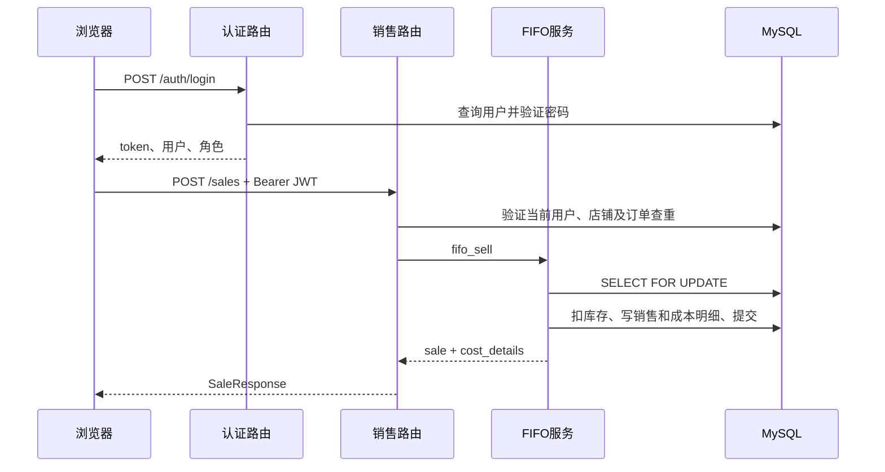

# 接口总览与调用关系

## 路由组织

[main.py](../../main.py) 注册六组 APIRouter，当前源码共有 56 个业务端点（按 HTTP 方法与路径计数），另有首页和静态挂载。接口详细清单、请求参数、权限和响应由各模块文档维护：

| 前缀 | 数量 | 文档 | 实现 |
| --- | ---: | --- | --- |
| /auth | 9 | [认证 API](../modules/auth/api.md) | [routers/auth.py](../../routers/auth.py) |
| /products | 10 | [商品 API](../modules/products/api.md) | [routers/products.py](../../routers/products.py) |
| /batches | 5 | [库存 API](../modules/inventory/api.md) | [routers/batches.py](../../routers/batches.py) |
| /sales | 9 | [销售 API](../modules/sales/api.md) | [routers/sales.py](../../routers/sales.py) |
| /finance-masters | 16 | [主数据 API](../modules/finance-masters/api.md) | [routers/finance_masters.py](../../routers/finance_masters.py) |
| /reports | 7 | [报表 API](../modules/reports/api.md) | [routers/reports.py](../../routers/reports.py) |

默认 FastAPI 文档入口为 /docs、/redoc 和 /openapi.json，代码未显式关闭。2026-10-12 商品导入修改后，已在本机核对实际 OpenAPI；不代表服务器已更新。

## 请求和响应约定

1. 登录使用 JSON username/password；业务请求通常带 Authorization: Bearer <JWT>。页面的 api() 自动附加令牌，上传和导出请求另行设置认证头。
2. 商品创建/更新是 multipart/form-data，带可选 image；批次、手工销售、主数据和损益更新用 JSON；销售文件导入、商品导入预览和确认使用 multipart 的 file，商品确认还需 preview_token；商品导入结果下载使用 JSON rows。
3. 日期查询为 YYYY-MM-DD；销售 month 为 YYYY-MM；损益 report_month 必须是该月第一天。
4. 商品、批次、销售列表不传 page 返回数组；传 page 返回 {items,total,page,page_size}。page 从 1 开始，page_size 默认 20、范围 1–100；超过末页会调整页码。待确认列表始终分页，导入历史是限量数组。
5. Excel 返回 StreamingResponse，MIME 为 application/vnd.openxmlformats-officedocument.spreadsheetml.sheet，并设置 Content-Disposition。图片导出失败处理需按对应实现核实。
6. 金额类型以 [schemas.py](../../schemas.py) 和 ORM 为准；JSON 数值/字符串不能假设全局完全一致：默认 DecimalJSONResponse 会转数值，但 FastAPI 响应模型的序列化仍参与处理。

依据：[前端 api 函数](../../templates/index.html)、[schemas.py](../../schemas.py)、[main.py](../../main.py)。

## 典型调用关系

文件导入会额外解析格式、匹配 SKU、查询汇率和创建结算行；报表会读取销售上下文、规则历史与 OA，详见对应模块流程。

商品批量新增的预览只读，确认重新校验文件和数据库后，将商品与当日规则统一提交；已有 SKU 跳过，错误行阻止整批新增。模板、预览、确认及清单下载见[商品 API](../modules/products/api.md#批量新增契约)，与销售导入接口是不同业务流程。

## 错误与边界

常见错误：401 登录/令牌无效，403 角色或店铺范围不足，404 记录不存在，400 业务校验失败，409 冲突，422 Pydantic/FastAPI 参数校验，502 导入汇率获取失败。HTTPBearer 对缺失认证头的状态码可能受 FastAPI 版本影响，不能只假设统一返回 401。

文件导入的部分错误返回 SalesImportResponse(success=false) 的 400，而其他错误使用 HTTPException(detail)。前端会处理字符串、数组和对象错误，不存在统一的自定义响应包络。

GET 存货查询/导出及财务附件可调用 ensure_period_snapshot 补建历史快照，存在数据库写入副作用；不要把所有 GET 当纯只读验证。权限过滤也不是全局中间件实现，必须同时核查查询、详情、汇总和导出，见[认证与隔离](authentication.md)。

test_main.http 保留旧字段 duty_cost 且缺认证头，不能直接作为当前契约。源码对应字段为 last_mile_cost。外部 TikTok API、OAuth 回调及公开会计期间接口未注册。
