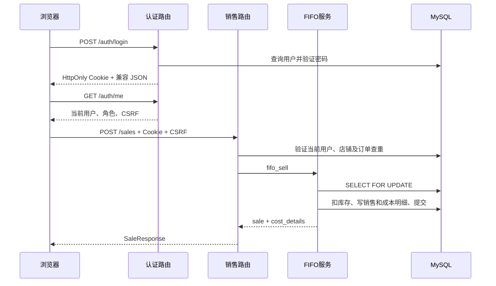

# 接口总览与调用关系

## 路由组织

[main.py](../../main.py) 注册八组APIRouter，当前源码共有87个路由端点（按HTTP方法与路径计数），另有首页、/financial-control.js和静态挂载。接口详细清单、请求参数、权限和响应由各模块文档维护：

| 前缀 | 数量 | 文档 | 实现 |
| --- | ---: | --- | --- |
| /auth | 16 | [认证 API](../modules/auth/api.md) | [本地/用户](../../routers/auth.py)、[EIMS](../../routers/eims_auth.py) |
| /products | 10 | [商品 API](../modules/products/api.md) | [routers/products.py](../../routers/products.py) |
| /batches | 6 | [库存 API](../modules/inventory/api.md) | [routers/batches.py](../../routers/batches.py) |
| /sales | 9 | [销售 API](../modules/sales/api.md) | [routers/sales.py](../../routers/sales.py) |
| /finance-masters | 16 | [主数据 API](../modules/finance-masters/api.md) | [routers/finance_masters.py](../../routers/finance_masters.py) |
| /financial-control | 22 | [财务增强API](../modules/financial-control/api.md) | [routers/financial_control.py](../../routers/financial_control.py) |
| /reports | 8 | [报表 API](../modules/reports/api.md) | [routers/reports.py](../../routers/reports.py) |

默认 FastAPI 文档入口为 /docs、/redoc 和 /openapi.json，代码未显式关闭。2026-10-12 商品导入修改后，已在本机核对实际 OpenAPI；不代表服务器已更新。

## 请求和响应约定

1. 本地登录使用 JSON username/password，浏览器使用 HttpOnly Cookie，api()/上传等请求通过 authHeaders 附加 CSRF。local/hybrid 无 Cookie 的既有客户端可继续带 Authorization: Bearer JWT；eims 模式禁用传统本地认证。SSO 登录/刷新/退出见[认证流程](../modules/auth/workflow.md)。
2. 商品创建/更新是 multipart/form-data，带可选 image；批次、手工销售、主数据和损益更新用 JSON；销售文件导入、商品导入预览和确认使用 multipart 的 file，商品确认还需 preview_token；商品导入结果下载使用 JSON rows。
3. 日期查询为 YYYY-MM-DD；销售 month 为 YYYY-MM；损益 report_month 必须是该月第一天。
4. 商品、批次、销售列表不传 page 返回数组；传 page 返回 {items,total,page,page_size}。page 从 1 开始，page_size 默认 20、范围 1–100；超过末页会调整页码。待确认列表始终分页，导入历史是限量数组。
5. Excel 返回 StreamingResponse，MIME 为 application/vnd.openxmlformats-officedocument.spreadsheetml.sheet，并设置 Content-Disposition。图片导出失败处理需按对应实现核实。
6. 金额类型以 [schemas.py](../../schemas.py) 和 ORM 为准；JSON 数值/字符串不能假设全局完全一致：默认 DecimalJSONResponse 会转数值，但 FastAPI 响应模型的序列化仍参与处理。

依据：[前端 api 函数](../../templates/index.html)、[schemas.py](../../schemas.py)、[main.py](../../main.py)。

## 典型调用关系

文件导入会额外解析格式、匹配 SKU、查询汇率和创建结算行；报表会读取销售上下文、规则历史与 OA，详见对应模块流程。

商品批量新增的预览只读，确认重新校验文件和数据库后，将商品与当日规则统一提交；已有 SKU 跳过，错误行阻止整批新增。模板、预览、确认及清单下载见[商品 API](../modules/products/api.md#批量新增契约)，与销售导入接口是不同业务流程。

## 错误与边界

常见错误：401 缺失/无效认证，403 角色、店铺、模式或 CSRF 拒绝，404 记录不存在，400 业务校验失败，409 冲突，422 参数校验，502 导入汇率获取失败，503 EIMS 提供方/配置暂不可用。API 的 401 仅清理本地登录状态，不触发 EIMS 全局退出。

文件导入的部分错误返回 SalesImportResponse(success=false) 的 400，而其他错误使用 HTTPException(detail)。前端会处理字符串、数组和对象错误，不存在统一的自定义响应包络。

07存货查询/导出按自然日回放增提及销售转销，取得两期余额；异常金额和不完整合计留空，不补建快照；应用启动仍有迁移和快照写入，其他GET入口需核实实际副作用。权限过滤也不是全局中间件实现，必须同时核查查询、详情、汇总和导出，见[认证与隔离](authentication.md)。

test_main.http 保留旧字段 duty_cost 且缺认证头，不能直接作为当前契约。源码对应字段为 last_mile_cost。TikTok 外部 API/其 OAuth 回调及公开会计期间接口未注册；新增 EIMS 登录/退出回调已注册，GET 会写临时认证状态。
