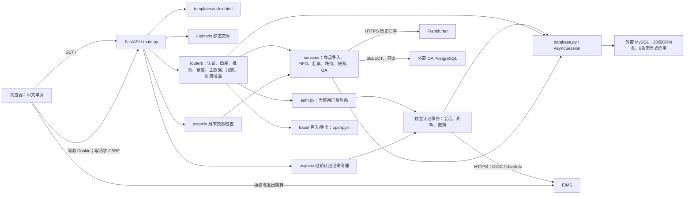

# 系统架构

## 组成

应用采用单体架构：同一 FastAPI 应用提供页面、图片和 API。路由直接使用异步 ORM，复杂逻辑部分下沉至 services；没有单独的 Controller 层。销售和报表还共享销售上下文辅助函数，不能假设路由之间完全解耦。依据：[main.py](../../main.py)、[routers/reports.py](../../routers/reports.py) 的 `_store_profit_loss_auto_values`。

[templates/index.html](../../templates/index.html) 的 `api()` 封装 JSON 请求；图片上传和文件下载单独使用 fetch。图片文件由磁盘持久化，数据库仅保存访问路径；导入后的原始结算行以 JSON 保存在数据库，未见原始销售文件另行持久化。

## 启动生命周期

`main.py.lifespan` 实际顺序：

1. `database.init_db()`：SQLAlchemy `Base.metadata.create_all` 创建缺失表。
2. `migrate.migrate()`：兼容字段、索引、补建表，以及结算映射和历史导入记录的数据修复。
3. `auth.seed_users()`：用户表完全为空时初始化三种角色账号。
4. `ensure_period_snapshot()`：按 Asia/Shanghai 日期检查上一完整自然月快照。
5. 启动 `_monthly_snapshot_worker()`，每小时检查上一自然月；同时启动 `_auth_session_worker()` 每小时清理过期认证记录。
6. 停止时取消两个后台任务并关闭 EIMS HTTP 客户端。启动不请求 EIMS，客户端/Discovery 在登录或复核时按需初始化。

启动不是只读操作，也不是单纯建立网络监听。首次快照错误可使启动失败；后台检查错误由 worker 捕获。多个 Uvicorn worker 会各自建立后台任务，快照并发创建的安全性需验证，当前 Docker 启动未显式配置多个 worker。依据：[main.py](../../main.py)、[accounting_periods.py](../../services/accounting_periods.py)。

## 事务和一致性

| 操作 | 边界和约束 | 代码 |
| --- | --- | --- |
| 手工销售 | 锁可用批次 → 复查库存 → 更新剩余数 → 创建销售/成本明细 → 一次提交 | [fifo.py](../../services/fifo.py) 的 lock_fifo_batches、fifo_sell |
| 商品批量新增 | 只读预览 → 确认重新校验 → 新商品与当日规则统一提交；唯一键冲突整批回滚 | [product_import.py](../../services/product_import.py) 的 confirm_product_import |
| 文件导入 | 校验/映射/汇率 → 按相同顺序锁全部涉及商品批次 → 逐行分配 → fifo_sell(commit=False) → 结算/分摊/导入批次一起提交 | [sales.py](../../routers/sales.py) 的 import_sales_file |
| 导入撤销 | 锁导入批次及原库存批次 → 校验恢复数量 → 恢复库存 → 删除关联业务行 → 保留撤销批次状态 → 提交 | [sales.py](../../routers/sales.py) 的 rollback_sales_import |
| 批次修改/作废 | 先锁批次、当前读调整来源并比对版本；编辑保留已售数，必要时冻结原依据并追加成本差额；作废保留原批次及关联，均与日志同事务。旧DELETE固定410 | [batches.py](../../routers/batches.py)、[batch_edits.py](../../services/batch_edits.py)、[cost_layers.py](../../services/cost_layers.py) |
| 月末快照 | snapshot_version 为 0 时生成，设为 1 并提交；已生成时不覆盖 | [accounting_periods.py](../../services/accounting_periods.py) |
| EIMS 认证/刷新 | 独立 AsyncSession 原子消费 state；同进程先按会话排队，再以行锁串行 Token 轮换；释放认证锁后才进入业务 | [auth_sessions.py](../../services/auth_sessions.py) |
| 图片修改 | 文件写入/删除不受数据库事务回滚保护 | [products.py](../../routers/products.py) |

FIFO 的锁序为 product_id、arrived_at、id，MySQL/InnoDB 事务持锁直至提交或回滚。FIFO 只按商品选择批次，没有按销售店铺筛选批次；库存归属与销售归属是不同口径，详见[库存流程](../modules/inventory/workflow.md)。

## 外部边界

EIMS 负责身份，本地负责角色/店铺；OA 为只读费用来源；汇率在导入时获取并固化；平台订单通过文件输入。调用方向、超时/重试、缓存和失败一致性统一见[系统集成](integrations.md)，避免各处重复维护协议参数。

## 复用能力与容量边界

| 公共能力 | 直接依赖与修改影响 | 已有机制/限制 |
| --- | --- | --- |
| [auth.py](../../auth.py)、SessionStore | 所有受保护路由；页面 api/authHeaders 与直接 fetch | 认证和库存事务分开；共享库存例外不能由角色名推断 |
| [fifo.py](../../services/fifo.py) | 手工销售、导入、撤销锁序；库存余额、成本及报表 | 有行锁及订单唯一占位；未见通用死锁自动重试机制，长批量事务的锁等待需实测 |
| [sales.py](../../routers/sales.py) 的 _sale_import_context | 销售展示、人民币汇总、损益和产品线 | 保存汇率与分摊；改来源/币种必须联查下游报表，不能仅检查销售 API |
| [inventory_provision_movements.py](../../services/inventory_provision_movements.py) | 07/09/10/12；商品规则、历史批次及 FIFO 明细 | 持有期间回放；按批次/日期前缀和与未知计数做期间查询，未知值继续传播 |
| [reports.py](../../routers/reports.py) 的 _load_inventory_provision_data | 存货、损益、产品线及财务附件 | 同一会话按截止日复用回放，不是跨请求持久化缓存；一次加载相关批次/规则/销售，大历史区间资源需实测 |
| [product_images.py](../../services/product_images.py)、[product_import.py](../../services/product_import.py) | 商品上传、模板、校验和确认 | 图片及商品 Excel 有明确大小/行数限制；不能推定其他文件入口沿用这些限制 |
| 列表、导入和导出 | 商品/批次/销售页面及 openpyxl 导出 | 列表兼容无 page 的全量数组；销售 import_sales_file 使用 file.read 整体读取，Excel 在内存生成，StreamingResponse 不代表流式构建 |

前端复用 api、authHeaders、formatApiError、escapeHtml 等局部函数，没有独立组件库；新增页面仍需核查直接 fetch 的认证/错误路径。运行模板与副本差异见[项目概况](project-overview.md)，文本规范见[国际化](internationalization.md)。

来源审计包括销售成本明细、原始结算 JSON/文件行号、导入/撤销记录及人工损益最后修改人；财务增强新增独立操作审计表（默认关闭），既有商品/销售等全部操作并未因此统一纳入；商品导入预览/结果未持久化。撤销会删除业务明细，快照和动态回放用途不同。重复提交保护依各操作的唯一键、预览签名和事务实现，不能宣称全局幂等。详见[销售流程](../modules/sales/workflow.md)、[商品流程](../modules/products/workflow.md)。

部署未声明任务队列、集中监控或性能基线。上述容量限制为源码可见边界，实际延迟/内存/并发上限待验证；风险及建议集中维护于[已有风险清单](../../PROJECT_ARCHITECTURE.md#9-当前已知风险)。

## 架构维护重点

新增库存写入必须沿用事务行锁；增加权限过滤须同时检查列表、详情、汇总、导出及旧记录兼容路径。启动迁移和后台快照检查有数据库写入，不能通过启动服务做只读核验。当前07/09/10/12使用实际持有期间回放，销售当天先计提再转销；07两期余额从同一回放取得，不补建快照。原余额算法仅保留于自动快照等历史路径，不替代现行损益口径，详见[报表流程](../modules/reports/workflow.md)。数据库表结构和迁移差异见[数据库总览](database.md)，部署边界见[部署文档](deployment.md)。
