# 系统架构

## 组成

应用采用单体架构：同一 FastAPI 应用提供页面、图片和 API。路由直接使用异步 ORM，复杂逻辑部分下沉至 services；没有单独的 Controller 层。销售和报表还共享销售上下文辅助函数，不能假设路由之间完全解耦。依据：[main.py](../../main.py)、[routers/reports.py](../../routers/reports.py) 的 `_store_profit_loss_auto_values`。

```mermaid
flowchart LR
    U["浏览器：中文单页"] -->|"GET /"| A["FastAPI / main.py"]
    U -->|"同源 Cookie；写请求 CSRF"| A
    A --> T["templates/index.html"]
    A --> UP["/uploads 静态文件"]
    A --> R["routers：认证、商品、批次、销售、主数据、报表"]
    R --> AU["auth.py：当前用户及角色"]
    R --> S["services：商品导入、FIFO、汇率、跌价、快照、OA"]
    AU --> SS["独立认证事务：会话、刷新、撤销"]
    SS --> DB
    SS -->|"HTTPS：OIDC / UserInfo"| EI["EIMS"]
    U -->|"授权与退出跳转"| EI
    R --> DB["database.py / AsyncSession"]
    S --> DB
    DB --> M["外置 MySQL：19 张 ORM 表"]
    S -->|"HTTPS 历史汇率"| FX["Frankfurter"]
    S -->|"SELECT，只读"| OA["外置 OA PostgreSQL"]
    A --> W["asyncio 月末快照检查"]
    A --> AW["asyncio 过期认证记录清理"]
    AW --> SS
    W --> S
    R --> XL["Excel 导入/导出：openpyxl"]
```

[templates/index.html](../../templates/index.html) 的 `api()` 封装 JSON 请求；图片上传和文件下载单独使用 fetch。图片文件由磁盘持久化，数据库仅保存访问路径；导入后的原始结算行以 JSON 保存在数据库，未见原始销售文件另行持久化。

## 启动生命周期

`main.py.lifespan` 实际顺序：

1. `database.init_db()`：SQLAlchemy `Base.metadata.create_all` 创建缺失表。
2. `migrate.migrate()`：兼容字段、索引、补建表，以及结算映射和历史导入记录的数据修复。
3. `auth.seed_users()`：用户表完全为空时初始化三种角色账号。
4. `ensure_period_snapshot()`：按 Asia/Shanghai 日期检查上一完整自然月快照。
5. 启动 `_monthly_snapshot_worker()`，每小时检查上一自然月；同时启动 `_auth_session_worker()` 每小时清理过期认证记录。
6. 停止时取消两个后台任务并关闭 EIMS HTTP 客户端。启动不请求 EIMS，客户端/Discovery 在登录或复核时按需初始化。

启动不是只读操作，也不是单纯建立网络监听。首次快照错误可使启动失败；后台检查错误由 worker 捕获。多个 Uvicorn worker 会各自建立后台任务，快照并发创建的安全性需验证，当前 Docker 启动未显式配置多个 worker。依据：[main.py](../../main.py)、[accounting_periods.py](../../services/accounting_periods.py)。

## 事务和一致性

| 操作 | 边界和约束 | 代码 |
| --- | --- | --- |
| 手工销售 | 锁可用批次 → 复查库存 → 更新剩余数 → 创建销售/成本明细 → 一次提交 | [fifo.py](../../services/fifo.py) 的 lock_fifo_batches、fifo_sell |
| 商品批量新增 | 只读预览 → 确认重新校验 → 新商品与当日规则统一提交；唯一键冲突整批回滚 | [product_import.py](../../services/product_import.py) 的 confirm_product_import |
| 文件导入 | 校验/映射/汇率 → 按相同顺序锁全部涉及商品批次 → 逐行分配 → fifo_sell(commit=False) → 结算/分摊/导入批次一起提交 | [sales.py](../../routers/sales.py) 的 import_sales_file |
| 导入撤销 | 锁导入批次及原库存批次 → 校验恢复数量 → 恢复库存 → 删除关联业务行 → 保留撤销批次状态 → 提交 | [sales.py](../../routers/sales.py) 的 rollback_sales_import |
| 批次修改/删除 | 先锁目标批次，按创建人权限及是否消耗判断 | [batches.py](../../routers/batches.py) 的 _locked_batch |
| 月末快照 | snapshot_version 为 0 时生成，设为 1 并提交；已生成时不覆盖 | [accounting_periods.py](../../services/accounting_periods.py) |
| EIMS 认证/刷新 | 独立 AsyncSession 原子消费 state；按会话行锁串行 Token 轮换；释放认证锁后才进入业务 | [auth_sessions.py](../../services/auth_sessions.py) |
| 图片修改 | 文件写入/删除不受数据库事务回滚保护 | [products.py](../../routers/products.py) |

FIFO 的锁序为 product_id、arrived_at、id，MySQL/InnoDB 事务持锁直至提交或回滚。FIFO 只按商品选择批次，没有按销售店铺筛选批次；库存归属与销售归属是不同口径，详见[库存流程](../modules/inventory/workflow.md)。

## 外部边界

EIMS 负责身份，FIFO 继续用本地角色/店铺授权。授权码 + PKCE、RS256 和 app_user_id 严格匹配；提供方 Token 只在后端加密持久化，不共享数据库。HTTP 请求 10 秒超时、禁跟随重定向，Discovery/JWKS 缓存 5 分钟并固定同源端点。公网必须 HTTPS；配置缺失保留 hybrid 本地登录，SSO 复核失败拒绝当次访问。详见[认证模块](../modules/auth/overview.md)。

OA 服务使用独立 OA_DB_* 连接，并只执行 SELECT；账号是否实际只有读取权限待验证。办公费用、薪资和管理费用直接用于损益计算，当前没有 OA 数据缓存表。未完整配置时返回空数据；完整配置存在但查询失败时抛异常。依据：[oa_office_expenses.py](../../services/oa_office_expenses.py)。

汇率按币种并发抓取日期区间，通过 asyncio.to_thread 执行阻塞 HTTP，保存汇率、日期和来源于结算记录。仅网络获取成功不等同于财务批准其口径。依据：[exchange_rates.py](../../services/exchange_rates.py)、[销售流程](../modules/sales/workflow.md)。

## 架构维护重点

新增库存写入必须沿用事务行锁；增加权限过滤须同时检查列表、详情、汇总、导出及旧记录兼容路径。启动迁移和后台快照检查有数据库写入，不能通过启动服务做只读核验。07存货查询/导出改为按每日销售后库存累计金额，不再补建快照；原余额算法仍用于快照和店铺损益。数据库表结构和迁移差异见[数据库总览](database.md)，部署边界见[部署文档](deployment.md)。
