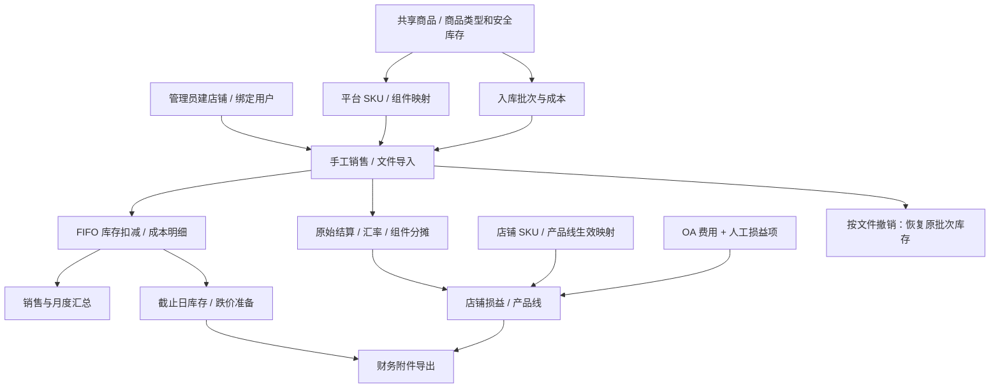

# 业务地图

## 已实现的模块与功能

| 模块 | 当前功能 | 角色/范围 | 代码与文档 |
| --- | --- | --- | --- |
| 认证与用户 | 本地/EIMS 混合登录、会话/CSRF、主动退出、当前用户、建号、启停、角色/密码、删除及店铺绑定 | 账号管理 admin；SSO 保留本地角色/店铺 | [认证路由](../../routers/auth.py)、[EIMS 路由](../../routers/eims_auth.py)；[认证模块](../modules/auth/overview.md) |
| 商品 | SKU/名称/图片维护、Excel 模板/预览/批量新增、图册、搜索分页、图片 Excel 导出、商品类型/安全库存和生效历史 | 三种角色均可读写，共享商品；导入已有 SKU 跳过 | [routers/products.py](../../routers/products.py)；[商品模块](../modules/products/overview.md) |
| 入库与库存 | 批次、钉钉单号留档、采购/头尾程/其他成本、剩余库存、搜索和图文导出 | 写入 admin/operator；operator 编辑/删除仅自己的未消耗批次；读取共享 | [routers/batches.py](../../routers/batches.py)；[库存模块](../modules/inventory/overview.md) |
| 销售与导入 | 指定店铺手工销售、FIFO、成本来源、CSV/Excel 导入、组合组件成本分摊、待确认查询/导出、导入记录及撤销、人民币月度汇总 | 写入 admin/operator；非 admin 的敏感数据按绑定店铺 | [routers/sales.py](../../routers/sales.py)；[销售模块](../modules/sales/overview.md) |
| 财务主数据 | 店铺、产品线、店铺 SKU 生效映射、平台 SKU 及组件倍数 | 店铺/产品线/店铺 SKU 写入仅 admin；平台 SKU 三种角色均可写 | [routers/finance_masters.py](../../routers/finance_masters.py)；[主数据模块](../modules/finance-masters/overview.md) |
| 报表与快照 | 月度销量/当前库存、存货跌价、月末快照、店铺损益人工项、产品线毛利、财务附件、OA 费用读取 | 损益保存 admin/operator；各接口隔离不同，见权限文档 | [routers/reports.py](../../routers/reports.py)；[报表模块](../modules/reports/overview.md) |

上述六个业务模块对应七组注册路由，认证包含本地和 EIMS 两组；图册属于商品展示，OA、汇率和快照属于服务能力，不虚构独立业务系统。EIMS 真实客户端与生产联调状态见[接入说明](../modules/auth/eims-sso-setup.md)。

## 核心依赖与业务链

重要规则分开维护：成本与批次约束见[库存](../modules/inventory/workflow.md)，组合商品和幂等见[销售](../modules/sales/workflow.md)，财务公式及快照见[报表](../modules/reports/workflow.md)。

## 页面入口和 API 独立能力

[templates/index.html](../../templates/index.html) 有商品、入库、产品图册、销售、报表、用户管理六个导航区。用户管理导航仅管理员显示；店铺创建及用户绑定也在该区。平台 SKU 配置在商品区；报表区包含存货、店铺损益和产品线。

产品线和店铺 SKU 的维护 API 已存在，但未在当前模板中发现独立维护页面。后续任务需区分已有 API 与 UI 是否接入，不能据此认定功能完全没有实现。

## 目标文档中尚未落地的对象

[FINANCIAL_REPORTING_TARGET.md](../../FINANCIAL_REPORTING_TARGET.md) 保留长期目标。当前 [models.py](../../models.py)、[路由注册](../../main.py)未见平台订单/订单行、独立费用台账、平台授权连接或同步运行记录等目标对象，也未见 TikTok OAuth、Shop/Ads 自动同步、退款自动恢复库存、人工结账公开接口。订单详情文件可保存退款/调整结算行，并不等于完整退款业务流程。

现有结算表、主数据、四类财务报表、存货SKU汇总导出和后台月末快照已经实现；目标文档中的“必须新增”不应全部视为仍然缺失。具体财务确认问题见[待验证清单](README.md#待验证清单)。
