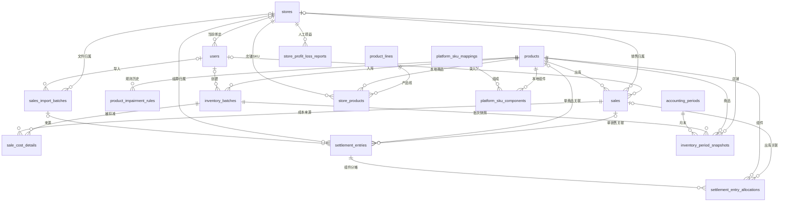

# 数据库总体结构

## 存储边界

主业务数据由 [database.py](../../database.py) 的 mysql+aiomysql 异步引擎存储于 MySQL，默认库名 inventory_fifo。以下为 [models.py](../../models.py) 中的 17 张 ORM 表；未连接实库，因此表是否已建、字段类型、外键、索引、引擎和数据量均待验证。

OA PostgreSQL 是外部只读数据源，不属于这 17 张表；实际表名为 SQL 中未加 schema 限定的 ding_approval_instance，解析依赖数据库 search_path。图片在 uploads/，数据库保存路径。依据：[OA 服务](../../services/oa_office_expenses.py)、[商品路由](../../routers/products.py)。

## 表清单与唯一维护入口

| 表 | ORM 类 | 用途 | 字段字典 |
| --- | --- | --- | --- |
| users | User | 用户、角色及当前店铺绑定 | [认证数据库](../modules/auth/database.md) |
| products | Product | 共享商品、类型、安全库存 | [商品数据库](../modules/products/database.md) |
| product_impairment_rules | ProductImpairmentRule | 商品跌价规则生效历史 | [商品数据库](../modules/products/database.md) |
| inventory_batches | InventoryBatch | 数量、剩余数、成本、创建人 | [库存数据库](../modules/inventory/database.md) |
| sales | Sale | 商品出库、店铺、售价、成本、费用、利润 | [销售数据库](../modules/sales/database.md) |
| sale_cost_details | SaleCostDetail | 销售扣减原批次的审计明细 | [销售数据库](../modules/sales/database.md) |
| sales_import_batches | SalesImportBatch | 文件导入统计与撤销记录 | [销售数据库](../modules/sales/database.md) |
| settlement_entries | SettlementEntry | 结算原始行、幂等键、币种、汇率和待确认 | [销售数据库](../modules/sales/database.md) |
| settlement_entry_allocations | SettlementEntryAllocation | 组合组件、数量、销售关联 | [销售数据库](../modules/sales/database.md) |
| product_lines | ProductLine | 产品线主数据 | [主数据数据库](../modules/finance-masters/database.md) |
| stores | Store | 平台店铺、国家、币种、时区、主体 | [主数据数据库](../modules/finance-masters/database.md) |
| store_products | StoreProduct | 店铺商品与产品线的生效映射 | [主数据数据库](../modules/finance-masters/database.md) |
| platform_sku_mappings | PlatformSkuMapping | 平台 SKU 标识及启用状态 | [主数据数据库](../modules/finance-masters/database.md) |
| platform_sku_components | PlatformSkuComponent | 本地商品组件及每次销售倍数 | [主数据数据库](../modules/finance-masters/database.md) |
| accounting_periods | AccountingPeriod | 自动生成的自然月和快照版本 | [报表数据库](../modules/reports/database.md) |
| inventory_period_snapshots | InventoryPeriodSnapshot | 固化月末批次数量、成本及跌价结果 | [报表数据库](../modules/reports/database.md) |
| store_profit_loss_reports | StoreProfitLossReport | 单店单月人工项、备注及更新者 | [报表数据库](../modules/reports/database.md) |

## 关系图

图中的连接代表 ORM 外键引用方向和一对多关系；外键可空时关联是可选的。为可读性省略部分审计用户外键，完整字段见上述字典。

## 金额、库存和时间

- 批次/销售金额及成本为 DECIMAL(12,4)，结算金额通常 DECIMAL(16,4)，汇率 DECIMAL(18,8)，快照比率 DECIMAL(8,6)。业务计算使用 Decimal；HTTP 及 Excel 输出存在浮点转换，不能反推数据库精度。依据：[models.py](../../models.py)、[main.py](../../main.py)。
- 当前库存从 inventory_batches.remaining_quantity 汇总；历史库存按入库 quantity 减截止日前 SaleCostDetail 数量重建，不直接使用当前剩余数。后者不是完整库存流水，撤销会删除销售明细。依据：[reports.py](../../routers/reports.py)。
- users.store_id 可改变；新销售/导入/结算保存独立 store_id，批次没有 store_id，库存报表从批次创建人当前绑定推导店铺。平台 SKU 映射也没有店铺外键。依据：[models.py](../../models.py)。
- 大多数时间列为无时区 DATETIME；月末自动任务使用 Asia/Shanghai，导入解析会移除时区信息；数据库/服务器统一时区仍需确认。依据：[accounting_periods.py](../../services/accounting_periods.py)、[sales.py](../../routers/sales.py)。

## 约束与迁移

创建新库使用 Base.metadata.create_all；既有库由 [migrate.py](../../migrate.py) 补兼容列、索引、表，并修复映射状态、回填历史导入批次。未发现 Alembic 或迁移版本表；DDL 不能假定与业务事务一样可整体回滚。

ORM 有外键的字段，在历史库通过 ALTER 添加时不一定同时补外键；sales_import_batches 的兼容建表 SQL 与 ORM 的外键定义也不完全一致。因此模型关系不等于实库约束。

SKU、用户名、批次号、source_key 具有唯一约束；销售 order_no 只有普通索引，程序查重不是数据库唯一幂等保证。店铺、映射、规则及快照组合约束见各模块字典。

商品规则使用 delete-orphan 及 ON DELETE CASCADE；平台映射组件有 ORM 级联。其他历史关联不能默认安全级联。商品/用户删除可能被外键或 ORM 关联阻止，图片文件还可能先删除，修改此类行为必须核查上下游。依据：[models.py](../../models.py)、[products.py](../../routers/products.py)、[finance_masters.py](../../routers/finance_masters.py)。

migrations/ 中的历史字段脚本和批次创建人转移脚本均有数据库写入；mysql-init/init.sql 不由当前 Compose web 服务执行。维护前需读[运行文档](../../PROJECT_RUNBOOK.md)，核实目标环境并取得对应操作授权，本次没有运行任何脚本。
