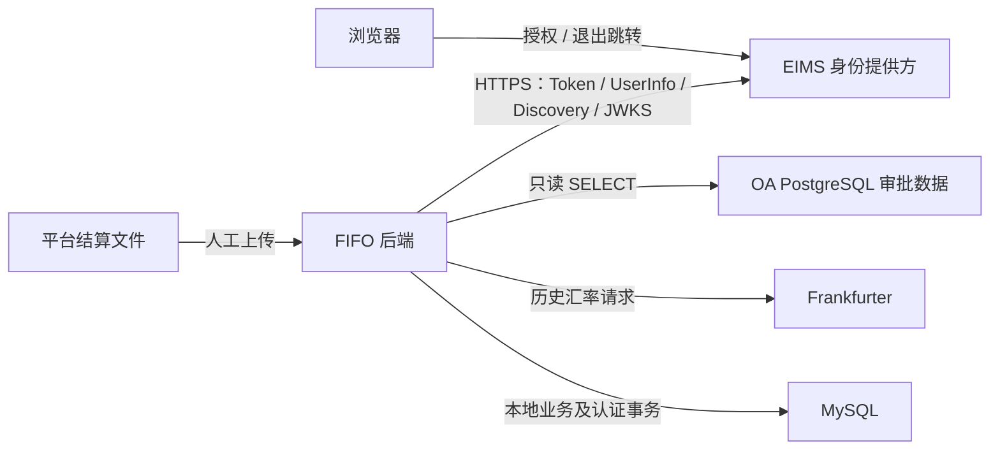

# 系统集成与责任边界

本页描述当前源码中的调用关系，不表示真实服务已联调。配置仅记录变量名，用途见[部署文档](deployment.md)；认证细节由[认证模块](../modules/auth/overview.md)维护。

## 数据方向及责任系统

| 集成 | 方向/方式 | 责任边界与保存结果 | 代码入口 |
| --- | --- | --- | --- |
| EIMS | 浏览器授权/退出跳转；FIFO 后端请求 OIDC Discovery、JWKS、Token、UserInfo | EIMS 负责身份和应用授权；FIFO 校验 app_user_id 绑定本地用户，本地维护角色/店铺。Token 加密后端保存，不共享数据库、不自动开户 | [EimsClient](../../services/eims_sso.py)、[认证路由](../../routers/eims_auth.py)、[SessionStore](../../services/auth_sessions.py) |
| OA PostgreSQL | FIFO 查询 ding_approval_instance，只执行 SELECT | OA 负责审批原始表单；FIFO 按申请日期、流程、完成结果及组件计算费用，不向 OA 回写，不建本地费用同步表 | [oa_office_expenses.py](../../services/oa_office_expenses.py)、[报表 OA 来源](../modules/reports/workflow.md#oa-来源) |
| Frankfurter | FIFO 按原币/日期区间请求历史汇率 | 服务返回币种→CNY；FIFO 保存汇率、实际日期、来源于结算行，后续报表复用。财务是否批准该来源仍待确认 | [exchange_rates.py](../../services/exchange_rates.py)、[销售流程](../modules/sales/workflow.md#组合金额与人民币) |
| TikTok 文件 | 人工上传订单详情 CSV/XLSX/XLSM | 平台文件负责原始结算值；FIFO 负责 SKU 映射、事件去重、出库、分摊及待确认。未实现平台 OAuth/API 自动同步 | [sales.py](../../routers/sales.py) 的 _read_import_file、import_sales_file |
| 钉钉单号 | 用户填写入库/费用单号 | 仅本地留档，无批次路由直接调用钉钉审批接口；OA 取数是独立链路 | [batches.py](../../routers/batches.py)、[库存字典](../modules/inventory/database.md) |

## 超时、缓存及失败处理

| 链路 | 当前机制 | 失败/重试边界 |
| --- | --- | --- |
| EIMS HTTP | httpx 单次超时配置 10 秒，禁跟随重定向，响应体限制；Discovery/JWKS 进程内缓存 300 秒，未知签名键触发有节流的重新取钥 | 没有通用 HTTP 自动重试循环；非业务拒绝映射为 provider_unavailable/503，错误码说明见[认证 API](../modules/auth/api.md) |
| EIMS 会话 | 读请求身份复核最多缓存 60 秒，写请求即时复核；行锁串行刷新，临时 state 原子消费 | 远端 Token 轮换不能靠本地事务撤销；已经收到的新 Token 在临时故障后保存待复核，拒绝当前请求；网络中断导致未收到轮换结果的恢复仍需真实提供方验收 |
| OA | 每次取数创建 asyncpg 连接并 finally 关闭；显式 command_timeout=10，未单独设置 connect timeout，无应用层重试或持久化缓存 | 配置缺失/不完整返回空数据并警告；配置完整但连接/查询失败抛 OaExpenseSourceError。路由未统一转换为专用业务响应，不能把故障当费用为 0 |
| 汇率 | urllib timeout=20，asyncio.to_thread 执行阻塞请求、按币种 gather；每个区间向前扩 14 天，取目标日之前最近可用值，CNY 为 1 | 无应用层自动重试；不可用/无有效值抛 ExchangeRateError，导入返回 502；汇率查询发生于库存锁之前 |
| 平台文件 | 文件解析、事件键及订单占位校验，整个导入业务事务提交 | 没有后台同步/失败队列；返回成功仍可能有待确认；补齐映射后同事件重导会跳过，按原文件撤销再导入的影响见[销售流程](../modules/sales/workflow.md#待确认与文件撤销) |

依据：[EIMS 服务](../../services/eims_sso.py)、[会话服务](../../services/auth_sessions.py)、[OA 服务](../../services/oa_office_expenses.py)、[汇率服务](../../services/exchange_rates.py)、[销售路由](../../routers/sales.py)。单次请求超时不是整条业务调用的总耗时上限。

## 一致性、审计及变更核对

- EIMS 一次性 state、会话哈希、Cookie/CSRF 和本地启用状态负责登录安全；外部角色不提升本地权限。改密/启停与签发会话遵循 User → AuthSession，释放认证事务后才进入库存业务。
- 销售 source_key 保证结算事件去重，order_claim 约束新订单占位；库存、销售、明细、结算、分摊同事务。保留来源文件名/行号/raw_data 和导入撤销状态，但撤销删除业务明细，不能当作不可变审计总账。
- OA 费用和当前启用店铺数实时参与计算；部门/组件名、店铺名称、历史补录及审批数据变化都会影响重算。没有跨 MySQL/PostgreSQL 的分布式事务或冻结费用版本。
- 平台字段、OA 组件、EIMS app_user_id、汇率日期或来源变化时，应联查请求契约、解析、权限、持久化、报表和导出；禁止把其他项目的同步/支付/审批能力推定为本项目实现。
- 验证状态统一维护在[待验证清单](README.md#待验证清单)；EIMS 验收沿用[接入说明](../modules/auth/eims-sso-setup.md)。本次未请求任何外部服务或数据库。
