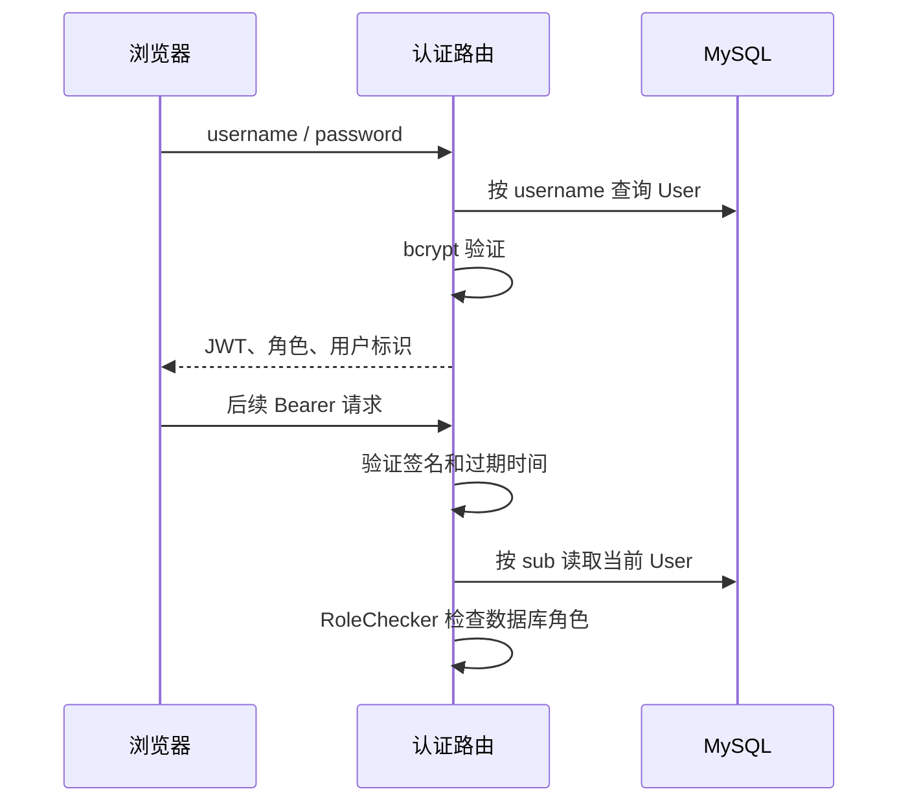

# 认证与用户流程

## 登录与请求鉴权



用户名或密码错误返回 401；令牌无效或用户已删除也返回 401。令牌有效期 24 小时，role 载荷不替代数据库角色。依据：[auth.py](../../../auth.py) 的 create_token、decode_token、get_current_user、RoleChecker。

页面 doLogin 保存 localStorage，api() 遇 401 调用 doLogout；退出是客户端清理，不会撤销已签发 JWT。前端使用缓存角色显示按钮，改角色后的按钮可暂时滞后，服务端仍校验最新权限。依据：[模板](../../../templates/index.html)。

## 用户和店铺状态

```text
新建用户 -> 无店铺绑定 -> 管理员绑定启用店铺 / 解绑
operator/viewer -> admin -> 自动清空绑定
admin -> operator/viewer -> 仍需按业务重新绑定
```

用户没有停用状态字段。店铺 is_active 不等于用户禁用；销售写入会验证有效店铺，部分读取仅要求已有绑定。角色和店铺字段分别更新并提交，无统一审批或变更审计流程。

## 密码与删除

管理员重置密码只校验新密码长度；自助修改还验证 old_password。两个请求都更新 bcrypt 哈希并提交，没有令牌吊销。删除用户先拒绝删除自己，然后 ORM 删除和 commit；未完整处理关联历史数据和外键异常。

模块验证参考 [test_user_creation_permissions.py](../../../tests/test_user_creation_permissions.py)、[test_store_data_isolation.py](../../../tests/test_store_data_isolation.py)。本次仅检查源码，未执行登录或数据库写入。
