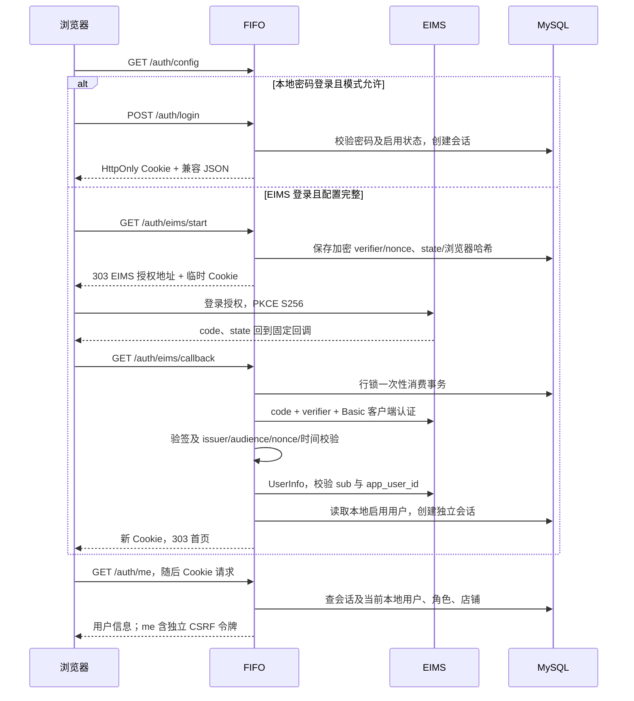

# 认证与用户流程

## 登录与请求鉴权



来源：[认证路由](../../../routers/auth.py)、[EIMS 路由](../../../routers/eims_auth.py)、[协议服务](../../../services/eims_sso.py)、[会话服务](../../../services/auth_sessions.py)。回调固定由公开地址拼接，不接受外部返回地址。登录事务有效期 5 分钟，绑定发起浏览器；先消费并保留解密上下文，再换 Token，拒绝重放、过期和错绑。通过有效事务切换身份时撤销旧 Cookie 会话，失败不会自动进入原账号；无效 state 不授权任何新身份。

正常鉴权先校验 Cookie；无 Cookie 且模式允许才使用传统 Bearer。两者均读取当前启用用户和本地角色。Cookie 写请求先验证 `X-CSRF-Token`，有 Origin/Referer 时严格匹配公开来源；无来源头的非浏览器兼容请求仍须正确 CSRF。无效身份为 401，权限/CSRF 为 403，提供方或配置暂不可用为 503。

本地密码校验后，创建会话在独立事务锁定 User，并复查与已校验密码哈希一致、账号仍启用。改密、重置密码和账号启停同样先锁 User，再更新/撤销 AuthSession，统一锁序为 **User → AuthSession**。自助改密在取得锁后刷新用户并校验旧密码，不使用鉴权阶段缓存的密码哈希。先创建的会话会被后续改密撤销；先提交改密时，旧密码校验结果不能再创建 Cookie 会话。旧哈希只在后端瞬时比对，不持久化或输出。依据：[login/密码与状态路由](../../../routers/auth.py)、[create_session](../../../services/auth_sessions.py)。

## 会话复核与刷新

浏览器会话绝对有效期 24 小时，不随访问延长。EIMS 读请求最多缓存 UserInfo 复核 60 秒；写请求每次复核，Token 剩余不超过 5 秒时提前刷新。同一进程内，同一浏览器 Cookie 会话从首次数据库读取前就排队，避免并发请求各自占用 MySQL 连接等待复核；本地和 EIMS 会话均适用。EIMS 刷新仍由独立 MySQL 事务和 `SELECT FOR UPDATE` 串行处理，保障跨进程的 Token 轮换顺序；进程内排队不能替代跨进程行锁。复核要求返回不同的新 Refresh Token；新 ID Token 如存在须验签并保持原 sub，UserInfo 绑定也必须不变。实现见 [auth_sessions.py](../../../services/auth_sessions.py) 的 `authenticate`、`_validate_eims_locked`。

永久身份/授权错误撤销会话并清除加密 Token；503 拒绝本次访问并将 validated_at 置空。若已经收到成功轮换的 Token，保留加密的新 Token 和待复核状态，不能回滚为已经失效的旧 Refresh Token；恢复后先复核，不重复刷新。新 ID Token 在加密 JSON 内有 `_id_token_pending` 标记，JWKS 暂不可用时保留；重试仍验签/核对 sub，UserInfo 绑定一致且全部复核成功后才更新 validated_at、删除标记并允许缓存读取。没有新增表或字段。

上述恢复保证针对已收到的轮换结果，不能把提供方远端行为与本地数据库描述为分布式原子事务；换 Token 响应丢失或数据库提交失败仍需按实际提供方策略处理。认证锁释放后才进入库存业务，不与 FIFO 批次锁混用。EIMS 停用、解绑或门户撤权能否由 UserInfo/刷新体现，仍待真实提供方验收。

## 主动退出与过期

`POST /auth/logout` 检查来源和已有会话的 CSRF，先撤销本地会话、清登录 Cookie。SSO 会话返回本地一次性 `/auth/eims/logout/start?ticket=…`；JS 只导航到该本地地址，服务端消费浏览器绑定票据后 303 跳转 Discovery 退出地址，ID Token hint 仅由后端构造。EIMS 返回 `/auth/eims/logout/callback` 后校验并消费另一个 logout state，清流程 Cookie 并回首页；不再删除当前登录 Cookie，避免延迟退出回调清除另一个标签页后来建立的本地登录。

不匹配/过期/重放的退出回调不删除新的流程 Cookie。登录回调及退出导航同样只在消费成功后清理自身失败流程，不能让旧的无效回调破坏新的浏览器绑定。服务端仍拒绝错误 state 和浏览器绑定，不恢复或授权旧身份。

提供方退出失败时本地会话已撤销；不能声称 EIMS 全局退出成功或全部提供方 Token 已撤销（Discovery 未公布 revocation endpoint）。API 的 401 由 `handleSessionExpired()` 清理 UI 和敏感缓存，不调用提供方退出。源码：[eims_auth.py](../../../routers/eims_auth.py)、[模板](../../../templates/index.html)。

## 用户与店铺状态

```text
新建且启用 -> 非管理员绑定启用店铺 / 解绑
operator / viewer -> admin（清空店铺）
启用 -> 停用（撤销 Cookie；所有认证方式拒绝）-> 启用（需新 Cookie 登录）
改密 / 重置密码 -> 全部 Cookie 会话撤销
```

店铺 is_active 与用户 is_active 独立。销售写入仍验证有效店铺，部分读取只要求绑定；角色和店铺变更无统一审批/审计流程。页面角色按钮可短暂滞后，服务端使用最新角色。传统 JWT 的改密/退出限制见[模块概览](overview.md)。删除用户仍禁止自删，再执行 ORM 删除/提交，历史外键异常没有统一处理。

验证入口：[test_eims_sso.py](../../../tests/test_eims_sso.py)、[auth_page_checks.cjs](../../../tests/auth_page_checks.cjs)、[mysql_auth_sessions.py](../../../tests/mysql_auth_sessions.py) 和原权限/店铺测试。模拟提供方验证不等于真实 EIMS 联调。
