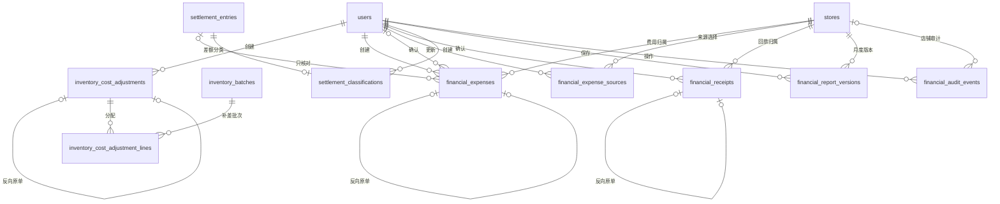

# 财务增强字段字典

依据[models.py](../../../models.py)，新增8张表、88个字段；不修改原19张表的列。日期/精度以本字典为准，API不是同名持久化列的集合。八表声明InnoDB/utf8mb4，实际环境仍需检查。

金额使用Decimal和DECIMAL；凭证日期为业务日，审计动作由应用UTC时间/数据库默认时间记录，数据库会话时区需统一核验。来源唯一范围与模型约束如下，不自动回填历史数据。

## financial_audit_events

| 字段 | SQL类型 | 可空 | 默认值/键 | 含义 |
| --- | --- | --- | --- | --- |
| id | INTEGER | 否 | 主键/自增 | 主键 |
| store_id | INTEGER | 是 | 索引；FK stores.id | 店铺ID（审计可空） |
| entity_type | VARCHAR(32) | 否 | — | 来源表名 |
| entity_id | INTEGER | 否 | 索引 | 来源记录ID |
| action | VARCHAR(32) | 否 | — | 操作编码 |
| before_values | JSON | 否 | 应用默认dict() | 操作前快照JSON |
| after_values | JSON | 否 | 应用默认dict() | 操作后快照JSON |
| actor_id | INTEGER | 否 | FK users.id | 操作人users.id |
| created_at | DATETIME | 否 | 数据库默认now() | 创建时间 |

组合唯一：无额外组合唯一。

## financial_expense_sources

| 字段 | SQL类型 | 可空 | 默认值/键 | 含义 |
| --- | --- | --- | --- | --- |
| id | INTEGER | 否 | 主键/自增 | 主键 |
| store_id | INTEGER | 否 | 索引；FK stores.id | 店铺ID（审计可空） |
| report_month | DATE | 否 | — | 核算月份第一天 |
| category | VARCHAR(64) | 否 | — | 稳定科目编码 |
| mode | VARCHAR(16) | 否 | — | manual/ledger来源选择 |
| updated_by | INTEGER | 否 | FK users.id | 来源选择更新人users.id |
| updated_at | DATETIME | 否 | 数据库默认now() | 更新时间 |

组合唯一：store_id+report_month+category。

## financial_receipts

| 字段 | SQL类型 | 可空 | 默认值/键 | 含义 |
| --- | --- | --- | --- | --- |
| id | INTEGER | 否 | 主键/自增 | 主键 |
| request_key | VARCHAR(64) | 否 | 唯一 | 请求幂等标识 |
| store_id | INTEGER | 否 | 索引；FK stores.id | 店铺ID（审计可空） |
| payout_id | VARCHAR(128) | 否 | 索引 | 平台付款ID |
| receipt_date | DATE | 否 | — | 实际到账日期 |
| source_ref | VARCHAR(128) | 否 | — | 来源凭证号 |
| amount | DECIMAL(16, 4) | 否 | — | 原币金额/差额 |
| currency | VARCHAR(3) | 否 | — | 三位原币编码 |
| exchange_rate | DECIMAL(18, 8) | 否 | — | 固化人民币汇率 |
| amount_cny | DECIMAL(16, 4) | 否 | — | 人民币金额/差额，四位 |
| note | VARCHAR(1000) | 否 | 应用默认 | 原因/说明 |
| reverses_id | INTEGER | 是 | 唯一；FK financial_receipts.id | 被反向的原单ID（每原单最多一次） |
| created_by | INTEGER | 否 | FK users.id | 创建人users.id |
| created_at | DATETIME | 否 | 数据库默认now() | 创建时间 |

组合唯一：store_id+source_ref。

## financial_report_versions

| 字段 | SQL类型 | 可空 | 默认值/键 | 含义 |
| --- | --- | --- | --- | --- |
| id | INTEGER | 否 | 主键/自增 | 主键 |
| request_key | VARCHAR(64) | 否 | 唯一 | 请求幂等标识 |
| store_id | INTEGER | 否 | 索引；FK stores.id | 店铺ID（审计可空） |
| report_month | DATE | 否 | — | 核算月份第一天 |
| version | INTEGER | 否 | — | 店铺/月版本序号 |
| source_digest | VARCHAR(64) | 否 | — | 来源/结果payload的SHA256 |
| calculation_version | VARCHAR(32) | 否 | 应用默认restated-cost-v1 | 计算口径版本编码 |
| status | VARCHAR(24) | 否 | — | draft/posted/cancelled；版本为confirmed/needs_review |
| payload | JSON | 否 | — | 冻结报表、来源清单及核对信息JSON |
| note | VARCHAR(1000) | 否 | 应用默认 | 原因/说明 |
| created_by | INTEGER | 否 | FK users.id | 创建人users.id |
| created_at | DATETIME | 否 | 数据库默认now() | 创建时间 |

组合唯一：store_id+report_month+source_digest；store_id+report_month+version。

## inventory_cost_adjustments

| 字段 | SQL类型 | 可空 | 默认值/键 | 含义 |
| --- | --- | --- | --- | --- |
| id | INTEGER | 否 | 主键/自增 | 主键 |
| request_key | VARCHAR(64) | 否 | 唯一 | 请求幂等标识 |
| source_ref | VARCHAR(128) | 否 | — | 来源凭证号 |
| category | VARCHAR(32) | 否 | — | 稳定科目编码 |
| allocation_basis | VARCHAR(16) | 否 | — | 分摊方式编码 |
| amount | DECIMAL(16, 4) | 否 | — | 原币金额/差额 |
| currency | VARCHAR(3) | 否 | — | 三位原币编码 |
| exchange_rate | DECIMAL(18, 8) | 否 | — | 固化人民币汇率 |
| rate_date | DATE | 否 | — | 汇率日期 |
| amount_cny | DECIMAL(16, 4) | 否 | — | 人民币金额/差额，四位 |
| document_date | DATE | 否 | — | 凭证日期 |
| is_final | BOOLEAN | 否 | 应用默认False | 该科目按实际凭证核对标记 |
| note | VARCHAR(1000) | 否 | 应用默认 | 原因/说明 |
| reverses_id | INTEGER | 是 | 唯一；FK inventory_cost_adjustments.id | 被反向的原单ID（每原单最多一次） |
| created_by | INTEGER | 否 | FK users.id | 创建人users.id |
| created_at | DATETIME | 否 | 数据库默认now() | 创建时间 |

组合唯一：category+source_ref。

## inventory_cost_adjustment_lines

| 字段 | SQL类型 | 可空 | 默认值/键 | 含义 |
| --- | --- | --- | --- | --- |
| id | INTEGER | 否 | 主键/自增 | 主键 |
| adjustment_id | INTEGER | 否 | 索引；FK inventory_cost_adjustments.id | 调整头ID |
| batch_id | INTEGER | 否 | 索引；FK inventory_batches.id | 原批次ID |
| quantity | INTEGER | 否 | — | 凭证入账时批次数量快照（分母），批次数量更正后也不回写；冲销继续使用此值 |
| allocation_weight | DECIMAL(20, 8) | 否 | — | 本次分摊依据数值 |
| amount_cny | DECIMAL(16, 4) | 否 | — | 人民币金额/差额，四位 |

组合唯一：adjustment_id+batch_id。

## financial_expenses

| 字段 | SQL类型 | 可空 | 默认值/键 | 含义 |
| --- | --- | --- | --- | --- |
| id | INTEGER | 否 | 主键/自增 | 主键 |
| request_key | VARCHAR(64) | 否 | 唯一 | 请求幂等标识 |
| store_id | INTEGER | 否 | 索引；FK stores.id | 店铺ID（审计可空） |
| expense_date | DATE | 否 | 索引 | 费用发生日 |
| category | VARCHAR(64) | 否 | — | 稳定科目编码 |
| source_ref | VARCHAR(128) | 否 | — | 来源凭证号 |
| amount | DECIMAL(16, 4) | 否 | — | 原币金额/差额 |
| currency | VARCHAR(3) | 否 | — | 三位原币编码 |
| exchange_rate | DECIMAL(18, 8) | 否 | — | 固化人民币汇率 |
| amount_cny | DECIMAL(16, 4) | 否 | — | 人民币金额/差额，四位 |
| status | VARCHAR(16) | 否 | 应用默认draft | draft/posted/cancelled；版本为confirmed/needs_review |
| settlement_entry_id | INTEGER | 是 | FK settlement_entries.id | 关联原始结算ID |
| reverses_id | INTEGER | 是 | 唯一；FK financial_expenses.id | 被反向的原单ID（每原单最多一次） |
| note | VARCHAR(1000) | 否 | 应用默认 | 原因/说明 |
| created_by | INTEGER | 否 | FK users.id | 创建人users.id |
| posted_by | INTEGER | 是 | FK users.id | 费用确认人users.id |
| created_at | DATETIME | 否 | 数据库默认now() | 创建时间 |
| posted_at | DATETIME | 是 | — | 费用确认时间 |

组合唯一：store_id+category+source_ref。

## settlement_classifications

| 字段 | SQL类型 | 可空 | 默认值/键 | 含义 |
| --- | --- | --- | --- | --- |
| id | INTEGER | 否 | 主键/自增 | 主键 |
| settlement_entry_id | INTEGER | 否 | 唯一；FK settlement_entries.id | 关联原始结算ID |
| breakdown | JSON | 否 | — | 原差额按稳定分类编码拆分的金额JSON |
| note | VARCHAR(1000) | 否 | 应用默认 | 原因/说明 |
| confirmed_by | INTEGER | 否 | FK users.id | 分类确认人users.id |
| confirmed_at | DATETIME | 否 | 数据库默认now() | 分类最近确认时间 |

组合唯一：无额外组合唯一。

## 状态与引用规则

八表20个外键均指向既有主数据或追加凭证，关系如下（同一用户表的创建/确认外键分别标注）：

cost_status为响应字段：actual要求四科目最新未反向凭证均is_final；partial为部分核对；unverified为未完成核对。allocation_basis为quantity/weight/volume/value。反向单本身不能再反向；更正通过另建凭证。

ExpenseSource.mode只改变计算来源，不覆盖StoreProfitLossReport.manual_values。FinancialReportVersion.payload不可变；费用草稿/分类/来源选择允许按服务状态流转，变更前后进入FinancialAuditEvent。共享成本审计store_id为NULL，其余按店铺保存。

唯一键及外键在数据库兜底，业务校验/权限/非负成本和月份由[financial_controls.py](../../../services/financial_controls.py)、[financial_versions.py](../../../services/financial_versions.py)保证；不能把任意手工SQL写入视为已受同样校验。
