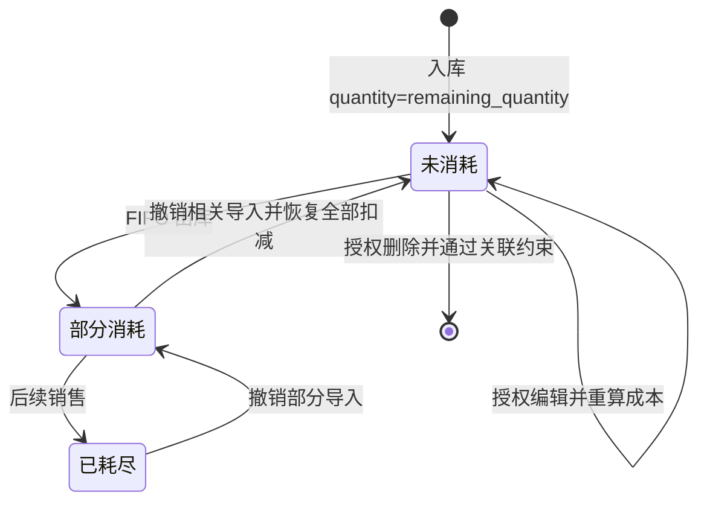

# 入库与库存流程

## 新建批次

create_batch 校验商品存在，BatchCreate 保证 quantity>0、各金额≥0；_resolve_purchase_values 确定采购价与总金额，_calc_unit_cost 计算含运费成本。arrived_at 缺省用 datetime.now，批次号前缀为 LatinGoYYYYMMDD（按到货日）。

_next_batch_no 查询该前缀的编号，提取最大有效数字序号后 +1，至少三位补零；不再按记录数量生成。commit 遇 IntegrityError 最多尝试三次，最终返回 409。数据库唯一约束防冲突，重试不是全局编号锁，真实并发仍待验证。依据：[batches.py](../../../routers/batches.py)。

以上状态根据数量推导，数据库没有独立批次状态列。撤销只恢复其文件产生的明细，能否完全回到未消耗取决于其他销售是否存在。

## 编辑与删除

_locked_batch 使用 FOR UPDATE 和 populate_existing，等待在途销售完成后读取最新数量。operator 必须是原创建人，admin 可处理任意批次；已有扣减直接返回 400。编辑重置 quantity/remaining_quantity、重算成本，未传总金额/单价时复用旧总金额；未传钉钉/费用单号则保留相应字段。

update_batch 接收 BatchCreate，但不会把 data.product_id 写回原批次；不能将它描述为换商品功能。它没有完整历史成本明细/快照引用校验，恢复到未消耗后的历史外键仍可能阻止删除。不能只依据数量相等认定数据库删除安全。

## 查询、字段显隐与导出

list_batches 按 arrived_at、id 降序，可按 product_id 或商品名称/SKU/批次号 keyword 过滤。显示字段面板只控制浏览器列可见性，不改 API 或成本。

导出有 batch_ids 时优先按选择 ID，不叠加 keyword/product_id；没有 ID 才用筛选条件导出全部匹配记录。宽表独立滚动、分页和跨页选择仅为前端交互。依据：[模板](../../../templates/index.html)、[batches.py](../../../routers/batches.py) 的 list_batches、export_batches。

销售事务和撤销细节见[销售流程](../sales/workflow.md)。本次未创建或编辑任何批次。
