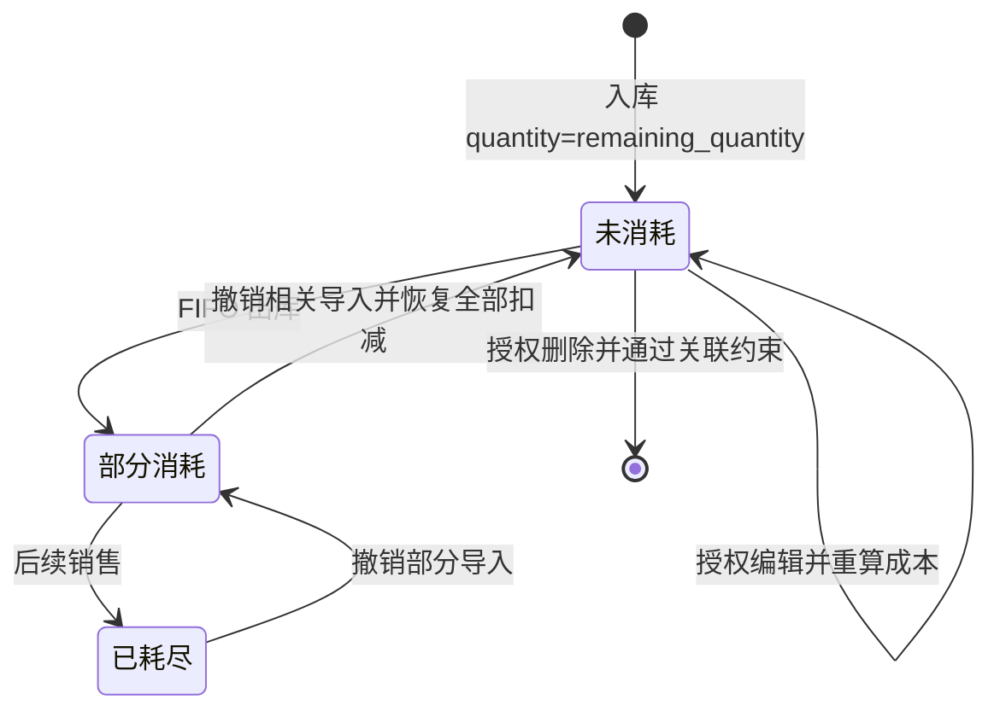

# 入库与库存流程

## 新建批次

create_batch 校验商品存在，BatchCreate 保证 quantity>0、各金额≥0；_resolve_purchase_values 确定采购价与总金额，_calc_unit_cost 计算含运费成本。arrived_at 缺省用 datetime.now，批次号前缀为 LatinGoYYYYMMDD（按到货日）。

_next_batch_no 查询该前缀的编号，提取最大有效数字序号后 +1，至少三位补零；不再按记录数量生成。commit 遇 IntegrityError 最多尝试三次，最终返回 409。数据库唯一约束防冲突，重试不是全局编号锁，真实并发仍待验证。依据：[batches.py](../../../routers/batches.py)。

以上状态根据数量推导，数据库没有独立批次状态列。撤销只恢复其文件产生的明细，能否完全回到未消耗取决于其他销售是否存在。

## 编辑与删除

admin/operator“强制删除”采用软作废，两者均可跨创建人操作，不删除有销售/快照/成本补差外键的原批次。页面必须填写作废原因并提交打开时的edit_version；服务端先按既有顺序锁批次和成本调整来源，比对版本，再同事务写voided_at（UTC）、voided_by、void_reason与action=void的BatchChangeLog。作废字段先落库并刷新，日志和响应使用数据库实际保存的时间精度及版本。重复作废409，viewer无权提交。作废后的原quantity/remaining_quantity保持历史值；默认批次列表不显示，admin/operator可用“查看已作废批次”读取、导出和查看日志，页面当前剩余显示0并注明原值。原销售、成本明细、财务来源及旧月度版本不删除，入库编号不复用。新增FIFO排除作废批次；商品当前库存与动态存货报表排除原剩余数；引用作废批次的销售保留原成本展示，状态为needs_review，利润及原销售期间的FIFO成本、跌价准备和销售转销留空并提示待核对。产品线成本同样留空。保存的旧快照及旧月度版本不覆盖；新报表应复核后另存版本。实现见[batches.py](../../../routers/batches.py)、[fifo.py](../../../services/fifo.py)、[reports.py](../../../routers/reports.py)。

_locked_batch 使用 FOR UPDATE 和 populate_existing，等待在途销售完成后读取最新数量。admin/operator 可编辑任意创建人的历史批次，包括部分出库和售完批次；operator 删除仍必须是原创建人，且已出库批次不能删除。编辑不更新 user_id、product_id 或 batch_no，未传单号仍保留相应字段。

保存先核对已出库数=原quantity−remaining_quantity，并用当前读复查销售明细数量。新quantity不能小于已出库数；新remaining_quantity=新quantity−已出库数，不会把已售库存重新加回。批次编辑允许将入库日改到该批次既有销售日之后，也允许在已有日期矛盾时继续修改资料、数量或成本；该入口不自动改写既有销售及FIFO成本明细。余量与明细不符或数量不足返回409，不写批次和日志。新销售仍只消耗销售当日或之前已到货的批次；销售早于入库的历史记录在存货准备回放中会标记待核对，相关金额可能留空，须核对原始业务日期。

从未出库、无补差且没有cost_basis的批次保持直接重算。已售、已有补差或已保存cost_basis的批次，修改数量/金额时必须启用财务增强，并以cost_edit_mode=restate提交：首次冻结原单位成本构成为cost_basis，原unit_cost和SaleCostDetail.unit_cost保持不变；绝对目标采购/头程/尾程/其他金额转为新增差额凭证，与批次数量、资料和日志一起提交。差额按凭证四位小数保存，单位成本继续Decimal计算，可能含计价尾差。新凭证不自动标记已完成账单核对。

费用清零的负成本校验采用金额尺度及凭证精度，避免冻结成本构成中的非整除尾差误报；编辑值和日志中的负零显示为0.0000。批次数量更正也不改变原成本凭证的幂等含义，相同内容重试复用原单，显式权重、批次集合和权限校验保留。具体精度、冲销和重试规则统一见[财务增强流程](../financial-control/workflow.md#1-实际成本补差)。

修改数量时四科目都保存本次来源，即使每件差额为0；仅改某项金额时也为该项保留零额来源，避免新的数量/账单继续沿用旧的已核对状态。无变化保存和纯资料更正不追加成本凭证。

成本差额通过既有调整层追溯原销售月，未来出库仍保存基准FIFO单价并在查询时叠加调整，避免重复计费。未售部分进入剩余库存；旧月度版本不改，复核后另存新版。普通财务补差API仍保留原创建人权限，仅本批次编辑入口允许运营跨创建人更正。财务增强关闭时可更改单号/发货等资料，数量或成本更正返回503并提示先准备结构、启用功能；不自动开启配置或迁移生产。

update_batch 接收 BatchUpdate（BatchCreate加edit_version/cost_edit_mode），不会把 data.product_id 写回原批次。历史快照引用仍可能阻止删除，不能只依据数量相等认定数据库删除安全。

列表返回批次字段及不可变成本调整来源共同组成的edit_version，零额补差也使旧版本失效；页面打开时固定保存。行锁内当前读批次、调整层后比对，过期409、缺少版本428，均不修改数据或追加成功日志。冲突保留表单，关闭、刷新并核对后重新编辑，不能自动换版本重试。算法位于InventoryBatch.edit_version和AdjustedBatch.edit_version，不是递增序号。

批次列表“操作”列固定在右侧，提供导出、编辑、日志和符合原限制的普通删除入口；已出库仍可编辑，查看者仅显示导出。admin/operator另有强制删除（作废）入口，已作废行只保留导出及日志；普通删除显隐独立检查是否出库，不复用编辑权限。页面预检查不替代服务端校验。

编辑弹窗可更正数量、采购总金额、三类整批费用、四种单号及发货/入库时间，不能改商品和批次号。数量为正整数，金额非负且支持四位小数；金额以字符串提交，由服务端 Decimal 计算。清空单号显式传 null，未修改日期保留原始精度。保存期间禁用保存按钮并阻止重复提交/切换目标；保存失败保留表单，保存成功后若列表刷新失败，单独提示已保存并要求刷新。

编辑弹窗内显示保存进度、字段校验及服务端错误；表单校验不通过时明确指出字段，保存失败的错误不会被弹窗遮住。只改头程运费钉钉单号属于资料更正，服务端不追加成本差额，财务增强关闭时也允许保存。

登录过期或退出时立即关闭编辑弹窗、清除保存状态，使登录层可操作；同一账号重新登录后，旧批次保存函数的回调不能关闭新弹窗、显示旧结果或解除新请求的保存锁。

### 修改日志

每次成功编辑（含无字段变化保存）同事务追加batch_change_logs：批次ID/编号、操作者身份、UTC时间和前后快照。先flush、refresh(with_for_update=True)，再当前读调整层；快照金额按字符串，展示实际叠加后的单价及edit_values金额，不记录计算版本或内部cost_basis。日志失败则批次、原成本依据、全部差额凭证及财务审计一起回滚。实现见update_batch、_batch_change_values、[batch_edits.py](../../../services/batch_edits.py)。

该表独立于财务增强开关，默认需建表；只提供 admin/operator 的分页读取，不提供修改/删除日志接口。action=update记录编辑，action=void记录管理员或运营作废；作废原因在after_values及批次字段中。日志不设批次/用户外键，保留当时身份和编号，后续账号改名、批次或账号删除不会级联丢失日志。不是防数据库管理员篡改机制；运行账号仍应按部署要求限制数据库权限。已有历史修改不反推或补造日志。新增表和生产准备步骤见 [运行说明](../../../PROJECT_RUNBOOK.md#批次跨创建人编辑与修改日志)。

页面日志弹窗按倒序显示操作者、发生时间及变化字段的前后值，20条分页；金额保持原字符串，日志时间按浏览器语言/时区显示，入库/发货业务日期不转换时区。内容转义，关闭、退出或切换批次后忽略旧响应。

### 批次业务日期

shipping_date、arrived_at 为无时区业务时间，页面新增/编辑直接提交 datetime-local 的填写值，不调用 Date/toISOString 转换到 UTC。回显使用原日期时间；未修改日期时提交原值，保留历史秒数及小数秒，避免每次编辑扣减浏览器时区偏移、跨日改变 FIFO 和库龄。实现见 [page-interactions.js](../../../static/page-interactions.js) 的 batchDateTimeInput/batchDateTimeValue 及两份首页的 createBatch/openEditBatch/saveEditBatch。

本修复不迁移日期字段、不更改 FIFO 自然日规则，也不自动修正已保存的历史时间；历史偏移需凭原始单据另行核对。

## 查询、字段显隐与导出

list_batches 按 arrived_at、id 降序，可按 product_id 或商品名称/SKU/批次号 keyword 过滤。显示字段面板只控制浏览器列可见性，不改 API 或成本。

导出有 batch_ids 时优先按选择 ID，不叠加 keyword/product_id；没有 ID 才用筛选条件导出全部匹配记录。宽表独立滚动、分页和跨页选择仅为前端交互。依据：[模板](../../../templates/index.html)、[batches.py](../../../routers/batches.py) 的 list_batches、export_batches。

列表中的批量导出与单条导出调用同一接口。请求期间页面在批量导出按钮下持续显示生成状态，并禁止重复提交；此时点击单条导出会提示等待当前文件。成功后提示检查浏览器下载列表，失败时保留错误提示。会话过期时清除跨页批次勾选，旧会话的下载结果不能覆盖新会话提示。服务器返回 5xx 表示文件未生成，应查看服务端日志定位具体异常，页面提示不代表导出成功。下载使用临时对象地址，触发下载后延迟释放。对应交互与文案见 [模板](../../../templates/index.html) 和 [page-interactions.js](../../../static/page-interactions.js)。

服务端批次导出先读取批次、成本层、商品和创建人店铺，结束只读 MySQL 事务后再生成带图片的 Excel，避免文件构造期间占用连接。读取结果仍是该请求内的已物化数据，不对库存或批次执行写入。依据：[batches.py](../../../routers/batches.py) 的 `export_batches`。

批次Excel末尾展示“店铺（创建人当前绑定）”，与存货报表的创建人当前绑定口径一致；未知显示“未关联店铺”。批次本身仍无store_id，账号改绑会影响该展示，不应据此认定为店铺独占库存。原21列不移动；商品汇总可能包含多个店铺创建的批次，不猜测单一店铺。

销售事务和撤销细节见[销售流程](../sales/workflow.md)。

## 实际成本补差

启用后列表、导出和商品库存使用原成本加调整层；批次编辑可以更正入库数量但保留已售数，FIFO原始保存单价不变。edit_values提供当前有效的采购和各类费用，用于回填、列表及导出；旧原始字段不再用于覆盖有效金额。已有补差来源的批次仍禁止删除，反向后也保留来源。流程见[财务增强](../financial-control/workflow.md)。

编辑先锁原批次，再由load_cost_layers(lock=True)当前读调整来源，版本不匹配返回409；删除通过ensure_batch_cost_editable当前读拒绝任何已有来源。成本补差同样先锁父批次，持锁至提交/回滚。不能改为普通SELECT，以免认证建立的RR旧快照漏检。数量变更后的凭证冲销按原分配行quantity校验，不能用当前批次数量稀释负成本检查。
