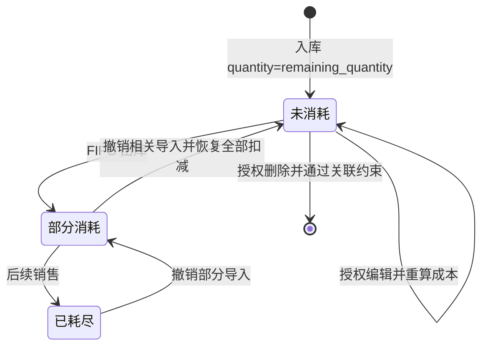

# 入库与库存流程

## 新建批次

create_batch 校验商品存在，BatchCreate 保证 quantity>0、各金额≥0；_resolve_purchase_values 确定采购价与总金额，_calc_unit_cost 计算含运费成本。arrived_at 缺省用 datetime.now，批次号前缀为 LatinGoYYYYMMDD（按到货日）。

_next_batch_no 查询该前缀的编号，提取最大有效数字序号后 +1，至少三位补零；不再按记录数量生成。commit 遇 IntegrityError 最多尝试三次，最终返回 409。数据库唯一约束防冲突，重试不是全局编号锁，真实并发仍待验证。依据：[batches.py](../../../routers/batches.py)。

以上状态根据数量推导，数据库没有独立批次状态列。撤销只恢复其文件产生的明细，能否完全回到未消耗取决于其他销售是否存在。

## 编辑与删除

_locked_batch 使用 FOR UPDATE 和 populate_existing，等待在途销售完成后读取最新数量。admin/operator 可编辑任意创建人的批次，operator 删除仍必须是原创建人；已有扣减直接返回 400。编辑重置 quantity/remaining_quantity、重算成本，未传总金额/单价时复用旧总金额；未传钉钉/费用单号则保留相应字段。编辑不更新 user_id、product_id 或 batch_no。

update_batch 接收 BatchUpdate（BatchCreate加edit_version），但不会把 data.product_id 写回原批次；不能将它描述为换商品功能。它没有完整历史成本明细/快照引用校验，恢复到未消耗后的历史外键仍可能阻止删除。不能只依据数量相等认定数据库删除安全。

列表返回原始批次持久化字段的内容版本edit_version，页面在打开弹窗时固定保存该值。保存先锁定并刷新批次，再比对版本；其他人改过内容返回409（batch_edit_conflict），缺少版本返回428（batch_edit_version_required），均不修改数据或追加成功日志。冲突保留当前表单，需先保留填写内容，再关闭、刷新并核对后重新编辑；不得自动替换版本并重试旧表单。内容完全相同时版本可保持相同，不是每次保存递增的序号。算法位于InventoryBatch.edit_version，无新增库存字段或历史回填。

批次列表的“操作”列固定在滚动区域右侧，提供导出、编辑、日志和满足原限制的删除入口。已有出库记录时编辑按钮禁用并提示原因；查看者仅显示导出。显示字段面板仍可显隐操作列。页面预检查不替代服务端行锁后的角色、最新剩余数及成本调整来源校验。

编辑弹窗可更正数量、采购总金额、三类整批费用、四种单号及发货/入库时间，不能改商品和批次号。数量为正整数，金额非负且支持四位小数；金额以字符串提交，由服务端 Decimal 计算。清空单号显式传 null，未修改日期保留原始精度。保存期间禁用保存按钮并阻止重复提交/切换目标；保存失败保留表单，保存成功后若列表刷新失败，单独提示已保存并要求刷新。

### 修改日志

每次成功的编辑保存（包括字段未变化的保存）在同一事务内向 batch_change_logs 追加记录：批次ID/编号、操作者ID/当时用户名/角色、UTC时间及修改前后完整批次快照。先 flush，再用refresh(with_for_update=True)当前读批次，确保金额快照是数据库实际四位小数；无字段变化时也不能退回RR旧快照。Decimal按字符串、业务日期按原值存JSON；快照不含edit_version或展示调整层。日志失败则批次修改一起回滚，不允许只保存批次而漏记日志。实现见 update_batch、_batch_change_values。

该表独立于财务增强开关，默认需建表；只提供 admin/operator 的分页读取，不提供修改/删除日志接口。日志不设批次/用户外键，保留当时身份和编号，后续账号改名、批次或账号删除不会级联丢失日志。不是防数据库管理员篡改机制；运行账号仍应按部署要求限制数据库权限。已有历史修改不反推或补造日志。新增表和生产准备步骤见 [运行说明](../../../PROJECT_RUNBOOK.md#批次跨创建人编辑与修改日志)。

页面日志弹窗按倒序显示操作者、发生时间及变化字段的前后值，20条分页；金额保持原字符串，日志时间按浏览器语言/时区显示，入库/发货业务日期不转换时区。内容转义，关闭、退出或切换批次后忽略旧响应。

### 批次业务日期

shipping_date、arrived_at 为无时区业务时间，页面新增/编辑直接提交 datetime-local 的填写值，不调用 Date/toISOString 转换到 UTC。回显使用原日期时间；未修改日期时提交原值，保留历史秒数及小数秒，避免每次编辑扣减浏览器时区偏移、跨日改变 FIFO 和库龄。实现见 [page-interactions.js](../../../static/page-interactions.js) 的 batchDateTimeInput/batchDateTimeValue 及两份首页的 createBatch/openEditBatch/saveEditBatch。

本修复不迁移日期字段、不更改 FIFO 自然日规则，也不自动修正已保存的历史时间；历史偏移需凭原始单据另行核对。

## 查询、字段显隐与导出

list_batches 按 arrived_at、id 降序，可按 product_id 或商品名称/SKU/批次号 keyword 过滤。显示字段面板只控制浏览器列可见性，不改 API 或成本。

导出有 batch_ids 时优先按选择 ID，不叠加 keyword/product_id；没有 ID 才用筛选条件导出全部匹配记录。宽表独立滚动、分页和跨页选择仅为前端交互。依据：[模板](../../../templates/index.html)、[batches.py](../../../routers/batches.py) 的 list_batches、export_batches。

批次Excel末尾展示“店铺（创建人当前绑定）”，与存货报表的创建人当前绑定口径一致；未知显示“未关联店铺”。批次本身仍无store_id，账号改绑会影响该展示，不应据此认定为店铺独占库存。原21列不移动；商品汇总可能包含多个店铺创建的批次，不猜测单一店铺。

销售事务和撤销细节见[销售流程](../sales/workflow.md)。

## 实际成本补差

启用后列表、导出和商品库存金额使用原成本加调整层；数量和FIFO原始保存成本不变。批次已有成本调整来源即禁止直接编辑/删除，反向后也不删除来源。按最新凭证重算历史库存和准备，已保存月度版本保持旧值。流程与公式见[财务增强](../financial-control/workflow.md)。

编辑/删除先锁原批次，再由ensure_batch_cost_editable对调整行执行SELECT ... FOR UPDATE当前读；成本补差也先锁原批次，保持父批次→调整行的锁序。不能将来源检查改成普通SELECT：MySQL/InnoDB REPEATABLE READ下，认证等较早查询可能建立旧快照，漏掉之后提交的调整来源。所有锁保留到事务提交或回滚，成本调整已提交则编辑/删除返回409（batch_has_cost_adjustments），不改写原成本或日志。
