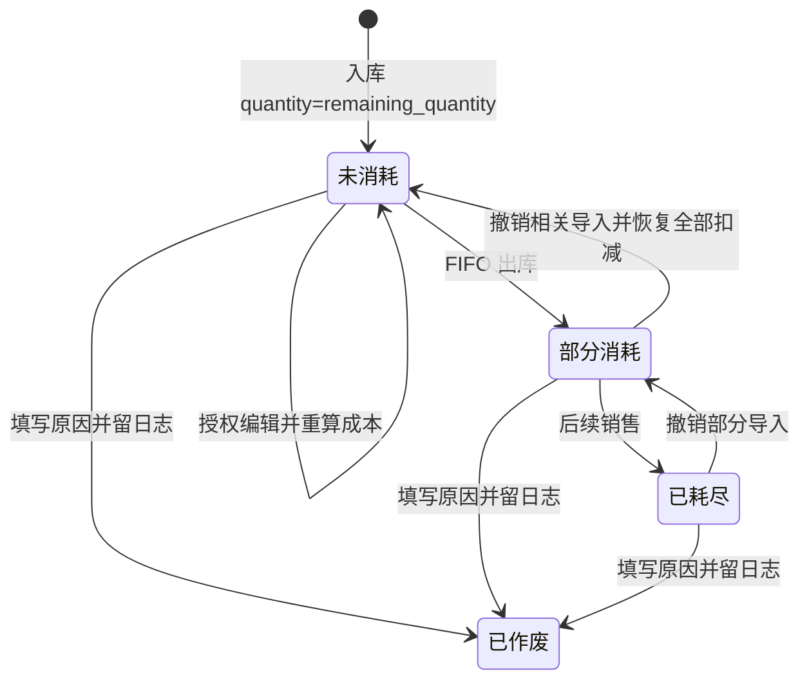

# 入库与库存流程

## 库存盘点与跌价

库存内新增“库存盘点与跌价”页签，按截止日显示本月入/出库、账面数量、库存平均成本/成本金额、期末准备、本月总计提、账面价值。展开商品可逐批查看入库日期、库龄、剩余数、成本、跌价及归属分摊，不限定两次入库。计算复用`inventory_activity`和`inventory_provision_data`；数量日结与准备回放不一致时金额留空。存在本月历史持有的作废批次时本月计提待核对，不能因排除作废批次而填0。实盘数不参与成本、跌价和账面价值计算。

截止日校验按批次进行，不能只比较SKU合计：两批之后分别更正+20/−20件，合计虽相等，按当前批次数量回放的成本和准备仍可能不适用于旧截止日。`build_activity`在同一次数量回放中提供可选的内部`batch_balances`，与准备回放逐批对照；任一批余量未知、非零批次缺失或数量不一致时，该商品成本/平均成本/准备/账面价值及相关批次金额、店铺分摊留空，返回`inventory_assessment_quantity_mismatch`警示。导出使用相同结果，不完整合计留空；不污染其他商品。截止日尚未到货或已作废且余量为0的批次不误判。此处理不重写历史成本或强行输出推定金额。

本月入库由同一数量回放产生的入库事件统计；viewer排除已作废批次，与原每日进出/来源权限一致，管理员与运营保留既有可见范围。隐藏批次入库数量未知时，不把其未知值传播到viewer有权查看的正常入库统计。内部共享账面数量和盘点版本仍基于完整数量事实，不因查看角色变化而改动，不对外返回内部逐批核验字典。

### 人工盘点对照

实盘数量手工填写0–2147483647整数，0有效，空白为未盘点；差异=实盘数−保存时账面数，正为盘盈、负为盘亏。按商品/盘点日期保存不可覆盖版本，记录当时账面数、实盘数、备注、操作人和UTC保存时间；历史对照差异不随随后正常销售重算。盘点日期采用自然日日末，日内盘点应先核对当天单据是否录入完整。录入不会改库存、FIFO、入库批次、跌价或财务凭证；实际盘盈/盘亏调整须另行设计，不通过改原批次数量来自动平账。

保存先释放认证可能建立的旧读取快照，按FIFO同向顺序锁该商品全部批次，重新构建日期日结；账面数未知则拒绝。`ledger_version`固定截至盘点日的月内日结与警示，`previous_id`防止两个编辑覆盖；库存回填/更正/撤销或盘点版本变化返回409，页面保留输入，请关闭后刷新核对。相同`request_key`与相同内容重试返回原记录，换内容拒绝；唯一商品/日期/版本和请求键兜底并发，保存失败回滚盘点记录。没有锁商品/用户来反转FIFO锁序。真实MySQL锁等待/并发仍待环境验证。

提交后冻结实盘数、备注、保存与取消控件，直到请求完成，避免旧提交成功时关闭窗口丢掉等待期间的新输入。普通失败/冲突/网络错误后恢复各控件原禁用状态，保留已填值；同内容重试沿用幂等键。退出/过期后旧回调不操作新会话表单；库存数的版本仍只按内部数量日结及其警示生成，展示权限过滤和财务待核对警示不改变已保存盘点的数量依据。

再次查询时保留已保存账面数/差异；截至原盘点日的数量事实改变才提示需复核，较晚日期的正常销售不使旧盘点失效。历史记录按日期分页查看，修改再次追加版本，不提供删除/覆盖接口。管理员可看/录历史日期；运营须绑定店铺，仅可录今天共享库存，查看账号只读今日。非管理员出库和店铺跌价分摊仅绑定店铺，响应不含全量历史日结；原总览/每日进出的权限保持不变。

盘点页Excel导出全部匹配商品，含盘点汇总、批次明细、店铺跌价分摊和口径说明，未知值/不完整合计空白，备注/SKU等强制文本。上限2000商品、10000导出批次；分组查询的源数量限制保留，准备回放最多10000条历史出库明细，不截断。新表及结构准备见[字段字典](database.md#inventory_stock_counts)，入口与参数见[API](api.md#盘点与跌价扩展)。

## 入库管理的批次搜索

批次列表复用库存的`ProductSearch.bind`，输入名称/SKU显示最多20项候选，精确SKU优先；点击或上下键后回车选择时按既有`product_id`精确筛选批次，并重置第一页。不选候选直接回车或点击搜索仍按商品名称、SKU或批次号模糊查询，清空恢复全部；再次输入后解除原精确选择。分页、刷新及未勾选批次时的全量导出使用同一筛选条件，已勾选批次仍按原选择优先导出。联想支持中文输入法、取消旧请求及过期会话隔离，退出清除候选和所选商品；不新增接口、数据库字段或库存写入。入口为两份首页的`initializeBatchSearch`、`batchFilterParams`和[共享联想组件](../../../static/product-search.js)。

## 库存查看与每日进出

“库存”独立于批次维护，原写入接口不变。两份首页挂载inventory-workspace-root，由[inventory-workspace.js](../../../static/inventory-workspace.js)提供搜索、月份、分页、按天/按商品/横向日期表及来源弹窗。总览和每日统计标注本页范围，不把分页小计当作全部合计。总览复用活动批次的记录余量及有效单位成本；指定日期余额看每日进出，成本金额不等于扣除跌价准备后的账面价值。

顶部“商品名称 / SKU”也提供输入联想，与下方商品选择共用候选请求、渲染及键盘逻辑，各自隔离请求状态。输入后显示相似SKU/名称，点击候选或上下键选中后回车，会在当前视图按商品ID精确筛选并同步导出，避免SKU前缀相近时混入其他商品；切换总览/每日进出保留该选择。不选候选直接回车或点击查询仍作关键字模糊搜索；Esc只收起顶部候选、保留输入，清空再查询恢复全部。输入内容与已加载查询不同则暂停导出，须先查询或选定候选；空输入不拉取全量候选。

联想的查询、防抖、渲染、键盘及过期请求保护已抽到[product-search.js](../../../static/product-search.js)的ProductSearch.bind，库存的bindProductSearch仅传入视图/会话、恢复已选商品和精确查询回调；销售产品名复用同一组件，但选择仅填名称。各输入独立保存候选和请求状态，不共享库存所选商品或销售草稿。

联想请求GET /products时显式开启prioritize_exact_sku=true，由服务端在分页前优先精确SKU，避免目标被20条候选截断；前端沿用服务端顺序。库存总览原有分页查询不启用该参数，排序与统计不变，接口约定见[商品API](../products/api.md#请求和查询)。

“按商品查看”的“查找商品”可输入SKU或名称，复用`GET /products`分页搜索全部商品，250毫秒合并连续输入，每次最多展示20项候选；SKU精确匹配优先，同名商品按SKU区分。点击或上下键/回车确认后按商品ID读取日结，清除上方关键字以免叠加旧筛选；不局限当前页。中文输入完成后才检索，未匹配/失败不会切换商品；退出输入或Esc恢复原选择。编辑搜索词时暂停导出，确认后导出跟随所选商品；查询变化、刷新、退出均取消旧候选请求，旧响应与401不能影响新会话。

计算由[inventory_activity.py](../../../services/inventory_activity.py)维护：月份须为过去/当前月首日，当前月截止上海当天；入库和销售沿用无时区业务日期，UTC日志/作废转Asia/Shanghai自然日。

1. 入库取批次，出库取SaleCostDetail.quantity按Sale.sold_at归日；结算退款金额、待确认订单不作实际进出库。组合商品按各自FIFO明细计数，不重复统计订单主表。
2. 当前quantity减去已有update日志的数量差还原第一条已知基数。入库日用该基数，后续更正在日志日列调整；到货前更正并入到货数，避免重复计入或提前形成库存。入库日期更正按最新日期重算并提示。更晚月份的数量调整不倒改此前月份。
3. 期末=期初+入库−出库+调整，无变动日延续。作废日将当日剩余列负调整移出；入库前取消且无销售的批次不构造到货库存。
4. 更正链不连续、余量与FIFO不符、非正数出库、销售早于入库/晚于作废等矛盾标记inventory_history_inconsistent；相关期初/调整/期末为null，不虚构平账数。已有来源数量仍可查看，缺失的更早日志不补造。
5. 默认inventory_current_documents提示：撤销导入删除原销售/FIFO明细，页面按撤销后的事实重算，不虚构退货入库。追溯撤销、更正前完整过程需另行设计不可变库存流水，本次不增加此表。

总览所有既有角色共享；日结/来源要求非管理员绑定店铺，出库复用_sale_store_scope，含旧销售空store_id的创建人绑定兼容。管理员输出全局日结；其他账号只显示可见入库、本店出库，期初/调整/期末为null并附inventory_scope_restricted，完整调整来源仅管理员可读。viewer不读作废批次入库来源；本店销售引用作废批次仍按销售权限可见。不能以本店出库勾稽共享余额，也不把创建人当前绑定当作固化店铺库存。

先分页商品，月内出库按批次/日聚合、此前按批次汇总，无逐商品N+1。单次源数据上限10,000条（批次、日志或月内聚合记录），超过要求缩小商品范围/减少每页数，不截断后返回不完整余额；来源另行分页20–100条。全部只SELECT，不运行main生命周期，不改批次/FIFO/销售/成本、建表或补快照。

页面切换查询清空旧结果并绑定请求序号；总览模式停用隐藏的月份输入，清空月份后切回总览仍可查询，每日视图恢复月份必填及范围校验。退出/过期清空工作台、关闭弹窗并使旧请求失效，同账号重登也隔离。关闭/重开弹窗不接收旧响应，工作台重建不重复注册根点击处理器。验证入口见[代码映射](code-map.md)。

“导出库存Excel”覆盖当前查询全部商品，不限当前页；每日视图为“导出整月Excel”，按商品查看仅导出所选商品。月汇总取首日期初、整月入/出/调整及末日期末，不累加每日结余；横向表每天展开入/出/调整/期末。页面和文件共用库存/日结行构建，权限空值、待核对及未知合计保留为空，说明页记录查询、范围、期间和历史限制。

导出上限2,000个商品并保留源限制，超限要求缩小查询，不截断。读完数据释放事务后生成文件；前端期间固定筛选/视图，禁止重复点击，完成恢复原分页/控件状态，退出取消下载。旧响应及401不得清理新会话；新导出接口需由更新后的后端加载，旧进程未注册时提示重启本地服务后刷新，不将错误网页保存为xlsx。

## 新建批次

入库与批次资料编辑不展示归属选择，允许先入库再到库存总览/盘点页的“跌价归属”逐批管理；入库批次列表的“修改归属”可直接打开指定批次。该入口独立于数量和成本编辑，支持单店、多店及两种归属生效范围。

## 批次跌价归属

入库批次列表的“修改归属”复用库存归属弹窗，按商品ID和批次ID精确重新读取当前版本并打开编辑，不受原列表页码影响。管理员/运营可修改旧批次、部分售出或售完的活动批次，不需要启用财务增强；已作废批次和viewer不显示写入口。保存只提交归属、生效模式和版本，保留数量、成本和日期；保存后刷新原筛选及页码，批次已作废/不存在时提示刷新。SKU下无手工归属且有显式日规则显示“待分配”，无显式日规则显示“未手工分配（兼容历史归属）”，避免把旧绑定兼容误认为明确未分配。入口见两份首页的`openBatchImpairmentStores`和[inventory-allocations.js](../../../static/inventory-allocations.js)。

单店全额、多店均分，仅用于跌价核算，不分配实物销售额度。一批100件归属A/B，A卖20、B卖10，剩70件；先按原类型、安全库存和持有期间算法计算全批跌价，再由A/B均分，不能分别重新应用安全库存。列表SKU下显示店铺，Excel追加均分列。

库存总览和盘点页每个商品的“跌价归属”打开该商品活动批次分页列表，管理员/运营可逐批设置，viewer只读。库存管理保存须选至少一家店铺；新入库遗漏或空选择可保存，并写入显式空归属日规则，标记待分配，不沿用创建人店铺。待分配期间仍按商品计算全局跌价，店铺分摊显示待核对；有非零或未知增提/转销的待分配期间，店铺损益相关值保持未知并警示，不能默认为0。历史无日规则的未分配批次保留原绑定兼容，不批量回填。旧批次编辑遗漏归属字段保留原值（包括待分配），显式[]清空仍拒绝；旧客户端可在原接口提交合法归属。

待分配的损益影响按实际金额判断：已知计提/转销数量与有效单位成本相乘为0时，不将店铺费用和利润置为未知；非零及数量未知仍待核对，小于一分钱的真实金额也不能先舍入成0。待分配状态标签保留，不因此自动分配店铺。作废后的待分配批次仍按归属历史和持有区间传播未知及警示，不能因排除正常准备回放而确认历史费用为0；入库前、售完/作废后的期间不扩散，已分配段继续按原店铺范围处理。

归属保存成功先恢复提交前的控件状态，再重新加载弹窗批次，并等待原页面刷新回调。只有两者都完成才显示完整成功提示；任何刷新失败明确提示“归属已保存，但列表刷新失败”，提供“重试刷新”，重试只读刷新、不再PUT归属，也可用普通刷新按钮恢复。刷新期间避免重复操作，完成后分页按钮按最新数据计算；失败不把旧分页状态重放到新列表。保存请求失败仍保留选择和恢复控件。关闭/重开及退出/重登由请求代次隔离；两份首页的loadBatches同时给商品候选与列表请求传isCurrent，旧响应在API解释401或正文前失效，不能清理新会话或覆盖新页面。

管理员/运营可更正，按批次锁和编辑版本防覆盖，与日志同事务。编辑页提供两种范围，默认“从修改日开始”；旧API调用方遗漏模式仍默认历史更正，保持兼容。纯归属修改不改变创建人、原成本、销售、剩余数和FIFO，也不需要开启财务增强。

| 模式 | 规则与影响 |
| --- | --- |
| `from_arrival` 从入库日开始 | 替换该批全部归属历史，按新归属重算历史查询；旧月度版本及原快照不覆盖。用于纠正原始归属填错。 |
| `from_change_date` 从修改日开始 | 服务端按Asia/Shanghai自然日生效。修改日前费用保留原归属；前一日末尚未随销售转销的准备随剩余库存转给新归属，单列转入/转出，不再计入费用。当天先转移准备、再计提和销售转销；同日多次修改合并为当日最终归属。 |

按修改日变更会保留修改日前的旧记录，并替换当天及未来尚未生效的旧规则，避免未来入库批次到货后自动恢复旧归属。例如11月1日入库的批次已有B店入库日基线，10月29日改为从修改日起归属A店后，到货及后续跌价均归A店，不再于11月1日切回B店；入库当天仍为0天。依据：[归属历史服务](../../../services/batch_impairment_history.py)的`save_change`。

首次建立按日历史时，基线保存原手工店铺；历史未指定则保存当时创建人绑定及隐式标记，之后改绑不改写该基线。无历史的旧批次读取继续原推导；不批量回填历史。新入库可写显式空日规则作为待分配；原批次编辑遗漏归属字段保留原值，显式空列表仍禁止清除已有归属；已有隐式历史仍保留，其跨店/缺失异常继续待核对，不因后续显式分配而被消除。生效历史也纳入edit_version和修改日志，历史引用的店铺不能删除。当前选择仍由`batch_impairment_stores`维护；日规则及关联由[归属历史服务](../../../services/batch_impairment_history.py)维护，结构见[字段字典](database.md#batch_impairment_rules与batch_impairment_rule_stores)。

现存准备、总计提、转销和转移共用[均分服务](../../../services/batch_store_allocations.py)。金额用Decimal，批次成本小数位再保留3位，覆盖现有1%/0.5%日比例；库存成本与准备共用这一固定精度。完整的最小金额单位均分，余下单位从末ID依次分配，不把全部尾差重新压到末店；累计额增加时各店份额不减少。每段从转入准备开始累计分摊增提，转销按段内累计分摊差，段末余额为段初准备+增提−转销。边界按新分配与旧实际余额的净差生成转入/转出，同一家仅记录净额。月度及年累计保持`期初+增提−转销+转入−转出=期末`，全局转入等于转出，不重复确认费用。显示仍沿用金额两位小数，Excel保留分摊值。余额或转出/转入方缺失且金额非零时转移为null并说明待核对，不填0、不影响无关店铺。归属更正使本会话财务缓存失效。店铺数量为报告日归属折算，非实际销量；上月比较按上月末归属，全局仍只统计原批一次。作废批次历史持有警示按各段归属圈定。

## 新建批次处理

create_batch 校验商品存在，BatchCreate 保证 quantity>0、各金额≥0；_resolve_purchase_values 确定采购价与总金额，_calc_unit_cost 计算含运费成本。arrived_at 缺省用 datetime.now，批次号前缀为 LatinGoYYYYMMDD（按到货日）。

_next_batch_no 查询该前缀的编号，提取最大有效数字序号后 +1，至少三位补零；不再按记录数量生成。commit 遇 IntegrityError 最多尝试三次，最终返回 409。数据库唯一约束防冲突，重试不是全局编号锁，真实并发仍待验证。依据：[batches.py](../../../routers/batches.py)。

消耗状态根据数量推导，作废状态由voided_at非空标识。撤销只恢复其文件产生的明细，不能清除作废标记或重新开放该批次库存。

## 编辑与删除

admin/operator“强制删除”采用软作废，两者均可跨创建人操作，不删除有销售/快照/成本补差外键的原批次。页面必须填写作废原因并提交打开时的edit_version；服务端先按既有顺序锁批次和成本调整来源，比对版本，再同事务写voided_at（UTC）、voided_by、void_reason与action=void的BatchChangeLog。作废字段先落库并刷新，日志和响应使用数据库实际保存的时间精度及版本。重复作废409，viewer无权提交。作废后的原quantity/remaining_quantity保持历史值；默认批次列表不显示，admin/operator可用“查看已作废批次”读取、导出，日志仅管理员从统一入口查看，页面当前剩余显示0并注明原值。原销售、成本明细、财务来源及旧月度版本不删除，入库编号不复用。新增FIFO排除作废批次；商品当前库存与动态存货报表排除原剩余数；引用作废批次的销售保留原成本展示，状态为needs_review，利润及原销售期间的FIFO成本、跌价准备和销售转销留空并提示待核对。产品线成本同样留空。保存的旧快照及旧月度版本不覆盖；新报表应复核后另存版本。实现见[batches.py](../../../routers/batches.py)、[fifo.py](../../../services/fifo.py)、[reports.py](../../../routers/reports.py)。

存货跌价费用的待核对范围还包括原归属店铺的历史持有月份，即使当月没有销售也不能因排除批次而填0；售完/作废后的新月份及无关比较期间不扩大置空。期间、时区及数量边界统一见[报表流程](../reports/workflow.md)。

页面已移除普通删除按钮及deleteBatch函数；未出库、部分出库和售完批次统一通过强制删除软作废。旧DELETE /batches/{id}保留为deprecated兼容入口，通过角色校验后返回410 batch_delete_retired，不删记录、不自动作废；旧客户端须刷新并通过作废接口显式填写原因和当前版本。

_locked_batch 使用 FOR UPDATE 和 populate_existing，等待在途销售完成后读取最新数量。admin/operator 可编辑任意创建人的活动历史批次，包括部分出库和售完批次。编辑不更新 user_id、product_id 或 batch_no，未传单号仍保留相应字段。

保存先核对已出库数=原quantity−remaining_quantity，并用当前读复查销售明细数量。新quantity不能小于已出库数；新remaining_quantity=新quantity−已出库数，不会把已售库存重新加回。批次编辑允许将入库日改到该批次既有销售日之后，也允许在已有日期矛盾时继续修改资料、数量或成本；该入口不自动改写既有销售及FIFO成本明细。余量与明细不符或数量不足返回409，不写批次和日志。新销售仍只消耗销售当日或之前已到货的批次；销售早于入库的历史记录在存货准备回放中会标记待核对，相关金额可能留空，须核对原始业务日期。

从未出库、无补差且没有cost_basis的批次保持直接重算。已售、已有补差或已保存cost_basis的批次，修改数量/金额时必须启用财务增强，并以cost_edit_mode=restate提交：首次冻结原单位成本构成为cost_basis，原unit_cost和SaleCostDetail.unit_cost保持不变；绝对目标采购/头程/尾程/其他金额转为新增差额凭证，与批次数量、资料和日志一起提交。差额按凭证四位小数保存，单位成本继续Decimal计算，可能含计价尾差。新凭证不自动标记已完成账单核对。

费用清零的负成本校验采用金额尺度及凭证精度，避免冻结成本构成中的非整除尾差误报；编辑值和日志中的负零显示为0.0000。批次数量更正也不改变原成本凭证的幂等含义，相同内容重试复用原单，显式权重、批次集合和权限校验保留。具体精度、冲销和重试规则统一见[财务增强流程](../financial-control/workflow.md#1-实际成本补差)。

修改数量时四科目都保存本次来源，即使每件差额为0；仅改某项金额时也为该项保留零额来源，避免新的数量/账单继续沿用旧的已核对状态。无变化保存和纯资料更正不追加成本凭证。

成本差额通过既有调整层追溯原销售月，未来出库仍保存基准FIFO单价并在查询时叠加调整，避免重复计费。未售部分进入剩余库存；旧月度版本不改，复核后另存新版。普通财务补差API仍保留原创建人权限，仅本批次编辑入口允许运营跨创建人更正。财务增强关闭时可更改单号/发货等资料，数量或成本更正返回503并提示先准备结构、启用功能；不自动开启配置或迁移生产。

update_batch 接收 BatchUpdate（BatchCreate加edit_version/cost_edit_mode），不会把 data.product_id 写回原批次。作废保留历史快照外键及原批次记录，不再依据数量相等尝试物理删除。

列表返回批次字段及不可变成本调整来源共同组成的edit_version，零额补差也使旧版本失效；页面打开时固定保存。行锁内当前读批次、调整层后比对，过期409、缺少版本428，均不修改数据或追加成功日志。冲突保留表单，关闭、刷新并核对后重新编辑，不能自动换版本重试。算法位于InventoryBatch.edit_version和AdjustedBatch.edit_version，不是递增序号。

批次列表“操作”列固定在右侧，admin/operator对活动批次可使用导出、编辑和强制删除（作废）；移除独立日志和垃圾桶删除按钮。已作废行只保留导出，查看者仅显示活动批次导出。日志统一由管理员从操作日志入口查询，页面预检查不替代服务端校验。

编辑弹窗可更正数量、采购总金额、三类整批费用、四种单号及发货/入库时间，不能改商品和批次号。数量为正整数，金额非负且支持四位小数；金额以字符串提交，由服务端 Decimal 计算。清空单号显式传 null，未修改日期保留原始精度。保存期间禁用保存按钮并阻止重复提交/切换目标；保存失败保留表单，保存成功后若列表刷新失败，单独提示已保存并要求刷新。

编辑弹窗内显示保存进度、字段校验及服务端错误；表单校验不通过时明确指出字段，保存失败的错误不会被弹窗遮住。只改头程运费钉钉单号属于资料更正，服务端不追加成本差额，财务增强关闭时也允许保存。

登录过期或退出时立即关闭编辑弹窗、清除保存状态，使登录层可操作；同一账号重新登录后，旧批次保存函数的回调不能关闭新弹窗、显示旧结果或解除新请求的保存锁。

作废操作对原因确认结果、POST结果和成功后的刷新失败提示均校验batchEditSessionEpoch。旧刷新失败只有在原会话仍有效时才显示“已作废但刷新失败”；退出或同账号重新登录后忽略旧提示，旧finally也不解除新会话的操作状态。该行为不改变服务端已提交的作废和日志。

### 修改日志

每次成功编辑（含无字段变化保存）同事务追加batch_change_logs：批次ID/编号、操作者身份、UTC时间和前后快照。先flush、refresh(with_for_update=True)，再当前读调整层；快照金额按字符串，展示实际叠加后的单价及edit_values金额，不记录计算版本或内部cost_basis。日志失败则批次、原成本依据、全部差额凭证及财务审计一起回滚。实现见update_batch、_batch_change_values、[batch_edits.py](../../../services/batch_edits.py)。

该表独立于财务增强开关，默认需建表；只提供 admin 的分页读取（兼容旧API），不提供修改/删除日志接口。action=update记录编辑，action=void记录管理员或运营作废；作废原因在after_values及批次字段中。日志不设批次/用户外键，保留当时身份和编号，后续账号改名、批次或账号删除不会级联丢失日志。不是防数据库管理员篡改机制；运行账号仍应按部署要求限制数据库权限。已有历史修改不反推或补造日志。新增表和生产准备步骤见 [运行说明](../../../PROJECT_RUNBOOK.md#批次跨创建人编辑与修改日志)。

批次列表不再挂载日志弹窗；管理员统一在[操作日志](../operation-logs/overview.md)查询前后值。旧弹窗脚本与分页API只保留管理员兼容能力，内容转义，关闭、退出或降权后忽略旧响应；不删除原日志，也不影响运营编辑时同事务留痕。

### 批次业务日期

shipping_date、arrived_at 为无时区业务时间，页面新增/编辑直接提交 datetime-local 的填写值，不调用 Date/toISOString 转换到 UTC。回显使用原日期时间；未修改日期时提交原值，保留历史秒数及小数秒，避免每次编辑扣减浏览器时区偏移、跨日改变 FIFO 和库龄。实现见 [page-interactions.js](../../../static/page-interactions.js) 的 batchDateTimeInput/batchDateTimeValue 及两份首页的 createBatch/openEditBatch/saveEditBatch。

本修复不迁移日期字段、不更改 FIFO 自然日规则，也不自动修正已保存的历史时间；历史偏移需凭原始单据另行核对。

## 查询、字段显隐与导出

list_batches 按 arrived_at、id 降序，可按 product_id 或商品名称/SKU/批次号 keyword 过滤。显示字段面板只控制浏览器列可见性，不改 API 或成本。

导出有 batch_ids 时优先按选择 ID，不叠加 keyword/product_id；没有 ID 才用筛选条件导出全部匹配记录。宽表独立滚动、分页和跨页选择仅为前端交互。依据：[模板](../../../templates/index.html)、[batches.py](../../../routers/batches.py) 的 list_batches、export_batches。

列表中的批量导出与单条导出调用同一接口。请求期间页面在批量导出按钮下持续显示生成状态，并禁止重复提交；此时点击单条导出会提示等待当前文件。成功后提示检查浏览器下载列表，失败时保留错误提示。会话过期时清除跨页批次勾选，旧会话的下载结果不能覆盖新会话提示。服务器返回 5xx 表示文件未生成，应查看服务端日志定位具体异常，页面提示不代表导出成功。下载使用临时对象地址，触发下载后延迟释放。对应交互与文案见 [模板](../../../templates/index.html) 和 [page-interactions.js](../../../static/page-interactions.js)。

服务端批次导出先读取批次、成本层、商品和创建人店铺，结束只读 MySQL 事务后再生成带图片的 Excel，避免文件构造期间占用连接。读取结果仍是该请求内的已物化数据，不对库存或批次执行写入。依据：[batches.py](../../../routers/batches.py) 的 `export_batches`。

批次Excel末尾展示“店铺（创建人当前绑定）”，该列与跌价生效归属分开；未知显示“未关联店铺”。批次本身仍无store_id，账号改绑会影响该展示，不应据此认定为店铺独占库存。原21列不移动；商品汇总可能包含多个店铺创建的批次，不猜测单一店铺。

销售事务和撤销细节见[销售流程](../sales/workflow.md)。

## 实际成本补差

启用后列表、导出和商品库存使用原成本加调整层；批次编辑可以更正入库数量但保留已售数，FIFO原始保存单价不变。edit_values提供当前有效的采购和各类费用，用于回填、列表及导出；旧原始字段不再用于覆盖有效金额。已有补差来源的批次同样可作废，原来源及反向单继续保留。流程见[财务增强](../financial-control/workflow.md)。

编辑和作废先锁原批次，再由load_cost_layers(lock=True)当前读调整来源，版本不匹配返回409。成本补差同样先锁父批次，持锁至提交/回滚。不能改为普通SELECT，以免认证建立的RR旧快照漏检。数量变更后的凭证冲销按原分配行quantity校验，不能用当前批次数量稀释负成本检查。
