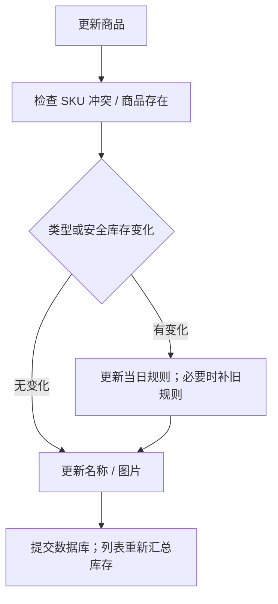

# 商品流程与规则历史

## 创建与图片

createProduct 使用 multipart 提交 sku、name、product_type、safe_stock_quantity 和可选 image。后端检查 SKU 唯一；图片按 UUID 和原扩展名写入 uploads，生成 /uploads 路径。随后验证规则、创建 Product、flush 取得 ID、写当日 ProductImpairmentRule 并 commit。

图片可能在规则校验或数据库提交前写入，失败不自动回滚文件。当前未完整限制图片 MIME、内容和大小。静态图片由 [main.py](../../../main.py) 公开挂载。

## 修改规则

同一天多次规则变化会更新同一个 effective_date；若旧商品没有历史且创建日在今天之前，先按商品创建日记录修改前规则，再建立当天新规则。后续跌价按规则时间段累计，已累计计提不因变为稳健/增加安全库存简单清零。

依据：[products.py](../../../routers/products.py) 的 update_product；[inventory_impairment.py](../../../services/inventory_impairment.py) 的 batch_impairments。商品日期使用 date.today，跨环境时区待核实。

## 查询、导出与删除

列表支持 SKU/名称模糊搜索，库存数量和价值由批次聚合；选项接口只取轻量商品信息。页面分页和跨页复选保存状态仅在浏览器内。导出带 product_ids 时导出选择记录；未传则导出全部商品，后端导出没有 keyword 参数，页面按当前查询得到 ID 实现筛选导出。

更新图片先删除旧文件再写新文件；删除商品在平台映射检查后先删文件，再删除 ORM 记录并提交。其他历史引用可能让提交失败，删除前需同时审查文件/表关联。依据：[products.py](../../../routers/products.py) 的 export_products、update_product、delete_product。
