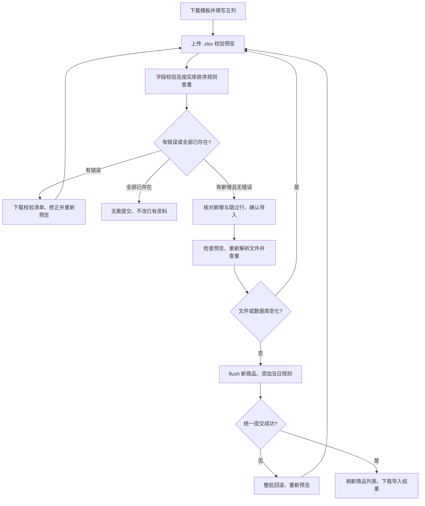
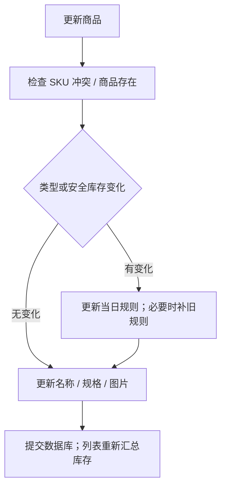

# 商品流程与规则历史

## 创建与图片

openNewProduct/openEditProduct 打开共用侧栏，saveProduct 使用 multipart 提交 sku、name、specification、product_type、safe_stock_quantity 和可选 image。规格录入使用可接收换行的 textarea，避免浏览器单行 input 在回显或粘贴时拼接词语；保存前将换行统一转为空格，后端及 Excel 导入复用同一规则，原文含 XML 非法字符则拒绝。后端先校验必填规格，再检查 SKU、校验商品规则，再有界读取图片；允许 JPEG/PNG/GIF/WebP 扩展名，且必须能实际解码为这些格式。原文件最多5 MiB、像素总数最多2000万，重新编码后最多10 MiB。JPEG统一保存为UUID文件名的.jpg，其余转为.png；移除元数据和尾随内容，GIF/WebP仅保留首帧。随后创建 Product、flush 取得 ID、写当日 ProductImpairmentRule 并 commit。

图片写入失败或数据库提交异常时，只清理本次新建文件。更新图片保留旧文件，避免事务失败破坏已有图片引用；历史文件清理需要另行核对引用和授权。静态图片仍公开访问，但只允许图片扩展名，历史HTML/SVG也返回404；强制图片MIME，并添加nosniff和sandbox CSP，隔离历史伪装图片的活动内容。依据：[product_images.py](../../../services/product_images.py) 的 normalize_product_image、read_product_image、ProductImageFiles；[products.py](../../../routers/products.py) 的 _save_product_image、create_product、update_product；[main.py](../../../main.py) 的 /uploads 挂载。

## 商品 Excel 批量新增

入口为商品列表工具栏“批量导入”；`openProductImport` 打开原生 dialog，`previewProductImport` 上传文件，`confirmProductImport` 确认，`downloadProductImportResult` 下载校验或导入清单。商品列表、图册及商品下拉框显示 SKU/名称时做 HTML 转义。前端依据：[templates/index.html](../../../templates/index.html)；服务依据：[product_import.py](../../../services/product_import.py)。

五列为SKU、商品名称、规格/型号、商品类型、安全库存；表头首行，优先读“商品导入”工作表，兼容“商品数据”或首张表。SKU/名称需非空文本，去首尾空白后长度分别不超过64/255；规格选填，填写时不超过255字符；规格在长度校验前将 CRLF/CR/LF 及 Unicode 行/段分隔符转为空格。规格列兼容“规格”“型号”“specification”表头；兼容没有规格列的旧四列文件，空规格按NULL保存，预览和结果清单留空；已有SKU仍只跳过、不更新。非文本规格、超长或非法字符仍返回字段校验错误。商品类型必填，模板仅列“稳健商品”/stable、“新品”/new、“不跌价商品”/no_impairment三种。安全库存留空为0，须为0–2147483647整数，仅稳健商品可填正数，新品/不跌价商品须为0。旧safe_stock/“安全库存商品”规范为stable并保留数量，旧“不计跌价商品”标签兼容no_impairment。模板示例在“填写说明”，商品导出与导入结果共用类型标签映射。

空数据行不计入 2,000 条上限，隐藏行仍读取；原始行号用于定位错误，超过 10,001 个物理行提示整理空白间隔。五个导入列中的公式和 Excel 错误单元格不接受；额外列（图片、库存、金额、日期、商品 ID 等）忽略，不能将商品导出文件中的库存当作入库。数字单元格 SKU 作为错误，不能凭格式猜测已丢失的前导零。宏、XML 实体声明、损坏/加密文件和解压后超过 20 MB 的文件拒绝；不保存上传文件。

`preview_product_import` 只读 `products` 和列排序规则，不写商品、规则或快照；按实际 `products.sku` 的 MySQL 排序规则判断文件内重复及已存在 SKU，大小写/重音行为不由 Python 字符串近似。有效且无错误的预览绑定用户、原文件摘要及预览结果，15 分钟内可确认；数据已变化、文件替换或预览过期均需重新预览。已有行即使被跳过，也需先通过字段校验。

`confirm_product_import` 只新增 Product，flush 取得 ID，写当日 ProductImpairmentRule，并一次 commit。数据库唯一键仍兜底并发冲突，失败 rollback 两张表；已有商品、图片、规则历史、批次及销售不修改。原生页面提交期间禁止再次提交/关闭，成功后刷新列表；超时或异常后重新预览，可识别已提交的 SKU，避免重复新增。

不建立商品导入批次表或持久化预览记录；下载的结果由页面当前清单生成，含原始行号、状态、商品 ID 和错误，不能替代服务端审计台账。导入结果文本以及现有商品导出的 SKU/名称/规格强制文本输出，保留前导零并防止以“=”开头的名称变成公式。已有异常规格或校验结果含 Excel/XML 不支持字符时，`specification_export_text` 按原位置输出 `[U+XXXX]` 并附说明批注，其他商品正常导出；数据库及传入结果行保持原值，不批量清洗历史数据。真实事务验证见[mysql_product_import.py](../../../tests/mysql_product_import.py)，字段/接口测试见[test_product_import.py](../../../tests/test_product_import.py)。

## 修改规则

同一天多次规则变化更新同一个effective_date；旧商品无历史且创建日在今天之前时，先按创建日记录修改前规则，再建立当天新规则。类型与安全库存分别保存规则；旧safe_stock显示为稳健商品并回显原安全库存，不批量改写历史。增加安全库存或停止计提只影响后续新增，保留已累计准备；恢复计提不补提停止期间。只有稳健商品扣除安全库存，新品仍按全部库存0.5%，不跌价商品停止新增。

依据：[products.py](../../../routers/products.py) 的 update_product。现行报表由[inventory_provision_movements.py](../../../services/inventory_provision_movements.py)的 replay_inventory_provisions 使用规则历史；[inventory_impairment.py](../../../services/inventory_impairment.py) 的 batch_impairments 保留于快照等历史算法路径。商品日期使用 date.today，跨环境时区待核实。

## 查询、导出与删除

列表和图册共用 loadProducts：商品工作台显式启用名称、SKU及规格搜索，服务端在分页前同时过滤列表和总数；页面已移除资料完整性下拉和相关查询状态，后端 completeness 参数保留兼容，旧调用默认仍按SKU/名称查询。分页、搜索、视图及跨页勾选仅保存在当前会话浏览器内，切换视图保留状态，退出清空。默认页面不展示库存数量、金额、最近入库或核算规则列，但商品查询响应继续保留原字段，库存数量和成本仍由批次聚合。

顶部导出菜单明确区分“导出所选商品”（跨页选择的ID，未选禁用，勾选一条即单个商品）和“导出全部商品”（无ID，不受搜索影响）；列表和图册不再提供行内导出或“更多”，删除直接显示并沿用原确认提示。原导出表头、图片、规格、商品类型、安全库存、库存及日期列继续保留，Excel导入五列、别名、预览确认和历史SKU跳过规则不变。后端导出没有 keyword 参数，不提供隐式“当前搜索结果导出”。

统一搜索复用[ProductSearch.bind](../../../static/product-search.js)：商品工作台通过可选queryParams启用规格搜索，库存/销售等旧调用不受影响。回车或候选点击回到第一页，完整SKU优先；翻页和刷新保留条件，刷新会应用未提交的搜索输入，清空恢复全部资料。setProductView在列表/图册间切换，共用renderProductPage和选择状态。loadProducts以请求序号、用户和会话代次隔离过期响应；resetProductSession清除查询、选择、图册及编辑资料，旧401不能退出新会话。

侧栏保留历史空规格提示及必填校验，图片留空保留原图；保存期间禁止重复提交和关闭，失败保留录入，保存成功后的刷新失败单独提示。旧会话的保存结果不能关闭新侧栏或覆盖新草稿。openProductInventory调用InventoryWorkspace.openProduct，以product_id进入库存总览并清除旧库存关键词，库存导出也沿用这个精确范围；原角色和共享库存规则保持。整合不新增数据表、迁移或依赖，不回填历史资料。

更新图片保留旧文件；删除商品先检查盘点、平台映射等引用，数据库提交成功后才清理图片。已有盘点记录的商品拒绝删除；其他外键冲突返回409，图片保留。提交成功但图片清理失败返回明确warning，不把数据库已完成删除误报为未保存。依据：[products.py](../../../routers/products.py)的delete_product。
