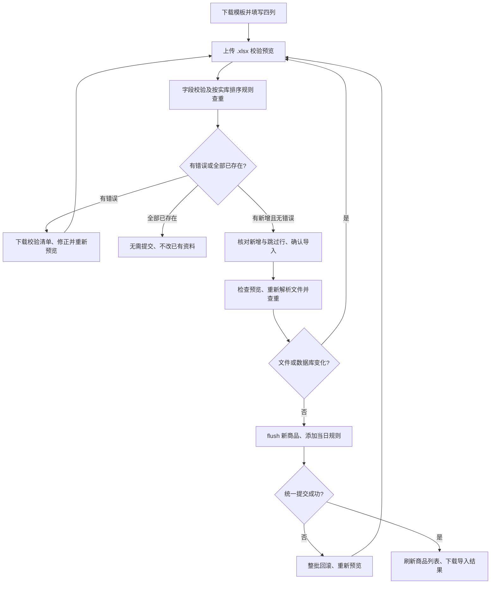
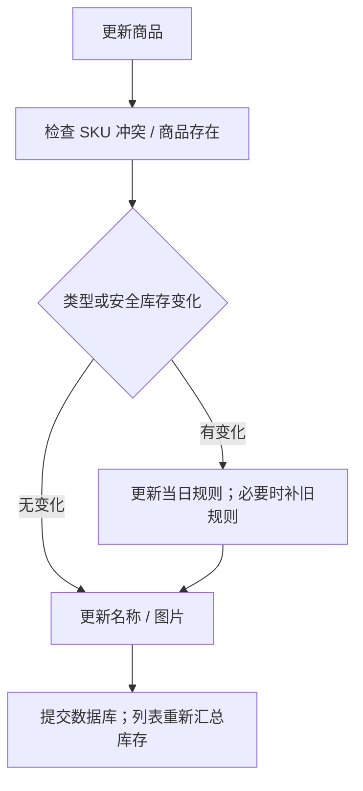

# 商品流程与规则历史

## 创建与图片

createProduct 使用 multipart 提交 sku、name、product_type、safe_stock_quantity 和可选 image。后端先检查 SKU、校验商品规则，再有界读取图片；允许 JPEG/PNG/GIF/WebP 扩展名，且必须能实际解码为这些格式。原文件最多5 MiB、像素总数最多2000万，重新编码后最多10 MiB。JPEG统一保存为UUID文件名的.jpg，其余转为.png；移除元数据和尾随内容，GIF/WebP仅保留首帧。随后创建 Product、flush 取得 ID、写当日 ProductImpairmentRule 并 commit。

图片写入失败或数据库提交异常时，只清理本次新建文件。更新图片保留旧文件，避免事务失败破坏已有图片引用；历史文件清理需要另行核对引用和授权。静态图片仍公开访问，但只允许图片扩展名，历史HTML/SVG也返回404；强制图片MIME，并添加nosniff和sandbox CSP，隔离历史伪装图片的活动内容。依据：[product_images.py](../../../services/product_images.py) 的 normalize_product_image、read_product_image、ProductImageFiles；[products.py](../../../routers/products.py) 的 _save_product_image、create_product、update_product；[main.py](../../../main.py) 的 /uploads 挂载。

## 商品 Excel 批量新增

入口为商品列表工具栏“批量导入”；`openProductImport` 打开原生 dialog，`previewProductImport` 上传文件，`confirmProductImport` 确认，`downloadProductImportResult` 下载校验或导入清单。商品列表、图册及商品下拉框显示 SKU/名称时做 HTML 转义。前端依据：[templates/index.html](../../../templates/index.html)；服务依据：[product_import.py](../../../services/product_import.py)。

四列为 SKU、商品名称、商品类型、安全库存；表头首行，优先读“商品导入”工作表，兼容“商品数据”或首张表。SKU/名称需非空文本，去首尾空白后长度分别不超过 64/255；商品类型必填，允许“新品”/new、“稳健商品”/stable。安全库存留空为 0，必须是 0–2147483647 整数，新品必须为 0。模板将 SKU/名称设为文本，类型有下拉项，示例放在“填写说明”而非数据表。

空数据行不计入 2,000 条上限，隐藏行仍读取；原始行号用于定位错误，超过 10,001 个物理行提示整理空白间隔。四个导入列中的公式和 Excel 错误单元格不接受；额外列（图片、库存、金额、日期、商品 ID 等）忽略，不能将商品导出文件中的库存当作入库。数字单元格 SKU 作为错误，不能凭格式猜测已丢失的前导零。宏、XML 实体声明、损坏/加密文件和解压后超过 20 MB 的文件拒绝；不保存上传文件。

`preview_product_import` 只读 `products` 和列排序规则，不写商品、规则或快照；按实际 `products.sku` 的 MySQL 排序规则判断文件内重复及已存在 SKU，大小写/重音行为不由 Python 字符串近似。有效且无错误的预览绑定用户、原文件摘要及预览结果，15 分钟内可确认；数据已变化、文件替换或预览过期均需重新预览。已有行即使被跳过，也需先通过字段校验。

`confirm_product_import` 只新增 Product，flush 取得 ID，写当日 ProductImpairmentRule，并一次 commit。数据库唯一键仍兜底并发冲突，失败 rollback 两张表；已有商品、图片、规则历史、批次及销售不修改。原生页面提交期间禁止再次提交/关闭，成功后刷新列表；超时或异常后重新预览，可识别已提交的 SKU，避免重复新增。

不建立商品导入批次表或持久化预览记录；下载的结果由页面当前清单生成，含原始行号、状态、商品 ID 和错误，不能替代服务端审计台账。导入结果文本以及现有商品导出的 SKU/名称强制文本输出，保留前导零并防止以“=”开头的名称变成公式。真实事务验证见[mysql_product_import.py](../../../tests/mysql_product_import.py)，字段/接口测试见[test_product_import.py](../../../tests/test_product_import.py)。

## 修改规则

同一天多次规则变化会更新同一个 effective_date；若旧商品没有历史且创建日在今天之前，先按商品创建日记录修改前规则，再建立当天新规则。后续跌价按规则时间段累计，已累计计提不因变为稳健/增加安全库存简单清零。

依据：[products.py](../../../routers/products.py) 的 update_product。现行报表由[inventory_provision_movements.py](../../../services/inventory_provision_movements.py)的 replay_inventory_provisions 使用规则历史；[inventory_impairment.py](../../../services/inventory_impairment.py) 的 batch_impairments 保留于快照等历史算法路径。商品日期使用 date.today，跨环境时区待核实。

## 查询、导出与删除

列表支持 SKU/名称模糊搜索，库存数量和价值由批次聚合；选项接口只取轻量商品信息。页面分页和跨页复选保存状态仅在浏览器内。导出带 product_ids 时导出选择记录；未传则导出全部商品，后端导出没有 keyword 参数，页面按当前查询得到 ID 实现筛选导出。

更新图片的旧文件保留策略见上文；删除商品仍在平台映射检查后先删文件，再删除 ORM 记录并提交。其他历史引用可能让删除提交失败，删除前需同时审查文件/表关联，本次图片上传修复没有改变删除商品的事务逻辑。依据：[products.py](../../../routers/products.py) 的 export_products、update_product、delete_product。
