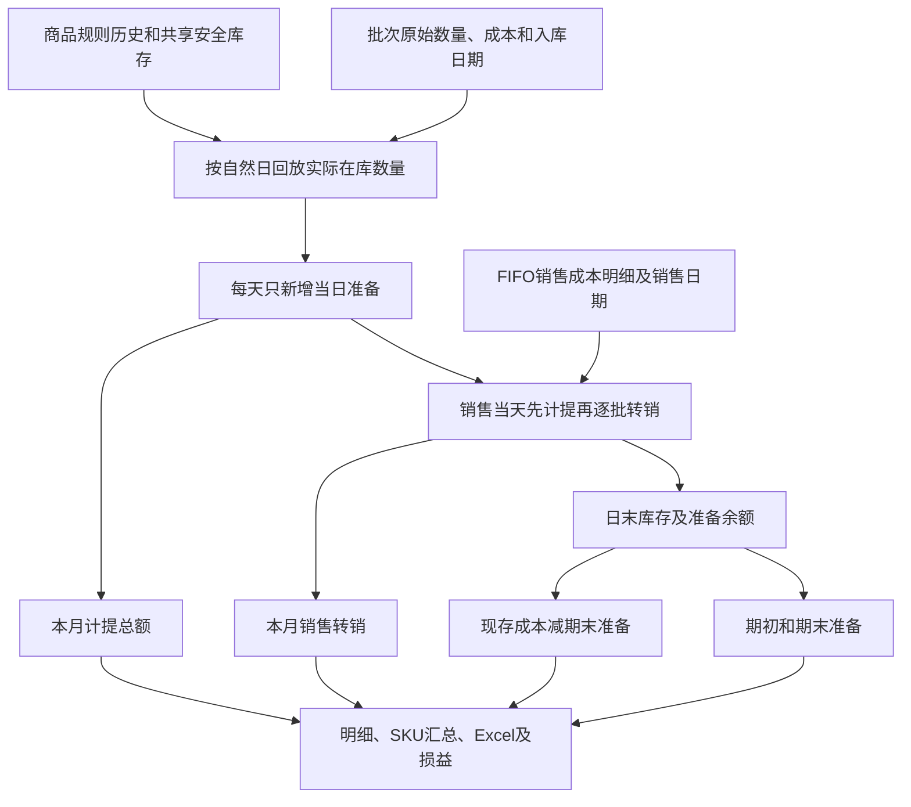

# 存货跌价明细：逐字段来源与准备余额

核实日期：2026-10-15。按用户追加确认，入库当天0天；销售当天先计提再转销。报表同时展示本月总计提、销售转销和期末准备；账面仍为现存库存成本减期末准备。旧逐日叠加完整余额及静态截止日回算均为历史版本，现行实现见[持有期间变更](../../development/2026-10-15-holding-period-impairment.md)。覆盖批次页面23列、SKU页面18列及API/Excel；生产更新与真实历史完整性待验证。

## 入口与数据范围

- 页面：报表 → 存货跌价明细，选择批次明细或按SKU汇总及截止日。
- 明细：`GET /reports/inventory-impairment?report_date=YYYY-MM-DD`。
- 汇总：`GET /reports/inventory-impairment/summary?report_date=YYYY-MM-DD`。
- 独立导出：`GET /reports/inventory-impairment/export`，`view=batch`默认，`view=sku`为汇总。
- 财务附件保留原顺序，末尾追加07存货SKU汇总；管理员五张，非管理员四张。
- 两种视图均包含截止日前全部已到货批次。售完批次保留入库/销售追溯列，期末准备、账面及现存库存本月计提为0，但本月计提总额及销售转销可能非0。
- 独立存货查询/导出为全局；财务附件管理员为全局，非管理员按绑定店铺过滤。归属来自批次创建人当前绑定，批次没有固化店铺。
- 截止包含当天全天，不包含次日00:00；后端拒绝未来日期。采用现有无时区数据库时间，跨环境时区一致性待验证。

依据：[reports.py](../../../routers/reports.py)的`_load_inventory_impairment_report_rows`及查询/导出函数；[运行模板](../../../templates/index.html)的`loadInventoryImpairment`。

## 取数链路



涉及七张表：inventory_batches、products、users、stores、sales、sale_cost_details、product_impairment_rules。查询一次读取必要事实，内存回放；同一请求会话按截止日复用结果。先全局分配同商品安全库存，再按既有店铺范围筛选输出；不读写或补建会计快照，无新增表字段或金额回填。


## 页面23列完整对照

`D`为截止日，`M`为D所在月1日，`P=M−1天`，`C`为批次保存单价，`Q0`为原始数量，`Q_D`为截止日剩余数量。

| 序号 | 页面字段 / API字段 | 原始来源与计算 | Excel列 |
| --- | --- | --- | --- |
| 1 | 店铺 / `store_name` | 批次user_id → users.store_id → stores.name；缺失显示未关联店铺，采用当前绑定。 | A |
| 2 | SKU编码 / `sku` | 批次product_id → products.sku；不是平台SKU。 | B |
| 3 | 商品名称 / `product_name` | products.name；改名影响历史展示。 | C |
| 4 | 批次号 / `batch_no` | inventory_batches.batch_no。 | T备注 |
| 5 | 入库日期 / `arrived_at` | inventory_batches.arrived_at的日期，不是created_at。 | D |
| 6 | 已入库天数 / `age_days` | max(0, D−入库日期)，入库当日为0。 | E |
| 7 | 单件到仓成本 / `unit_cost` | inventory_batches.unit_cost，DECIMAL(12,4)，含采购、头程、尾程及其他成本。 | F |
| 8 | 原始入库数量 / `original_quantity` | inventory_batches.quantity；销售不减该字段，未消耗批次允许编辑。 | G |
| 9 | 原始入库成本金额 / `original_inventory_amount` | Q0×C；不是仅采购金额total_amount。 | H |
| 10 | 累计销售出库数量 / `sold_quantity` | 按batch_id连接销售，SUM(sale_cost_details.quantity)，sales.sold_at小于D次日00:00。 | I |
| 11 | 累计销售出库成本 / `sold_cost_amount` | 同条件SUM(明细quantity×明细保存unit_cost)，不用后来批次价格重算。 | J |
| 12 | 现存库存数量 / `quantity` | max(0, Q0−截至D销售出库数量)，不直接取实时remaining_quantity。 | K |
| 13 | 期末计提数量 / `provision_quantity` | 回放后累计比例大于0的现存整数数量层之和；历史规则可使安全库存内部分保留准备；异常时为空。 | L |
| 14 | 现存库存成本金额 / `inventory_amount` | C×Q_D，是账面价值的成本基数。 | M |
| 15 | 累计跌价比例 / `impairment_rate` | Σ(q_j×r_j)÷期末计提数量；分母0时0，各部分比例最多90%。 | N |
| 16 | 期末累计跌价准备 / `impairment_amount` | C×Σ(q_j×r_j)，即C×期末计提数量×累计比例；只计算截止日余额。 | O |
| 17 | 本月计提（现存库存） / `monthly_impairment_amount` | 回放后仍在库的数量层在本月增加的比例金额；已售部分的本月增提不留在此列。 | R |
| 18 | 期初跌价准备余额 / `opening_impairment_amount` | 上月末回放所得准备余额；本月新批为0，异常时为空。 | U |
| 19 | 本月计提总额 / `monthly_total_impairment_amount` | 本月每天实际新增准备之和，包含已售部分售出前的增提。 | V |
| 20 | 本月销售转销 / `monthly_writeoff_amount` | 本月销售明细对应的全部准备，可能含前月准备；未知时为空。 | W |
| 21 | 账面价值 / `book_value` | C×Q_D−期末累计跌价准备；已售商品成本不包含在现存成本中。 | P |
| 22 | 与上月末账面价值差额 / `book_value_difference` | 本期账面价值−按上月末数量及同一余额算法重算的上月账面价值，含销售/新入库影响。 | Q |
| 23 | 状态 / `status` | 关键准备金额未知时为历史流水待核对；其次库存0为已售完；计提数量0为安全库存内；比例≥90%为达到上限，≥60%为接近上限，其余正常。 | S |

API共24字段，额外`comparison_note`说明本月新增批次上月账面为0；正常历史批次为空。不因快照缺失留空，防御性比较未知时仍保留null。

依据：[reports.py](../../../routers/reports.py)、[持有期间回放](../../../services/inventory_provision_movements.py)的`replay_inventory_provisions`；[原规则模块](../../../services/inventory_impairment.py)提供日增率、类型及90%上限及[models.py](../../../models.py)。

## 准备余额、本月总计提与销售转销

```text
每日新增准备 = 当天参与计提的实际整数数量层 × 批次单价 × 当天新增比例
期初准备 + 本月计提总额 − 本月销售转销 = 期末准备
账面价值 = 截止日剩余数量 × 批次单价 − 期末准备
```

入库当天0天；同一天先加入当日入库批次、应用生效规则并计提，再按sold_at、sale_id、明细id排序处理销售。销售日期用sales.sold_at，不用上传或结算日期；该规则按自然日计算，不按小时计提。

新品每日增加0.5%，全部在库数量参与；稳健每日增加1%，先保护同商品最新批次及批内靠后的数量层。各层累计比例最多90%，达到上限后新增为0；已形成准备在受保护时保留。销售按照已保存的FIFO批次明细，批内从较早整数数量层开始扣减并转出对应准备，不使用小数件数或重新分配历史FIFO。

规则按effective_date使用当时设置；旧天数不因后来新到货而补算。缺失规则用当前配置推定，首条已知规则晚于入库时向前推定，备注说明待核对。历史保护变化会使回放结果与旧的静态截止日回算不同；旧快照不覆盖。

本月总计提是本月每日新增准备的合计；现存库存本月计提仅保留月底仍在库层的本月新增部分。销售转销包含已售层此前形成的全部准备，可能跨月，不能把“现存本月计提+本月转销”当作本月总计提。

销售早于批次入库或超数量扣减时，相关准备返回null、状态和备注提示待核对；共享安全库存时影响可能传播同商品相关批次，普通新品的其他独立批次保持计算。单价来源不一致保留两种真实成本并提示，不改写历史数据。


## 上月比较

上月末数量和准备取同一回放服务的上月末日末状态；上月账面为该日剩余成本减准备，本月新批上月为0。差额为本期账面减上月账面，包含销售/入库影响，不能代替本月计提。

后续补录、撤销、成本/规则或店铺绑定变更会影响动态重算，报表不是冻结凭证。读取不依赖原inventory_period_snapshots，也不触发补建；自动快照仍保留原算法，见[流程](workflow.md#自动月末快照与比较值)。


## SKU汇总与成本核对

按product_id汇总18个显示列和19个API/Excel字段，只加批次数、数量、金额，不加单价/库龄/比例。后续同物料到货独立成批，保留各自单价和日期。

流水完整、无超扣且FIFO保存单价与批次单价一致时：`原始入库成本−累计销售成本=现存库存成本`；此时也可写`账面=原始成本−销售成本−期末准备`。保存成本与批次价不同的历史数据保留两种真实来源，账面仍按现存数量×批次价减准备，不改写销售成本以制造相等。

两种视图纳入相同批次；售完批次仍有追溯成本，期末准备/账面为0。任一准备/数量/比较值未知时，对应SKU及全表该列合计留空，不以0代替，不显示不完整总计。

## Excel与显示

批次页面/Excel均23列：Excel批次号在T备注，R为现存本月计提，U/V/W分别为期初准备/本月总计提/销售转销；保留旧列位置。SKU页面18列，Excel另有P比较说明，共19列，新三项在Q/R/S。

```text
E = 固定报告DATE值 − D入库日期（不用TODAY）
H = F单价 × G原始数量
M = F单价 × K现存数量
P = M现存库存成本 − O期末累计跌价准备
```

O准备、R现存本月计提、U/V/W三项变动及比较值写后端计算值；手工修改Excel源列不会重建规则及库存历史。公式缓存与API一致，未知准备和不完整合计留空。金额/比例显示两位，显示值手工求和可能有尾差。店铺、SKU、名称、状态、备注按字面文本写，避免被解释成公式；仅数量/金额合计，空数据可加总列为0。

## 财务验收例子

新品2026-08-21入库100件、单价10元，已售40件，9月30日剩60件，库龄40天：

```text
累计比例 = 40 × 0.5% = 20%
原始成本 = 100 × 10 = 1,000
累计销售成本 = 40 × 10 = 400（明细保存单价一致时）
现存成本 = 60 × 10 = 600
期末累计准备 = 600 × 20% = 120
账面价值 = 600 − 120 = 480
```

若40件全部在8月卖出，8月31日剩60件、比例5%，上月准备30、账面570；9月现存库存新增比例15%，本月计提90，账面差额−90。若40件改在9月卖出，上月剩100件、账面950，本期账面仍480，差额−470，但本月现存计提仍90。

再入库B批100件、单价15元，9月20日到货且未售：9月30日库龄10天、比例5%，成本1,500、准备75、账面1,425；两批汇总现存成本2,100、准备195、账面1,905。旧批成本和库龄不重置。


追加持有期间验收：2026-08-31入库100件×10元，9月10日（满10天）售10件，9月20日（满20天）售30件，9月30日满30天：本月计提125、转销35、期末准备90、账面510。若9月1日入库、仍在满10/20天时销售，9月30日满29天：总计提122、转销35、期末准备87、账面513。

跨月例子：期初持有20天、准备100；本月满25天时售40件，截止满30天，期末准备90、本月总计提40、销售转销50；现存库存本月计提只有30。说明转销可能包含期初准备。

## 历史数据与空列排查

上述金额动态重算，无需数据库迁移或回填。异常金额留空时，先查状态/比较说明及原始销售、入库日期，不应直接补0。页面出现undefined或“-”先核对后端版本；Python路由更新需重启后端并刷新页面，旧Excel须重新导出，见[运行手册](../../../PROJECT_RUNBOOK.md)。

“原始入库”仅指系统批次记录；只导入盘点期初库存不能自动恢复启用前真实采购/销售/规则。缺失销售明细时计算的销售为0不证明从未销售，须凭原始单据制定补录方案。

回归：[持有期间算法](../../../tests/test_inventory_provision_movements.py)、[报表及损益联动](../../../tests/test_provision_reporting.py)、[报表/API/成本/Excel](../../../tests/test_inventory_cost_summary.py)、[原快照规则](../../../tests/test_inventory_impairment_report.py)、[快照](../../../tests/test_accounting_period_snapshots.py)。最新决策及验证见[持有期间变更](../../development/2026-10-15-holding-period-impairment.md)。
