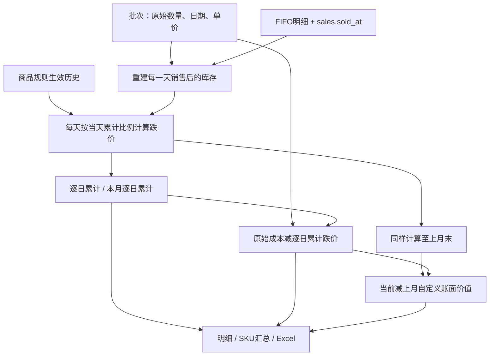

# 存货跌价明细：逐字段来源与财务自定义口径

核实日期：2026-10-12。本文依据当前源码，覆盖批次页面20列、SKU页面15列、API比较说明及两种Excel。用户在本次任务确认了逐日金额累计，以及原始入库成本减该累计金额；允许负值。该口径不替代自动快照和店铺损益中的准备余额。服务器是否部署及真实历史完整性待验证。

## 入口与数据范围

- 页面：报表 → 存货跌价明细，可选择批次明细或按SKU汇总及截止日。
- 明细：`GET /reports/inventory-impairment?report_date=YYYY-MM-DD`。
- 汇总：`GET /reports/inventory-impairment/summary?report_date=YYYY-MM-DD`。
- 独立导出：`GET /reports/inventory-impairment/export`，`view=batch`为默认，`view=sku`为汇总。
- 财务附件保留原顺序，末尾追加07存货SKU汇总；管理员五张，非管理员四张。
- 明细与汇总均包含截止日前全部入库批次，已售完旧批保留销售前累计金额；售完后不再新增。
- 独立存货查询/导出为全局；财务附件管理员为全局，非管理员按绑定店铺过滤。归属来自批次创建人当前绑定，不是批次固化店铺。
- 截止包含当天全天，不包含次日00:00；后端拒绝未来日期。时间采用现有无时区数据库时间，跨环境时区一致性待验证。

依据：[reports.py](../../../routers/reports.py) 的 `_load_inventory_impairment_report_rows`、查询/导出函数；[运行模板](../../../templates/index.html) 的 `loadInventoryImpairment`。

## 取数链路



涉及七张表：`inventory_batches`、`products`、`users`、`stores`、`sales`、`sale_cost_details`、`product_impairment_rules`。不读取/补建会计期间快照，不调用OA或汇率服务。数量和金额为动态计算字段，不新增数据库列。

## 页面20列完整对照

`D`为截止日，`M`为D所在月1日，`P=M−1天`，`C`为批次保存单价，`Q_t`为第t天销售后的数量。

| 序号 | 页面字段 / API字段 | 原始来源与计算 | Excel列 |
| --- | --- | --- | --- |
| 1 | 店铺 / `store_name` | 批次user_id → users.store_id → stores.name；缺失显示未关联店铺，采用当前绑定。 | A |
| 2 | SKU编码 / `sku` | 批次product_id → products.sku；不是平台SKU。 | B |
| 3 | 商品名称 / `product_name` | products.name；改名影响历史查询展示。 | C |
| 4 | 批次号 / `batch_no` | inventory_batches.batch_no，不重新生成。 | T备注 |
| 5 | 入库日期 / `arrived_at` | inventory_batches.arrived_at的日期，不是created_at。 | D |
| 6 | 已入库天数 / `age_days` | max(0, D−入库日期)，入库当日为0。 | E |
| 7 | 单件到仓成本 / `unit_cost` | inventory_batches.unit_cost，DECIMAL(12,4)，含采购、头程、尾程及其他成本。 | F |
| 8 | 原始入库数量 / `original_quantity` | inventory_batches.quantity；销售不减该字段，未消耗批次允许编辑。 | G |
| 9 | 原始入库成本金额 / `original_inventory_amount` | 原始入库数量×批次单价；不是仅采购金额total_amount。 | H |
| 10 | 累计销售出库数量 / `sold_quantity` | 按batch_id连接销售，SUM(sale_cost_details.quantity)，sold_at小于D次日00:00。 | I |
| 11 | 累计销售出库成本 / `sold_cost_amount` | 同条件SUM(明细quantity×明细保存unit_cost)，不用新批次价格重算。 | J |
| 12 | 现存库存数量 / `quantity` | max(0, 原始入库数量−截至D销售出库数量)，不直接取实时remaining_quantity。 | K |
| 13 | 当日计提数量 / `provision_quantity` | D当天余额算法中，累计比例大于0的现存数量之和；不表示历史每天计提数量合计。 | L |
| 14 | 现存库存成本金额 / `inventory_amount` | C×Q_D，用于核对库存成本，单列保留。 | M |
| 15 | 当日累计比例 / `impairment_rate` | D当天Σ(q_j×r_j)÷当日计提数量；分母0时0，各部分比例最多90%。 | N |
| 16 | 累计跌价（逐日累计） / `impairment_amount` | C×Σ_tΣ_j(q_tj×r_tj)，从入库次日至D逐日相加；历史已售商品售前金额保留，合计不封顶。 | O |
| 17 | 本月跌价（逐日累计） / `monthly_impairment_amount` | 同公式仅加总M至D各天金额，含本月已售商品售前金额，不是比例日增量。 | R |
| 18 | 账面价值 / `book_value` | 原始入库成本金额−逐日累计跌价；不再减出库成本，负值保留。 | P |
| 19 | 与上月末账面价值差额 / `book_value_difference` | 当前自定义账面价值−按相同每日口径重算的上月自定义账面价值。 | Q |
| 20 | 状态 / `status` | 库存0为已售完；当日计提数量0为安全库存内；当日比例≥90%为比例达到上限，≥60%为比例接近上限，否则正常计提。 | S |

API共21字段，额外的`comparison_note`作为差额提示：本月新增批次为“本月新增批次，上月自定义账面价值为0”，通常历史批次为空。正常流程从现有流水算出上月值，不因准备余额快照缺失而为空；防御性汇总和展示仍保留未知值，不把null补成0。

依据：[reports.py](../../../routers/reports.py) 的 `inventory_impairment_report`、`_load_inventory_impairment_report_rows`；[inventory_daily_impairment.py](../../../services/inventory_daily_impairment.py) 的 `daily_accumulated_impairments`；表定义为[models.py](../../../models.py)。

## 每日库存与累计公式

入库当日累计比例为0。每个自然日先扣当天所有已确认销售，再计算当天跌价；同日多笔销售按批次加总。

```text
Q_t = max(0, 原始入库数量 − SUM(销售日期≤t的本批FIFO明细数量))
当天跌价金额 A_t = C × batch_impairments(当天仍在库库存层, t).impairment_units
累计跌价 Y_D = SUM(A_t，入库次日≤t≤D)
本月跌价 = SUM(A_t，M≤t≤D)
自定义账面价值 = 原始入库数量×C − Y_D
```

无规则变化、安全库存影响的新品：`A_t=Q_t×C×min(库龄_t×0.5%,90%)`。90%限制每一天的累计比例，**不限制逐日金额合计**；达到90%后，只要仍有计提库存，后续每天仍按90%计算金额相加。账面价值不按0截断。

日期来自`sales.sold_at`，不是created_at、文件上传时间或结算日期；只存在待确认结算行且未形成销售/FIFO明细时不扣库存。撤销删除销售/成本明细会改变重算历史，批次.quantity或单价、规则历史变化也会改变结果，不能宣称冻结报表。

数据库一次按批次和销售日分组读取，不逐日查询数据库；服务在内存逐日计算，使用Decimal且不每天舍入，最后显示两位小数。不能用报告日库存代替过去每天库存。

## 当天累计比例、安全库存与规则历史

每天调用原有`batch_impairments`，这使新报表的“每日金额”与现有算法在该日的余额计算保持一致：新品日增0.5%，稳健日增1%；规则按effective_date分段；每部分累计比例最高90%。稳健商品安全库存在当天已到货且仍在库的同商品批次之间共享，优先保护最新入库批次；已有规则段累积比例保留。

单日算法按该日库存层回算规则段；它不保存逐件转销或安全库存保护变化的完整会计流水。新报表重建每天实际数量，但不另行定义逐件历史准备分配政策。若需要此类会计台账，需要另行确认。

规则记录缺失时沿用当前设置推定；第一条规则晚于最早入库时，沿用既有算法向前补用首条已知规则。真实历史规则不能凭空恢复，需核实。跨店查询范围会影响共享安全库存分配，当前权限范围不变。

依据：[inventory_impairment.py](../../../services/inventory_impairment.py) 的 `batch_impairments`、`_historical_batch_impairments`、`_safe_stock_protection`；[商品流程](../products/workflow.md)。

## 上月比较

上月截止为P；同一批次按每天销售后库存计算到P，得到`Y_P`。历史批次`previous_book_value=原始入库成本−Y_P`，本月新增批次上月基准为0。差额方向为当前减上月。

批次原始成本未变化且上月已入库时：`账面差额=−本月逐日累计跌价`。本月新增批次的差额还包含其原始成本，不应把全表差额直接当作本月跌价。

`previous_month_quantity`由P之前销售明细重建，Excel备注列展示。新口径不读取或补建`inventory_period_snapshots`，旧快照中的准备余额不能当作逐日累计金额。应用启动/后台快照仍按原服务运行，见[报表流程](workflow.md#自动月末快照与比较值)。

## SKU汇总与成本核对

按内部product_id分组，共15个显示列和16个接口/Excel字段。汇总只相加批次数、数量和金额，不合计单价、库龄、比例或状态；各批单价和日期独立，不用最新入库价重算旧批。

正常成本来源一致且无超扣时：`原始入库成本−累计销售成本=现存库存成本`。该成本核对式不等于自定义账面公式；历史FIFO保存单价不同于批次价时，保留两个真实来源，不能改写成本以制造相等。

明细与汇总的入库/出库数量、成本、累计跌价、本月跌价和自定义账面合计范围相同，已售完旧批也纳入。任一比较值意外未知时SKU及总差额留空，避免不完整加总。

## Excel与显示

批次页面20列，Excel不单列批次号而用T备注列；本月跌价Excel在R列。SKU页面15列，Excel另有P比较说明，共16列。

```text
E = 固定报告DATE值 − D入库日期（不用TODAY）
H = F单价 × G原始数量
M = F单价 × K现存数量
P = H原始入库成本 − O逐日累计跌价
```

其他金额、当日比例与状态由后端写数值或字面文本；逐日累计不能用O=F×L×N的单日公式替代。`_workbook_bytes_with_formula_cache`写公式结果缓存，保证初次打开可读负值与合计。金额显示两位、比例显示两位百分数，底层不等量舍入，手工加总显示值可能有尾差。

店铺、SKU、名称、状态和备注写字面文本，避免业务值以等号开头时被解释成公式。合计只加数量/金额；空数据可加总列为0，库龄、单价和比例留空。

依据：[reports.py](../../../routers/reports.py) 的两种工作簿构建函数及公式缓存。

## 财务验收例子

新品2026-08-21入库100件、单价10元，第1天卖10件、第2天卖10件，以后未售。2026-09-30库龄40天、当天累计比例20%。这是前两天总共卖20件的场景，不是已售40件。

```text
Y = 90×10×0.5% + SUM(80×10×(d×0.5%)，d=2..40)
  = 4.50 + 3,276.00 = 3,280.50
自定义账面价值 = 100×10 − 3,280.50 = −2,280.50
8月逐日累计 = 220.50，上月自定义账面 = 779.50
9月逐日累计 = 3,060.00，与上月差额 = −3,060.00
```

若再入库B批200件、单价12元，9月20日入库且未售：9月30日B批累计金额为`200×12×0.5%×SUM(1..10)=660`，账面为1740；与A批汇总成本3400、累计3940.50、账面−540.50。新批不影响旧批单价；稳健商品共享安全库存时新批可能改变随后每天保护分配。

## 历史数据与空列排查

原始入库/出库四列和新累计字段都由现有记录动态计算，不需新增表、迁移或回填报表金额。数量显示undefined或金额显示“-”时先核对后端版本；首页模板每次读磁盘，Python路由启动时载入，更新文件后需重启后端，见[运行手册](../../../PROJECT_RUNBOOK.md)。

原始入库仅指本系统批次记录；若只是把某日盘点库存作为期初批次导入，系统启用前的真实采购/销售/规则不能自动补出。销售成本明细不存在时系统记录的销售为0，这不是“历史从未销售”的证明。缺失原始数据须依据凭证制定补录方案，不能猜测。

回归入口：[逐日算法](../../../tests/test_inventory_daily_impairment.py)、[报表/API/成本/Excel](../../../tests/test_inventory_cost_summary.py)、[原余额算法](../../../tests/test_inventory_impairment_report.py)、[快照](../../../tests/test_accounting_period_snapshots.py)。历史环境记录与本次实际验证分别记录在[报表流程](workflow.md)和[运行手册](../../../PROJECT_RUNBOOK.md)。
