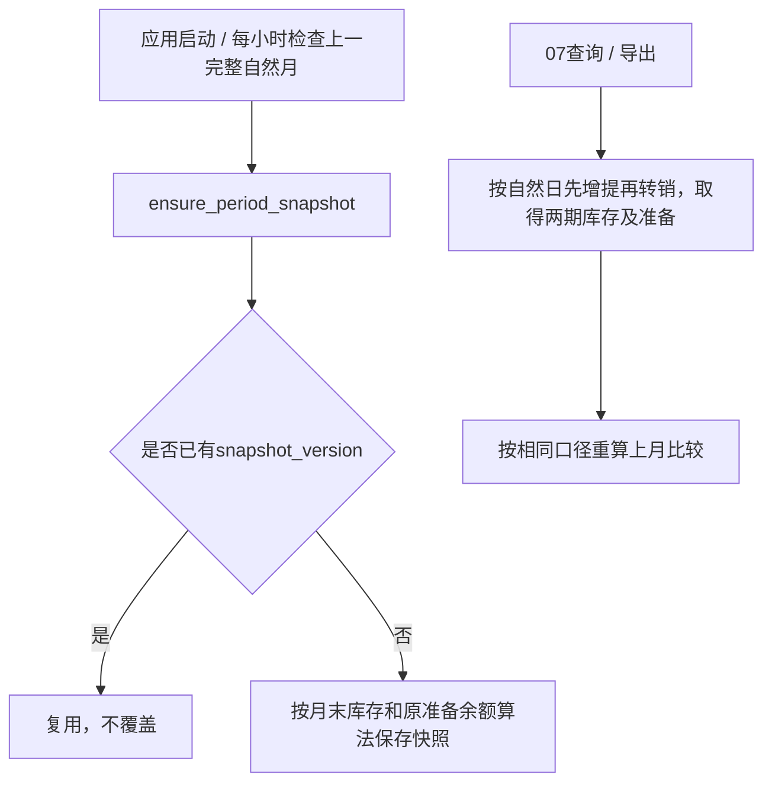

# 报表流程、公式与快照

2026-11-10分类修复：按店铺/平台SKU明确配置的non_inventory结算保留原金额、费用和币种，作为独立财务事件取数，排除实物履约计费。明确标记的opening_deduction不进入销量、采购/FIFO销售成本、产品线实际出库和履约订单；库存与准备使用扣减后的数量基线，原凭据及成本不改。07原入库−期初扣减−真实已售=现存，期初扣减写入comparison_note供核对。真正历史销售的缺失店铺/时序异常继续传播null；不能用初始化分类推断其归属。见[销售分类](../sales/workflow.md#非实物结算与初始化扣减2026-11-10)和[库存基线](../inventory/workflow.md#初始化历史扣减)。

2026-11-02确认的店铺损益口径：外币按各核算月月末当天或之前最近可用汇率换算，沿用Frankfurter/ECB，不改销售保存的逐日汇率。履约订单按店铺及原始订单ID去重（跨SKU/组合只计一次），每单8 MXN；退款、调整、赔付及待确认行不新增履约费。销售费用包含薪资、广告、样品、平台月费/年费、仓储、配送和平台罚款/赔偿。跌价计提/转销/归属算法保留。营业外收支及所得税标记暂未接入，净利润暂按营业利润计算；历史人工代发及预留金额保留且保存时不覆盖。人工费用按人民币录入。

本年累计按1月至核算月逐月事实汇总，各月各用自己的月末汇率；不再采用旧人工ytd覆盖累计。页面显示本月与本年累计（累计只读），API及Excel保留上月字段兼容；旧月度版本仅读原payload，无新样品行的旧版不补行或重算。取不到月末汇率或月份尚未结束时，受影响人民币金额和利润留空并警示，已知零不误报；查询无数据库写入。月度汇率、实际日期/来源及履约订单数随响应返回，新保存版本一并留档。实现：[月末汇率服务](../../../services/report_exchange_rates.py)、[报表路由](../../../routers/reports.py)；回归：[月度损益口径](../../../tests/test_monthly_profit_policy.py)。

履约去重先使用有效店铺（销售固定店铺优先，旧记录沿用用户绑定）；单店损益与产品线保持一致。旧三列CSV的来源order_id是SKU占位，按原保存的销售编号兼容计数，不能按SKU合并不同日期记录，也不反推平台真实订单数；文件类型从导入批次读取，兼容组件分摊和早期直接关联销售两种来源。产品线代发费按各店各月收入占比分摊后累计，不能改用全年收入比例重分；当月无收入时单列未分配代发成本并纳入累计。月度缺率或分摊收入不完整只影响对应月份及其累计，不扩散到未涉及的产品线。

## 手工店铺跌价归属

归属入口在库存页逐批维护。新入库待分配批次有显式空日规则，不沿用创建人店铺，仍计算全局跌价；待分配期间有非零或未知金额的增提/转销时，店铺损益相关准备/转销与衍生利润留空并警示。首次从入库日起分配可重算此前查询；从修改日起分配保留旧未分配期间的待核对，旧月度版本不覆盖。历史无日规则的绑定兼容保持不变。

批次可选单个或多个跌价归属店铺，仅用于均分，不限制销售或重分原FIFO成本。先全局回放一次，再按日生效归属分摊准备余额、期间增提和转销；无历史时沿用当前手工归属或创建人绑定，隐式跨店/缺失异常继续待核对。归属可从入库日历史更正，也可从北京时间修改日生效并单列剩余准备转移，规则及同日边界见[库存流程](../inventory/workflow.md#批次跌价归属)。旧月度版本和原快照不重写；自动快照仍是旧辅助口径。

服务[batch_store_allocations.py](../../../services/batch_store_allocations.py)在批次固定精度内按最小金额单位均分，余数按ID从末店依次分配，累计份额随总额单调增加；精度及分配规则统一见[库存流程](../inventory/workflow.md#批次跌价归属)。期间取累计分摊差，余额由段初转入准备加已分摊累计增提减转销取得，月度/YTD保持一致，不因分位跳动产生负计提或负准备。未知仍null。单店报表的数量是归属折算，注明非实际销量；全局不复制批次。07的现存成本使用相同精度分摊，账面=该店成本−该店准备；店铺损益使用同一分摊结果。产品线的显式均分转销单列“未分配产品线（跌价均分转销）”，包括未实际销售但承担该批跌价的店铺，不把全额抵减强行记到销售店铺，也不猜产品线。明细/汇总/附件/新版本共用动态结果，旧版本继续按原payload导出。

管理员或运营作废错误历史批次后，当前动态存货、准备计算和商品库存排除该批次原剩余数量；原销售与成本明细仍保留。单店损益对引用已作废批次的原销售月份将采购/物流/其他FIFO成本、存货跌价准备和销售转销跌价准备留空，相关利润随公式留空并给出待核对警示；产品线报告对应成本亦留空。销售前的历史持有月份也须核对存货跌价费用，不能因该月没有销售就填0，具体范围见下段。旧内部月末快照及人工保存月度版本不覆盖，作废后的当前计算可与旧版比较并另存待核对新版。销售列表保留历史成本但标记needs_review，不能把它当作重新分配后的正确成本。依据：[reports.py](../../../routers/reports.py)、[accounting_periods.py](../../../services/accounting_periods.py)、[financial_versions.py](../../../services/financial_versions.py)。

`_voided_inventory_holding_counts`用一次分组查询读取已作废批次保存的入库数量、日期、单位成本和销售明细，不改源数据。按归属日规则圈定各店有效期间，无历史才按当前手工归属或创建人当前绑定，从入库次日起至售完日（按保存的出库数量及最后销售日判断）或作废日的较早者，标记历史持有区间；部分出库、无销售持续至作废日。作废时间按UTC保存，边界转换为现有核算时区Asia/Shanghai的自然日，入库日仍为0天。本月、上月和年累计分别判断重叠：受影响期间仅存货跌价准备及衍生利润留空并追加warnings；销售转销继续按销售期间规则处理。入库前、售完后、作废后的新月份及其他归属店铺不因本批次持有记录被统一置空；累计期间若包含待核对月份仍留空。这里只圈定待核对区间，不将排除批次所得的0当作已确认的历史费用。 新增显式待分配日规则的作废批次即使不属于创建人绑定店铺，也进入核验；非零有效成本的待分配持有段可能影响任一店铺，对应期间准备、转销及利润保留未知。已分配段仍按实际归属圈定，不扩散到无关店铺或持有范围之外。有效成本包含已启用的财务补差；已知零成本不制造全店待核对。原有已分配/旧绑定作废处理保持兼容，不更改原数据或旧月度版本。

待分配的活动批次通过`has_unassigned_provision`按金额而非比例单位判断影响：已知零成本且比例单位已知时金额为0，不污染无关店铺损益；计提或转销单位未知仍为待核对，非零小额成本保留原精度，不以显示分位判断为0。

## 截止日库存与跌价准备

2026-10-15追加确认：入库当天0天，销售当天先计提再转销。现行07、09、10、12统一使用[持有期间回放](../../../services/inventory_provision_movements.py)，逐字段/公式见[字段说明](inventory-impairment-fields.md)，实施边界及验证见[变更记录](../../development/2026-10-15-holding-period-impairment.md)。

_load_inventory_provision_data一次读取批次、规则和逐笔FIFO明细，在内存按天回放；同一请求的数据库会话按截止日复用结果。先加入当日入库/规则，分配实际共享安全库存，只增加当日新比例，再按已保存批次明细转销。商品类型三选一：稳健商品仅超出安全库存部分每日1%，新品全部库存每日0.5%，不跌价商品不新增准备。每个整数数量层累计最多90%；旧`safe_stock`兼容为稳健商品，旧安全库存和保护语义保留，不批量改写历史。停止计提或提高安全库存只保护后续增提，已形成准备保留并随销售转销；恢复计提不补算停提期间。后到货不重置旧批日期或补算旧日保护。规则定义与类型标签复用[inventory_impairment.py](../../../services/inventory_impairment.py)，没有新增表、列、迁移或历史回填。

异常批次自身从异常销售日开始标记待核对；向同商品其他批次传播须按当天规则判断：仅当安全库存规则（含旧stable规则）保护数量为正，且原始异常批次按记录仍在库、异常已发生但尚未到记录入库日，或当日又发生异常销售时，才影响当天库龄大于0的其他在库批次。后来启用安全库存不倒改此前健康月份；原始异常批次售完后不预先污染后来入库批次，但若其又出现超量销售，异常当天仍须核对。因共享安全库存形成的准备未知继续保留，但它自身不成为新的数量异常源。相关空值仍不以0代替，见[持有期间回放](../../../services/inventory_provision_movements.py)的`replay_inventory_provisions`。

回放完成后，`ProvisionReplay`按批次和日期预汇总增提、转销，并建立金额前缀和及独立未知次数索引。任意左闭右开期间查询用日期二分定位，不对每个批次反复扫描全局流水；期间含未知金额或未知转销时仍返回null，其他期间不被污染。回放结果及原始事件列表构建后按只读方式复用。

期初+本月总计提−本月销售转销=期末准备；账面=现存成本−期末准备。保留现存库存本月计提以区分指标；售完期末余额为0，本月总计提/转销仍可能非0。按同一回放重建上月账面，不读写或补建快照。

全局计算共享安全库存后，按原店铺范围过滤输出；独立存货仍为全局，财务附件非管理员按绑定店铺。销售早于入库、超量出库等相关金额返回null；按列传播到SKU/合计。规则推定和保存成本不一致在备注说明，不能把估算当作完整历史。

批次日期更正后，如果报告截止日在新入库日前但该批次已有截止日前销售，07 明细仍保留该异常批次：当日现存数量按回放为 0，已保存销售数量与成本继续展示，销售转销等无法确认的金额为 null，并在备注标出日期待核对。没有截止日前销售的未来批次不进入该报表；按店铺查看时按期间生效归属筛选，无历史未指定才按创建人绑定。依据：[reports.py](../../../routers/reports.py) 的 `_load_inventory_provision_data`、`_load_inventory_impairment_report_rows`。

## 页面与Excel字段名称

存货页面/Excel使用“期末累计跌价准备”“本月计提（现存库存）”“账面价值”；计提数量及累计比例描述截止日余额。Excel P列公式为M现存成本减O期末准备，公式结果缓存与API一致。原始入库和销售成本列用于核对。

不计跌价商品在明细API/Excel的状态为“不计跌价”；若仍有历史准备，为“停止新增计提（保留历史准备）”。状态使用截止日实际生效类型，不能以当前商品字段倒改更早报告的状态；异常待核对、已售完状态仍优先。依据：`ProvisionReplay.product_types`、`_load_inventory_impairment_report_rows`及`_inventory_status`。

期末准备、本月总计提、本月销售转销或准备转入/转出任一金额为null时，批次状态优先显示“历史流水待核对”，即使归属折算余量为0也不显示“已售完”。旧隐式归属存在跨店销售、后续才指定归属时，销售转销仍可未知，不能因期末准备已知而显示“正常计提”；单店财务附件沿用同一状态及转销空值。已确认的0元转销保持正常状态判断，不视为未知。依据：[reports.py](../../../routers/reports.py)的`_inventory_status`。

表头由[reports.py](../../../routers/reports.py)的`INVENTORY_IMPAIRMENT_HEADERS`和`INVENTORY_IMPAIRMENT_SUMMARY_COLUMNS`维护，同步更新[运行模板](../../../templates/index.html)和[副本](../../../index.html)，保留其原有非本功能差异。批次页面单列批次号，Excel放备注；批次页面/Excel25列；SKU页面20列，Excel21列含比较说明；期初、本月总计提、转销及准备转入/转出已增加。

其他报表命名仍来自`STORE_PROFIT_LOSS_ROWS`、产品线构建函数；单店页面展示本月与本年累计，Excel/API还保留上月，不能将不同期间混为同一列。页面通过`calculation_policy=month_end_fx_mxn8_v1`识别新口径，后端尚未更新时提示并禁用保存，避免混用旧计算结果。

## 自动月末快照与比较值

快照按Asia/Shanghai生成，使用现存库存成本减现存准备余额；没有人工结账或公开会计期间接口，已有快照不覆盖。07表现在不读取该快照，也不会因缺少上月快照触发补建；原先的“缺少上月快照”排查适用于旧版本报表。

应用启动仍有建表、兼容迁移、历史修复、用户初始化和快照检查，不能当纯只读。已保存快照不覆盖，07动态重算可能因补录/撤销或规则变化与旧快照不同，不能直接替换上月比较值。

此前68行、2026-10-12逐日累计及2026-10-15早期静态余额验证属于历史记录，见[运行手册](../../../PROJECT_RUNBOOK.md)。现行回归入口覆盖持有期间增提/转销、异常传播、成本勾稽及快照兼容，见[代码映射](code-map.md)；实现记录见[持有期间决策](../../development/2026-10-15-holding-period-impairment.md)和[后续一致性修复](../../development/2026-10-16-project-safety-fixes.md)。真实历史完整性与服务器发布仍待核实，不将历史运行结果当作当前验证。

依据：[accounting_periods.py](../../../services/accounting_periods.py)、[main.py](../../../main.py)、[reports.py](../../../routers/reports.py)。

## 店铺损益及期间

独立结算调整由[financial_facts.py](../../../services/financial_facts.py)的unlinked_settlement_events读取：排除直接/组件已关联出库的结算、排除待确认的普通正数量订单，纳入退款、赔付等不出库事件。按结算日期→订单日期→导入日期归月；导入日期兜底时提示核对，原销售仍按sold_at。普通记录沿用净商品额及差额费用，物流/平台/物料赔付按结算总金额及固化汇率计入店铺收入，费用为0，负数赔付冲减收入；不恢复库存或冲改原FIFO成本。销售月度/列表、09/10/12及Excel共享同一来源，未确定组合份额归产品线未分配组。原始结算及不可变月度版本保留，不批量改写历史数据。

_month_periods 定义 current（本月）、previous（上月）、ytd（当年1月到本月末），均采用左闭右开区间；report_month 必须该月第一天。自动项与来源：

| 项目 | 实际来源/算法 |
| --- | --- |
| 商品销售收入 | 通过 _sale_import_context 还原净商品收入并乘固化汇率；手工销售以CNY处理 |
| 商品采购成本 | 按原批次 purchase_price 计算权重，从该笔已保存FIFO成本中分配 |
| 头程尾程物流成本 | 按批次 shipping_cost+last_mile_cost 及原始数量计算权重，从该笔已保存FIFO成本中分配 |
| 入库其他成本 | 按批次 other_cost 及原始数量计算权重，从该笔已保存FIFO成本中分配，按销售日计入期间 |
| 其他直接成本 | 销售来源其他费用/平台费按汇率换算 |
| 存货跌价准备 | 对应期间每天实际新增准备合计 |
| 销售转销跌价准备 | 已售商品对应准备抵减营业成本，不改保存的FIFO成本 |
| 房租+水电+网费 | OA 指定部门租金/电费，按当前启用店铺数均分 |
| 分摊人事财务 | 默认按审批费用所属年月、明细店铺取同名组件原金额；本店本月已保存人工值优先，覆盖而非叠加 |
| 人员薪资 | OA 部门名精确匹配店铺名；已保存人工值优先 |

批次数量/成本经历史编辑更正后，原FIFO单价不改写；_fifo_cost_components通过base_cost_components读取cost_basis冻结的原构成，再叠加各类差额。不能改用当前数量和最近目标费用重新分配旧FIFO成本，否则会重复或错配成本。当前查询追溯原销售月，旧FinancialReportVersion.payload保持原值；规则及结构前提见[库存流程](../inventory/workflow.md#编辑与删除)。

关税、本地物流、代发、运费/其他收入、广告、税费等人工项按报表JSON保存；自动项与公式项不允许通过manual_values覆盖，不支持的键被忽略。PUT默认update_scope=all，仍完整替换manual_values/remarks；页面显式使用current，仅替换本月人工列并在metadata标记monthly。原比较值保留存储；读取时上月取上月记录的current，年累计按当年各月current汇总，OA薪资按月缺省/覆盖后汇总。旧all模式显式比较值保持兼容，缺失比较值才推导，未提交本月项清空为null。已有报表行锁保护读取及合并；响应同时提供最终计算值value和实际保存的manual_value，页面只用后者填入输入框，OA默认薪资显示为占位值，留空提交null并继续随OA重算。备注始终完整替换；空人工薪资可以回落到OA默认。UI只编辑本月列，API/Excel仍含三个期间，具体契约见[损益API](api.md#损益保存契约)。

页面加载时清空旧报表并禁用保存；仅最新请求且店铺/月与控件一致的响应可展示。保存绑定已加载报表的店铺和月份，禁止重复提交；保存中切换条件会等待其结束再查询，旧保存成功响应不会覆盖新选择，保存失败始终提示原月份，避免未保存的修改静默丢失。会话过期使待处理报表请求失效。依据：[运行模板](../../../templates/index.html) 的 loadStoreProfitLoss、saveStoreProfitLoss、resetStoreProfitLossState；[页面模拟检查](../../../tests/profit_loss_page_checks.cjs)同时覆盖根目录副本。

店铺损益期间跌价费用取总计提，营业成本减销售转销；本月、上月、年累计分别汇总。跨店或缺失店铺归属且有非零转销、或历史时序异常时，不猜测归属：受影响准备/转销及衍生利润留空，通过API warnings、页面提示和Excel备注说明。其他可确定的收入及原始成本仍展示。普通空人工科目依旧按原约定参与计算，不能把待核对的自动金额当0。

损益页固定核算说明通过标题旁问号查看；汇率月份、币种、数值、实际日期及来源放在默认收起的“查看汇率明细”中，空列表不显示入口。店铺/月及上次保存时间独立展示；待核对警示在表前保持可见，仅合并内容完全相同的期间提示并保留各期间，未知提示原文保留并转义。汇率缺失仍显示行内警示，不因折叠明细隐藏；旧后端口径不兼容提示也继续行内展示并禁止保存。查询条件变更、加载失败和认证重置清理旧报表状态、警示与汇率。实现位于两份首页的`clearProfitLossContext/compactProfitLossWarnings/renderStoreProfitLoss`及[PageInteractions](../../../static/page-interactions.js)，没有修改金额计算、后端/API或Excel口径。

1月读取上年12月销售/费用以覆盖上月比较，不把仅查询当年数据所得的空成本与上月转销相减。OA读取区间同步覆盖所有核算期间。产品线按相同销售成本明细扣除已确认转销，归属不明时该期间成本及毛利/汇总留空。

营业收入 = 商品+运费+其他收入；营业成本 = 采购+头尾程+入库其他成本+关税+本地物流+代发+其他直接；营业成本再减已确认销售转销；毛利 = 收入−成本；毛利率 = 毛利÷收入（收入0时空）。营业利润从毛利依次扣税金、销售/管理/研发/财务费用、资产和信用减值，净利润再加减营业外收支与所得税。

2026-10-16起，批次other_cost以“入库其他成本”自动项纳入09、10、12，原销售FIFO成本不改写。每条销售明细先取已保存的数量×单件成本作为总额，再按批次采购、物流、其他三部分原始金额比例拆分；最后一个非零科目承接除法尾差，使三项之和等于保存的FIFO成本。原始三项全为0但保存成本非0的异常历史暂归采购成本，需财务核对。例如100件×采购单价10元、整批其他成本1000元，售10件：采购100元+入库其他100元=成本200元。产品线直接按同一已保存明细成本汇总。此项与销售侧“其他直接成本”独立；如果历史上将同笔入库费用人工填入关税/物流/代发等科目，应由财务核对重复，不自动清空历史人工值。缺失/无效历史汇率时，对应期间自动收入、销售费用、相关利润及Excel合计留空并提示；已保存的人民币FIFO成本可继续核对。产品线的未知收入/费用同样传播，不能显示部分数据计算的毛利。实际历史费用分类、跨表勾稽及缺失数据影响仍待财务核验。

依据：[reports.py](../../../routers/reports.py) 的 STORE_PROFIT_LOSS_ROWS、_store_profit_loss_auto_values、_build_store_profit_loss_values、update_store_profit_loss。

## OA 来源

人员薪资的业务核对口径为本月工资＋上月提成/绩效，例如11月编制10月报表仍选择10月，已包含在工资金额中的提成不重复加。页面问号及输入提示说明该口径；OA现有归月解析不等于实际发薪日识别，提成缺少明确计入月份时仍回落申请月，历史差异由财务按确认后的本月薪资总额覆盖，不自动把所有工资审批月份前移。

`salary`和`shared_admin`均支持本店本月人工覆盖：留空/清空保存为null，继续取OA；填写0也视为明确覆盖；填写的是总额，不能只填写与OA的差额。平摊费用按费用所属月份填写，管理费用合计仍为房租水电网费＋平摊人事财务费。公司级工资审批只有汇总部门时，不自动映射或复制工资到店铺，财务依据历史分配数据分别录入。手填不修改OA归档，也不硬编码特定店铺或金额。

两项费用都提供OA逐月默认值；年累计逐月取已保存current，未填的月份回落各自OA金额，上月按对应月事实计算。页面、单店Excel和跨店汇总使用同一结果。保存沿用既有权限和行锁，使用现有manual_values JSON，无结构迁移。代码入口为[reports.py](../../../routers/reports.py)的`STORE_PROFIT_LOSS_OA_DEFAULT_KEYS`、`_store_profit_loss_auto_values`、`_store_profit_loss_response`及[financial_facts.py](../../../services/financial_facts.py)的`manual_period_values`。

OA 只读取未删除、指定流程、COMPLETED、结果同意的 ding_approval_instance。办公费用按表单申请日期筛选并按指定部门取数。薪资按明细店铺取数，PostgreSQL 直连按申请日期归月。OA HTTP 汇总优先按工资审批的「费用所属月份」归月，其次识别「事项说明」中明确关联工资的完整年月，如「2026年10月薪资」。只有参考月份时仍按申请日期归月。明确注明的月份无效或冲突且可能涉及查询期间时提示待核对。

分摊管理费用先读取含同名金额组件的有效审批，再按费用所属年月归期，因此晚提交或次年申请的审批也能进入原费用月。优先读取表单的「费用所属月份」，支持年月、ISO 日期或形如「2026年10月」的值。该字段空缺时，从「事项说明」识别唯一的完整中文年月。OA HTTP 汇总对工资单上的平摊费用使用该单注明的工资所属月。同一审批内各明细部门去重，名称匹配的店铺各计一份原金额。所属年月无法确定时，相关店铺的报表和附件提示待核对，自动金额只合计可确定归属的单据。代码见 [oa_office_expenses.py](../../../services/oa_office_expenses.py) 的 `shared_admin_expenses_by_store_and_month` 和 [reports.py](../../../routers/reports.py) 的 `_store_profit_loss_auto_values`。

配置 `OA_EXPENSE_API_BASE_URL` 后，FIFO 每次请求向新 OA 的 `GET /api/v1/reporting/operating-expenses` 读取三类费用的人民币月度汇总，并校验企业、月份和返回结构。企业与服务凭据通过 `OA_EXPENSE_API_CORP_ID` 和 `OA_EXPENSE_API_TOKEN` 配置。HTTP 查询或校验失败抛出 `OaExpenseSourceError`。地址留空时使用原 `OA_DB_*` 直连，直连配置缺失时沿用空数据和警告。OA 更新会影响实时重算，当前有效店铺数量参与办公费用均分。依据：[HTTP 取数](../../../services/oa_operating_expenses.py)、[直连取数](../../../services/oa_office_expenses.py)。

HTTP 模式下，OA 的申请月份和币种待核对记录随已确认金额返回。FIFO 按审批去重并显示核对提示，办公费用提示适用于参与均摊的报表，工资和分摊费用提示按店铺匹配。异常金额待核对，确认金额继续按现有口径汇总。上线时先更新能识别新警示码的 FIFO，再启用新版 OA 响应。

单店损益读取、保存后的响应及财务附件导出先读取当前有效店铺数，结束只读 MySQL 事务后再等待 OA 取数。OA 结果在同一请求内复用，财务附件的跨店汇总不逐店重复请求 OA。OA 返回后才重新读取 MySQL 报表和销售数据，避免等待外部读取时占用 MySQL 连接。保存接口先提交人工值，再执行上述读取。OA 失败仍按原有错误传播，已提交人工值不回滚。此分段读取不提供跨 MySQL/OA 的一致快照，金额仍应按业务核对。依据：[reports.py](../../../routers/reports.py) 的 `_prepare_profit_loss_oa_values`、`_store_profit_loss_auto_values`。

## 产品线、跨店汇总与 Excel

“产品线毛利”菜单、标题和12工作表名称保留，现按已保存的本地商品ID逐行汇总，显示商品编码及中文名称；同名不同编码分行，同商品跨来源SKU/多个订单在授权店铺范围内合并。无销售的旧产品线映射不生成空行，StoreProduct/ProductLine不再决定本报表归类。商品名称来自当前商品资料，不翻译平台标题，不重新解析组合或扣库存。页面及Excel第二列为本月实际出库数量，来自Sale.quantity；组合按组件件数，退款/赔付不增加或反扣该数量。API旧sku_count保留，逐商品为1、未分配为0。

组合收入和费用复用结算保存的组件分摊；已可靠关联商品的退款/调整按product_id归回该商品，无商品关联的结算调整/赔付单独列示，不猜测平台SKU、标题或产品线。每店运费/其他收入以及人工关税/本地物流等仍按原店铺范围的收入比例分摊，代发按各店各月收入分摊后累计；未归属结算行也沿用原收入分摊池，不能因拆行丢失费用或重复计算。每月无收入的代发费用保留独立未分配行。归属批次销售转销已有明确product_id，按商品归集授权店铺份额，不改承担店铺；只承担跌价转销、没有销售的店铺仍可出现该商品行，实际出库数量为0。

产品线批次成本直接使用实际FIFO明细保存的数量×单件成本，包含采购、头尾程及入库其他成本，再加销售侧费用和分摊成本、减已确认销售转销；与店铺损益三个自动成本科目之和保持一致，不重复加入人工分摊池。

管理员跨店汇总仅包含当前启用店铺，数值来自相同店铺损益计算，合计毛利率是总毛利÷总收入。财务附件中管理员的存货为全局、单店损益为所选店铺、汇总/产品线为启用店铺；非管理员按绑定店铺且不生成第三张跨店汇总。

存货批次 Excel 输出公式及缓存值，通过 _workbook_bytes_with_formula_cache 改写工作簿 XML 的结果缓存；openpyxl 本身不计算公式，追加的 SKU 汇总写已计算数值。财务附件统一输出不等于所有来源已核对，须保留未映射、缺失率和成本分类检查。

依据：[reports.py](../../../routers/reports.py) 的 _product_line_profit_data、_allocate_store_profit_loss_to_product_lines、_build_store_profit_loss_summary_sheet、export_financial_attachments；原_product_line_mapping_for_sale保留兼容，不参与现行毛利分组。验证入口见[代码映射](code-map.md)。

## 实际成本、费用来源及月度版本

开启财务增强后，销售月成本、库存和持有期间准备加入当前已知补差并追溯原月份；不是以调整单日期过滤历史重算。每店/月/科目选择ledger替换人工项，存在草稿则相关金额/利润null；原人工备选值保留，页面只读显示ledger结果。仅相关科目的比较值受明细来源影响，其他旧人工比较值保留。

FinancialReportVersion保存独立不可变payload，显式保存新版本；它与AccountingPeriod自动快照不同。旧版导出只读payload，当前导出仍是实时重算；平台分类/回款不改变已入账差额，核对警示随版本保留。详见[财务增强流程](../financial-control/workflow.md)。
