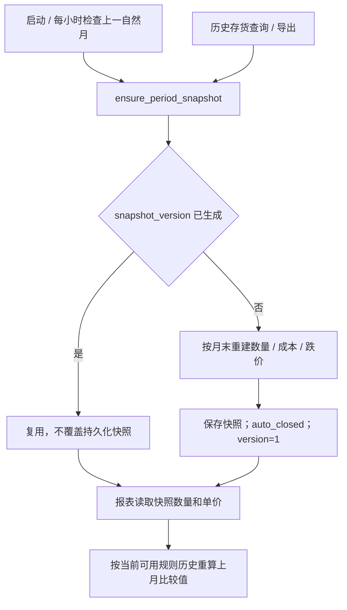

# 报表流程、公式与快照

## 截止日库存与跌价准备

_load_inventory_impairment_report_rows 先确保上一个月末快照存在，再读取报告截止日次日00:00前到货批次，并统计 sold_at 在该截止时间前的 SaleCostDetail：

```text
截止日数量 = max(0, 原始入库 quantity − 截止日前销售明细数量)
库存金额 = 批次 unit_cost × 截止日数量
累计跌价准备 = unit_cost × impairment_units（报告日现存库存）
本月计提（现存库存） = unit_cost × period_impairment_units
账面价值 = 库存金额 − 累计跌价准备
账面价值较上月变化 = 当前账面价值 − 上月比较账面价值
```

对数量归零但上月仍有库存的批次保留行，以显示下降差额。店铺从批次创建人当前 store_id 推导，不是入库时固化。源码： [reports.py](../../../routers/reports.py) 的 _load_inventory_impairment_report_rows、inventory_impairment_report。

batch_impairments 按 product_id 分组，以最新 arrived_at/id 批次优先分配稳健商品安全库存；被保护数量不继续新增计提，但保留以往已累计准备。新品不保护安全库存，日率0.5%，稳健日率1%，每部分累计最多90%；计提从到货次日开始，按 effective_date 分段。规则历史晚于最早入库时，会向最早入库日补用首条已知规则，避免漏掉早期累计。

报表的 rate 是有计提数量的加权平均，impairment_units 是各部分数量×累计率之和；变规则后不能只用“当前类型×库龄”重算。安全库存按已加载商品库存层分配，不是独立的“每店安全库存”字段。依据：[inventory_impairment.py](../../../services/inventory_impairment.py)；[商品规则流程](../products/workflow.md)。

2026-10-10 已确认口径：累计准备针对报告日仍在库商品，从入库后累计至截止日；另列这些现存库存本月新增的准备。`batch_impairments(..., period_start=report_date.replace(day=1))` 在同一规则历史计算过程中统计本月1日至报告日的增提，按各部分到达90%上限前的实际增幅计算。数量始终采用报告日剩余数，不能用本月末准备余额减上月末快照准备余额替代；本月已售商品在销售前的计提不属于这列。

例如新品8月1日入库、单价10元，上月末100件、本月9月30日剩50件且无安全库存：报告日累计率30%，累计准备150元，本月现存库存新增15个百分点、计提75元；上月账面850元、本月350元，账面差额为−500元。账面差额包括数量变化，不能作为本月计提。售完批次仍保留上月账面减少信息，但现存库存累计准备和本月计提均为0，状态显示“已售完”。页面与独立/财务附件 Excel 使用相同计算结果。回归用例：[test_inventory_impairment_report.py](../../../tests/test_inventory_impairment_report.py)。

## 自动月末快照与比较值



ensure_period_snapshot 只处理已结束自然月，使用 Asia/Shanghai，生成后不重新写快照；没有公开结账 API。应用启动和每小时只检查上一自然月，其他更早缺失期间由报表请求按需补建。

报表读取已保存的 quantity/unit_cost，再用规则历史重算 previous_book_value，未直接采用快照保存的 book_value；这由 [test_inventory_impairment_report.py](../../../tests/test_inventory_impairment_report.py) 的 test_report_restates_previous_book_value_without_overwriting_snapshot 明确记录。持久化快照不变与报表比较值重述必须区分。

上月比较缺少对应批次快照时，按到货日期区分：本月新增批次上月账面价值为0，可以计算差额；上月末或之前已经到货的历史批次保留未知值，页面提示“缺少上月快照，无法比较”，Excel 差额单元格留空并在备注中说明。存在未知批次时，Excel 账面差额合计也留空，避免将不完整合计当完整结果；现存库存本月计提不依赖上月快照，仍正常计算。服务器出现提示时，应核对对应 `accounting_periods`、`inventory_period_snapshots`、批次到货/创建日期及服务器代码版本；本次本地回归没有连接服务器，实际缺失原因待验证。

2026-10-12 使用用户下载的服务器备份在独立本地库核验 `2026-09-30` 报表：68 行通过独立算术核对，覆盖截止日前销售重建库存、安全库存分配、累计上限、本月增提及已有快照比较；本地 HTTP 接口与独立存货 Excel 逐行金额一致，快照内容未改变。同时执行 34 项存货、快照和财务附件回归测试，全部通过。此备份中的商品各有一条规则记录，多次规则变更由模拟回归覆盖；部分历史日期只能采用当前可用规则，真实历史规则是否完整仍待财务核实。备份中有 15 行缺少对应的 8 月末批次快照，比较值保留未知，没有补写快照；缺失原因及生产更新状态仍待验证。核验摘要和 Excel 位于 Git 忽略的 `output/local-db-restore/`，不将业务原始行纳入知识库。

GET 报表和导出可能补建并提交历史快照，是数据库写入副作用。后续补录/撤销、成本变化、规则变化、用户改绑、映射变化及 OA 更新可能改变未冻结计算结果；不能承诺同期间任意时点导出都完全一致。首次补建历史快照只能依据当时仍存在的事实数据，不能恢复已经删除的销售明细。

依据：[accounting_periods.py](../../../services/accounting_periods.py)、[main.py](../../../main.py)、[reports.py](../../../routers/reports.py)。

## 店铺损益及期间

_month_periods 定义 current（本月）、previous（上月）、ytd（当年1月到本月末），均采用左闭右开区间；report_month 必须该月第一天。自动项与来源：

| 项目 | 实际来源/算法 |
| --- | --- |
| 商品销售收入 | 通过 _sale_import_context 还原净商品收入并乘固化汇率；手工销售以CNY处理 |
| 商品采购成本 | SaleCostDetail 数量×原批次 purchase_price |
| 头程尾程物流成本 | 批次 shipping_cost+last_mile_cost 按原 quantity 分摊 |
| 其他直接成本 | 销售来源其他费用/平台费按汇率换算 |
| 存货跌价准备 | 本月末累计减上月末累计；上月及年累计类推 |
| 房租+水电+网费 | OA 指定部门租金/电费，按当前启用店铺数均分 |
| 分摊人事财务 | OA 同名非零组件，按当前启用店铺数均分 |
| 人员薪资 | OA 部门名精确匹配店铺名；已保存人工值优先 |

关税、本地物流、代发、运费/其他收入、广告、税费等人工项按报表 JSON 保存；自动项与公式项不允许通过 manual_values 覆盖，不支持的键被忽略。PUT 用整个新的 manual_values/remarks 替换原 JSON，不是增量 PATCH；空人工值可以回落到 OA 默认薪资。UI 当前只编辑本月列，API/Excel 仍含本月、上月、年累计。

店铺损益的“存货跌价准备”当前仍是期间准备余额差，未随本次07表新增列改动。07表“本月计提（现存库存）”与全店损益不是同一指标；有销售出库时，余额差也会受到已售库存退出的影响。如需全月计提、转销/转回和损益勾稽，需要另行确认并实现完整期间口径。

营业收入 = 商品+运费+其他收入；营业成本 = 采购+头尾程+关税+本地物流+代发+其他直接；毛利 = 收入−成本；毛利率 = 毛利÷收入（收入0时空）。营业利润从毛利依次扣税金、销售/管理/研发/财务费用、资产和信用减值，净利润再加减营业外收支与所得税。

损益当前成本拆分没有自动把批次 other_cost 纳入采购/物流；销售 FIFO total_cost 却包含它。缺失历史汇率时损益收入/费用会跳过，产品线会提示缺失但仍保留采购/物流成本；与销售月度汇总“金额为空”不同。跨年上月查询、各口径勾稽及缺失数据行为待财务/集成验证。

依据：[reports.py](../../../routers/reports.py) 的 STORE_PROFIT_LOSS_ROWS、_store_profit_loss_auto_values、_build_store_profit_loss_values、update_store_profit_loss。

## OA 来源

_approved_forms_by_expense 查询未删除、指定流程、COMPLETED、结果同意的 ding_approval_instance，按申请日期左闭右开过滤，只执行 SELECT。办公明细只取指定部门的租金/电费，工资按明细部门名归属，分摊管理费按精确组件名取数。代码固定流程/组件/部门标识，实际 OA 表单契约待验证。

OA_DB 必要配置缺少或不完整时返回空数据并记录警告；完整配置但连接/查询失败抛 OaExpenseSourceError，没有统一转换为专用业务响应。数据是直接读取，没有稳定期间缓存，OA 更新和当前有效店铺数量变化会影响重算。依据：[oa_office_expenses.py](../../../services/oa_office_expenses.py)。

## 产品线、跨店汇总与 Excel

产品线通过销售店铺/本地商品、来源平台 SKU 和销售日期匹配有效 StoreProduct；无来源 SKU、匹配失败或产品线冲突进入未分配组。手工销售通常无来源平台 SKU，需要关注该组。每店运费/其他收入以及人工关税/本地物流/代发按该店各线销售收入比例分摊，不能跨店混分；期间收入合计0时不分摊。

管理员跨店汇总仅包含当前启用店铺，数值来自相同店铺损益计算，合计毛利率是总毛利÷总收入。财务附件中管理员的存货为全局、单店损益为所选店铺、汇总/产品线为启用店铺；非管理员按绑定店铺且不生成第三张跨店汇总。

存货 Excel 输出公式及缓存值，通过 _workbook_bytes_with_formula_cache 改写工作簿 XML 的结果缓存；openpyxl 本身不计算公式。四表统一输出不等于所有来源已核对，须保留未映射、缺失率和成本分类检查。

依据：[reports.py](../../../routers/reports.py) 的 _product_line_mapping_for_sale、_product_line_profit_data、_allocate_store_profit_loss_to_product_lines、_build_store_profit_loss_summary_sheet、export_financial_attachments；验证入口见[代码映射](code-map.md)。
