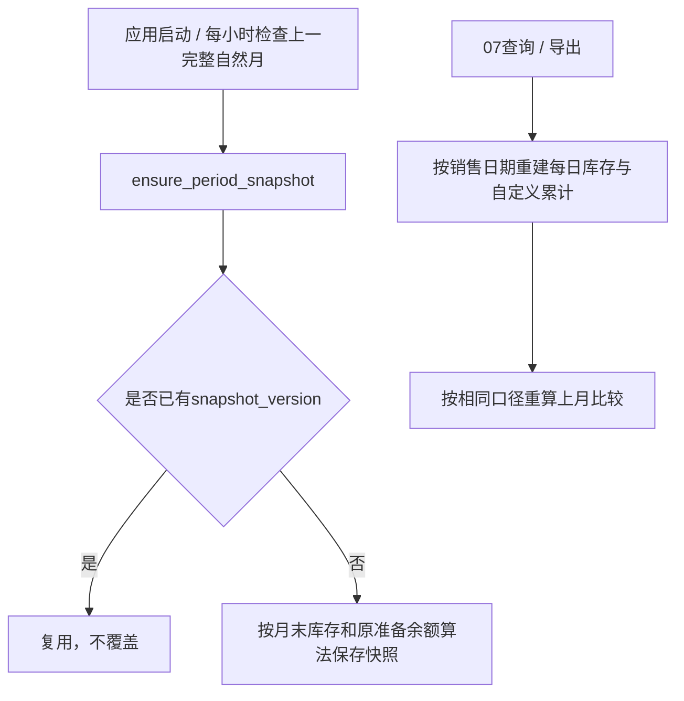

# 报表流程、公式与快照

## 截止日库存与跌价准备

2026-10-12用户最终确认07存货表采用财务自定义逐日累计口径，替代该表此前的“报告日现存库存准备余额”口径。逐字段来源、完整公式与验收例子统一见[存货明细字段说明](inventory-impairment-fields.md)，不在此重复维护。

`_load_inventory_impairment_report_rows`读取截止日前全部批次、商品规则，以及按batch_id和sales.sold_at日期分组的FIFO销售数量/保存成本。在内存重建每天销售后的库存，`daily_accumulated_impairments`每天调用原余额算法计算该日金额，逐日相加；本月为本月各天之和。原始入库成本减累计跌价为自定义账面价值，可为负。已售完批次保留售前金额。两种查询/独立导出和财务附件07表使用同一来源和全部批次范围，权限范围保持原有设计。

当天比例仍按新品日增0.5%、稳健日增1%、规则历史及90%比例上限处理；合计金额不封顶。每个批次自身单价和日期独立，SKU只汇总数量和金额。该自定义累计不等于现存库存准备余额；店铺损益、自动快照仍采用原余额口径。

上月比较用同一每日公式算至上月末；本月新增批次上月为0，其他批次为原始入库成本减上月逐日累计。该路径不读/补建准备余额快照，也不写数据库。后续补录/撤销、成本、规则或归属变化会影响重算结果；不能将其视为冻结凭证，也不能凭剩余库存补出缺失真实历史。

依据：[reports.py](../../../routers/reports.py)、[inventory_daily_impairment.py](../../../services/inventory_daily_impairment.py)、[原余额算法](../../../services/inventory_impairment.py)。

## 页面与Excel字段名称

存货页面/Excel使用“累计跌价（逐日累计）”“本月跌价（逐日累计）”“账面价值”；当日计提数量和当日累计比例只描述截止日，不能用它们乘单价替代历史金额合计。Excel P列公式为H原始成本减O累计跌价，保留负值，公式结果缓存与API一致。

表头由[reports.py](../../../routers/reports.py)的`INVENTORY_IMPAIRMENT_HEADERS`和`INVENTORY_IMPAIRMENT_SUMMARY_COLUMNS`维护，同步更新[运行模板](../../../templates/index.html)和[副本](../../../index.html)，保留其原有非本功能差异。批次页面单列批次号，Excel放备注；SKU页面15列，Excel另有比较说明。

其他报表命名仍来自`STORE_PROFIT_LOSS_ROWS`、产品线构建函数；单店页面只展示本月，Excel/API还有上月和年累计，不能将不同期间混为同一列。

## 自动月末快照与比较值

快照按Asia/Shanghai生成，使用现存库存成本减现存准备余额；没有人工结账或公开会计期间接口，已有快照不覆盖。07表现在不读取该快照，也不会因缺少上月快照触发补建；原先的“缺少上月快照”排查适用于旧版本报表。

应用启动仍有建表、兼容迁移、历史修复、用户初始化和快照检查，不能当纯只读。快照事实与自定义报表金额含义不同，禁止直接把旧快照金额当作新口径上月值。

此前对旧口径的68行、本月现存增提和快照缺失等验证属于历史记录，见[运行手册](../../../PROJECT_RUNBOOK.md)，不能当作新口径验收。本次回归同时覆盖新日累计及原余额算法/快照，真实历史完整性和服务器部署仍待核实。

依据：[accounting_periods.py](../../../services/accounting_periods.py)、[main.py](../../../main.py)、[reports.py](../../../routers/reports.py)。

## 店铺损益及期间

_month_periods 定义 current（本月）、previous（上月）、ytd（当年1月到本月末），均采用左闭右开区间；report_month 必须该月第一天。自动项与来源：

| 项目 | 实际来源/算法 |
| --- | --- |
| 商品销售收入 | 通过 _sale_import_context 还原净商品收入并乘固化汇率；手工销售以CNY处理 |
| 商品采购成本 | SaleCostDetail 数量×原批次 purchase_price |
| 头程尾程物流成本 | 批次 shipping_cost+last_mile_cost 按原 quantity 分摊 |
| 其他直接成本 | 销售来源其他费用/平台费按汇率换算 |
| 存货跌价准备 | 本月末累计减上月末累计；上月及年累计类推 |
| 房租+水电+网费 | OA 指定部门租金/电费，按当前启用店铺数均分 |
| 分摊人事财务 | OA 同名非零组件，按当前启用店铺数均分 |
| 人员薪资 | OA 部门名精确匹配店铺名；已保存人工值优先 |

关税、本地物流、代发、运费/其他收入、广告、税费等人工项按报表 JSON 保存；自动项与公式项不允许通过 manual_values 覆盖，不支持的键被忽略。PUT 用整个新的 manual_values/remarks 替换原 JSON，不是增量 PATCH；空人工值可以回落到 OA 默认薪资。UI 当前只编辑本月列，API/Excel 仍含本月、上月、年累计。

店铺损益的“存货跌价准备”仍为期间准备余额差，未改为07表的逐日金额累计。两个指标不能相互替代；完整会计计提、转销/转回和损益勾稽仍需另行确认和实现。

营业收入 = 商品+运费+其他收入；营业成本 = 采购+头尾程+关税+本地物流+代发+其他直接；毛利 = 收入−成本；毛利率 = 毛利÷收入（收入0时空）。营业利润从毛利依次扣税金、销售/管理/研发/财务费用、资产和信用减值，净利润再加减营业外收支与所得税。

损益当前成本拆分没有自动把批次 other_cost 纳入采购/物流；销售 FIFO total_cost 却包含它。缺失历史汇率时损益收入/费用会跳过，产品线会提示缺失但仍保留采购/物流成本；与销售月度汇总“金额为空”不同。跨年上月查询、各口径勾稽及缺失数据行为待财务/集成验证。

依据：[reports.py](../../../routers/reports.py) 的 STORE_PROFIT_LOSS_ROWS、_store_profit_loss_auto_values、_build_store_profit_loss_values、update_store_profit_loss。

## OA 来源

_approved_forms_by_expense 查询未删除、指定流程、COMPLETED、结果同意的 ding_approval_instance，按申请日期左闭右开过滤，只执行 SELECT。办公明细只取指定部门的租金/电费，工资按明细部门名归属，分摊管理费按精确组件名取数。代码固定流程/组件/部门标识，实际 OA 表单契约待验证。

OA_DB 必要配置缺少或不完整时返回空数据并记录警告；完整配置但连接/查询失败抛 OaExpenseSourceError，没有统一转换为专用业务响应。数据是直接读取，没有稳定期间缓存，OA 更新和当前有效店铺数量变化会影响重算。依据：[oa_office_expenses.py](../../../services/oa_office_expenses.py)。

## 产品线、跨店汇总与 Excel

产品线通过销售店铺/本地商品、来源平台 SKU 和销售日期匹配有效 StoreProduct；无来源 SKU、匹配失败或产品线冲突进入未分配组。手工销售通常无来源平台 SKU，需要关注该组。每店运费/其他收入以及人工关税/本地物流/代发按该店各线销售收入比例分摊，不能跨店混分；期间收入合计0时不分摊。

管理员跨店汇总仅包含当前启用店铺，数值来自相同店铺损益计算，合计毛利率是总毛利÷总收入。财务附件中管理员的存货为全局、单店损益为所选店铺、汇总/产品线为启用店铺；非管理员按绑定店铺且不生成第三张跨店汇总。

存货批次 Excel 输出公式及缓存值，通过 _workbook_bytes_with_formula_cache 改写工作簿 XML 的结果缓存；openpyxl 本身不计算公式，追加的 SKU 汇总写已计算数值。财务附件统一输出不等于所有来源已核对，须保留未映射、缺失率和成本分类检查。

依据：[reports.py](../../../routers/reports.py) 的 _product_line_mapping_for_sale、_product_line_profit_data、_allocate_store_profit_loss_to_product_lines、_build_store_profit_loss_summary_sheet、export_financial_attachments；验证入口见[代码映射](code-map.md)。
