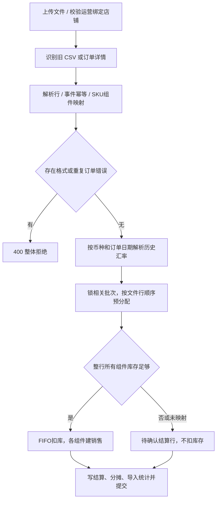
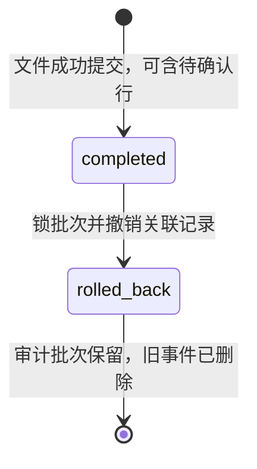

# 销售、导入与撤销流程

## 手工销售

页面 createSale 提交店铺、商品、订单号、数量、售价、其他费用和日期（时间为该日23:59:59）；这些金额可填写，不再固定传0。后端 strip 订单号并全局查重，非管理员强制采用绑定店铺且不允许指定他店，管理员必须选有效店铺。

fifo_sell 在同一会话按 product_id、arrived_at、id 锁定 remaining_quantity>0 的批次，复查总库存，逐批扣减，写 Sale 和 SaleCostDetail。成本 = Σ(明细数量×批次 unit_cost)，利润 = 单价×数量−FIFO 成本−费用；手工销售提交一次，库存不足400。它不按店铺限定批次，也不要求批次到货时间早于 sold_at；回填历史销售对历史库存的影响需核实。

依据：[sales.py](../../../routers/sales.py) 的 create_sale；[fifo.py](../../../services/fifo.py) 的 lock_fifo_batches、fifo_sell。

## 文件导入

1. XLSX/XLSM 只读取“订单详情”工作表，必须有9个必要列；CSV 优先识别这些表头，否则按无表头 SKU,日期,数量 解析。编码按 utf-8-sig/utf-8/gb18030 尝试。
2. 运营必须绑定有效店铺；管理员没有这一前置绑定要求。所有本地商品读取用于解析；订单详情只加载启用的 platform=tiktok_shop 映射。
3. 事件键 _source_key 包含结算单、付款、订单、SKU、交易类型、日期、数量和金额等；已存在事件跳过，文件内重复事件为错误。兼容旧哈希的事件通过 raw_data 重算判断。
4. 新的库存销售还检查 sales.order_no。组合组件有相同订单号，因此该列没有唯一约束；程序查重不能当作完整并发幂等。
5. 订单正数量且净销售额非负才可作为库存销售；退款/调整/负数行仅保存结算等关联，不自动恢复库存。无 SKU 的物流/平台赔付按独立费用保存。
6. SKU 映射缺失、组件不足或库存不足转 pending_confirmation。按文件行序验证整行需求，任何组件不足则该行不扣任何库存，后续更小行仍可能成功。
7. 汇率在锁库存前查询；同商品批次按统一顺序 FOR UPDATE，预分配与实际 fifo_sell(commit=False) 使用同一锁保护的库存；最后一个事务提交导入批次、销售、明细、结算和分摊。
8. HTTPException/IntegrityError 路径回滚业务事务，冲突返回409。成功结果仍可包含 pending_confirmation>0，不能只凭 success=true 认定全部出库。

依据：[sales.py](../../../routers/sales.py) 的 _read_import_file、_source_key、_resolve_platform_sku_components、_allocate_available_stock、import_sales_file。

## 组合金额与人民币

每个组件出库数量 = 来源数量×quantity_per_sale。初始按数量分配收入/费用；总 FIFO 成本>0 时改为各组件 FIFO 成本占比分摊收入及其他费用；总成本为0时保持数量分摊。_sale_import_context 从保存的关联及权重重构来源金额。

其他费用 = 净商品销售额−结算总金额；物流/平台赔付取差额绝对值作为费用。外币净收入和费用乘固化汇率；profit_cny = 收入人民币−FIFO成本−费用人民币。导入后的 sales.selling_price/platform_fee 为来源分摊金额，持久化 profit 会与人民币成本相减，报表应使用人民币响应与结算上下文，不能直接把原字段视为人民币。

get_cny_rates 对 CNY 返回1，对其他三字母币种查询包含向前14天的区间，取目标日及之前最近可用汇率。获取失败502；保存汇率、实际汇率日期及 Frankfurter/ECB 来源，重复报表不重新查汇率。缺失或历史遗留汇率在月度汇总显示 fx_missing_count 并将金额设为空；损益/产品线对缺失率的处理不同，见[报表流程](../reports/workflow.md)。

依据：[exchange_rates.py](../../../services/exchange_rates.py)、[sales.py](../../../routers/sales.py) 的 _component_allocation_shares、_build_sale_response、_sale_import_context、_monthly_sales_summary。

## 待确认与文件撤销

待确认只提供查询和汇总导出，没有单行“确认并扣库”API。补齐映射/库存后直接重导相同事件会被去重；现有可用操作是按授权撤销原文件再重导，撤销会同时恢复该文件已成功销售，不是只处理待确认行。此操作范围应在业务使用前明确。

结算映射状态 confirmed/pending_confirmation 与导入状态 completed/rolled_back 是两套字段。撤销先锁导入批次，拒绝重复撤销；按原明细汇总并锁库存批次，校验恢复不超过原数量，然后删除分摊、结算、成本明细、销售并标记撤销。历史快照不随撤销重建，当前报表可受影响。

source_key 与手工订单查重均未按店铺分区，跨店事件冲突及并发重复订单需进一步验证。依据：[sales.py](../../../routers/sales.py) 的 rollback_sales_import；[models.py](../../../models.py)。
