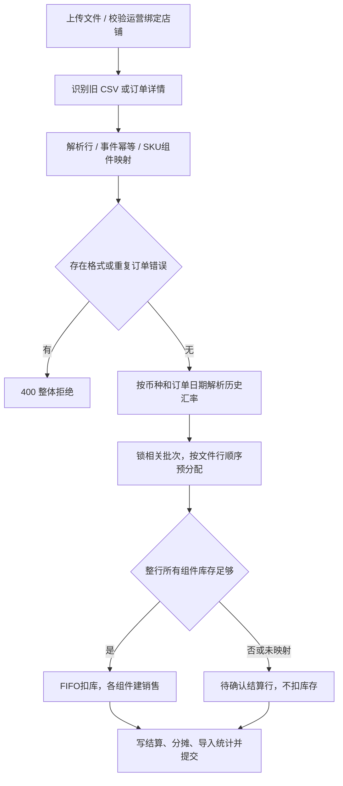
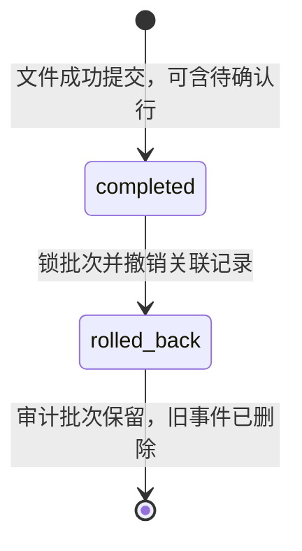

# 销售、导入与撤销流程

管理员或运营作废错误历史批次后，lock_fifo_batches排除voided_at非空的批次；既有Sale和SaleCostDetail保留。销售列表仍展示原成本供追溯，cost_status为needs_review、人民币利润留空；月度毛利留空并计数，待人工核对原销售分配。普通文件撤销若恢复到已作废批次，只修改历史剩余字段，不让其重新参与FIFO。详见[库存作废规则](../inventory/workflow.md#编辑与删除)。

## 手工销售

页面createSale现在调用POST /sales/manual-settlements，填写来源SKU ID、产品名、交易类型、来源数量、结算日期、净商品销售额及结算总金额，币种为人民币。该补录不关联商品、不扣库存、不生成成本或跌价；保存SalesImportBatch与SettlementEntry，保留创建人及店铺，支持既有撤销流程。request_key保证失败重试不重复入账，相同标识更换内容返回409；非管理员只能写绑定店铺，管理员必须选有效店铺。

保存后的销售列表、月度汇总、商品选项、待确认及导入历史刷新均携带会话校验。退出/重登（包括同账号）后，旧响应在处理401、读取完正文以及更新页面前检查会话版本，不能退出新会话、显示旧店铺数据或覆盖新补录草稿。当前会话的部分刷新失败复用“补录已保存，部分列表刷新失败”提示，不能重新提交已保存记录；被新查询替代的旧刷新直接丢弃，不作为失败提示。实现为两份首页的api可选requestOptions与SalesLedger.requestOptions；未传此选项的其他API调用保持原行为。

以下为保留兼容的POST /sales库存销售接口，不再由手工补录表单调用：

fifo_sell 在同一会话按 product_id、arrived_at、id 锁定 remaining_quantity>0 的批次，只从到货自然日不晚于销售日的批次复查可用库存、逐批扣减，写 Sale 和 SaleCostDetail。同一天到货可用，未来到货不能填补历史销售；共享库存仍不按店铺限定。成本 = Σ(明细数量×批次 unit_cost)，利润 = 单价×数量−FIFO 成本−费用；手工销售提交一次，销售日库存不足返回400并回滚。

新订单首条Sale以order_claim=order_no占用数据库唯一索引uq_sales_order_claim；并发重复请求即使通过前置查询，也只有一个事务能成功，另一事务返回409并回滚扣库。组合订单后续组件为NULL，保留同订单号多明细。历史记录保持NULL，仍由order_no前置查询拦截，不回填或重算历史成本；内部claim_order不是外部请求参数。上线需先完成兼容迁移并统一更新写入进程，旧版本进程不写占位值，不能混跑时宣称完整防重。

依据：[sales.py](../../../routers/sales.py) 的 create_sale；[fifo.py](../../../services/fifo.py) 的 lock_fifo_batches、fifo_sell。

## 出库成本拆分与跌价参考

导入成功后已有的 `SaleCostDetail` 是成本依据；列表、单条详情、手工销售响应及导出自动读取，无新增持久化字段或历史回填。按明细保存的 `unit_cost × quantity` 分配采购、头程、尾程、其他入库成本，多批次相加；数量更正后的批次使用冻结 `cost_basis`，已启用的财务补差按原分配数量叠加到对应科目。原始 `Sale.total_cost`、明细单价及利润不改写。报表仍按原采购/头尾程/其他三组分配；头尾程只在已分配物流金额内再拆，保留既有财务报表尾差规则。

人民币台账每行为本地商品/组件出库行，“订单总成本（本行）”为该行四项之和。同一订单号的组合组件行相加才是整单成本，不能把整单金额重复记到每一行。展示分项和本行总额按分舍入（ROUND_HALF_UP）；尾差按科目金额由大到小分配，避免微小金额舍入为负。API 原 `total_cost`、FIFO 单价、利润和月度核算仍保留原始精度；月度按原精度汇总，与逐行舍入合计可能有分位尾差。

“出库商品跌价（参考）”重用持有期间回放，以实际出库数量层的已提比例乘当前追溯成本；入库当天0天，销售当天先计提再转销。稳健/新品/不跌价三类及规则生效历史沿用报表算法，只有稳健商品扣除独立安全库存。一次读取可见销售涉及商品的全局批次和历史出库，先分配共享安全库存，再仅回写当前有权限的销售响应；不会把其他店铺的销售明细、批次或名称加入响应。跌价单列，不加到订单成本、不重复扣减销售毛利；财务店铺损益继续按批次跌价归属分摊，本列不代表实际销售店铺承担额，也不包含未售库存准备。

原始成本构成缺失时不猜测采购/物流份额，四项为空，但保留已知FIFO总成本及可回放的跌价参考。明细数量/保存成本不一致、缺失或引用作废批次时四项为空；异常历史/无法回放时跌价为空，相应合计为空，不能以0替代。规则历史缺失而沿用既有推定算法时，参考金额保留并附推定说明（页面金额悬停、Excel说明列）。独立退款/赔付/结算事件没有库存出库，四项成本与跌价均为0。正常旧数据读取时自动获得拆分，查询不补明细、不修历史库存。

实现：[cost_layers.py](../../../services/cost_layers.py) 的 `fifo_cost_groups/fifo_cost_components/rounded_cost_components/sale_cost_context`；[sales_costs.py](../../../services/sales_costs.py) 的 `attach_sale_impairment`；共享事实入口 [inventory_provision_data.py](../../../services/inventory_provision_data.py)，[报表流程](../reports/workflow.md)的财务归属规则保持不变。

## 分组台账与字段计算说明

销售台账按基本信息、交易金额、单件成本、本行销售成本、跌价金额和明细分组。每个列头问号通过现有HelpTips显示公式、来源和口径；直接取值的店铺/日期/SKU等只解释来源。单件成本的分子为未舍入分项，分母为本地库存实际出库件数，显示4位；不是平台销售套数。四项本行金额和总额沿用分位尾差平衡，单价不合计，无出库的退款/赔付单价显示不适用；已知零成本、未知金额及零数量不能混用。台账SKU ID、产品名和交易类型保留来源值，来源数量单列且不合计；实际出库数量仍为本地组件件数。计算明细使用本地SKU/名称定位成本，不改变历史关联。

“计算明细”只对正ID库存销售开放，读取服务端授权的本行数据、实际FIFO成本分项、准备转销折算量和完整订单组件。代入金额最多显示8位，计算用服务端原精度。整单是同店铺同订单的完整出库行，包含当前商品/月/页之外的组件；不把整单总额重复放进每一行。未知店铺不猜测整单范围，部分金额未知保留待核对。店铺归属分摊及毛利口径不变。

整单店铺名称按权限及分组所用的店铺ID读取主数据；历史销售未固化店铺时，与创建人兼容绑定一致，不使用其他店铺的商品映射名称。解释响应内各行及Excel“订单汇总”采用同一名称，未知店铺不推断名称。

[销售页面模块](../../../static/sales-ledger.js)管理字段资源、分组/合计、计算弹窗及异步代次；关闭/退出取消请求，旧401、旧正文或重新打开的旧响应不能覆盖新会话/新弹窗。列表渲染也核对加载代次，失败清空本页合计。原错误/待核对保留可见，字段说明只用问号；手机表格局部横向滚动、弹窗限制在视口内。弹窗重建正文时，公共HelpTips拒绝打开已经移除的说明，下一帧清理旧问号。公开字段资源与Excel共用[JSON定义](../../../static/sales-fields.zh-CN.json)，不是另一套业务计算实现。

台账成功加载后，待确认记录单独处理异常；失败只在待确认区域显示提示、清除旧待确认分页，保留台账、合计、月度统计及其分页。再次查询可恢复待确认内容；旧加载或退出后晚到的失败提示按台账加载代次丢弃。实现位于两份首页的loadSales，不改变待确认API权限及金额口径。

导出继续按筛选全部记录输出，“字段口径说明”写相同资源的公式/来源/口径，“订单汇总”按完整授权订单去重。后者范围可能大于筛选行，说明中明确不重复加总；单件分项4位且合计留空。数据查询只有SELECT，不改Sale、FIFO明细、批次、历史快照或店铺归属。接口、空值与关联数量上限见[API](api.md#单件成本与计算明细)。

## 销售台账导出

“导出销售记录”位于人民币台账筛选栏。点击时读取当前可见月份、商品名称/SKU输入，导出全部匹配记录；不要求停留第一页，不传分页参数，清空月份即覆盖全部月份。导出期间固定月份/商品筛选、禁用重复导出及搜索/清空，完成或失败后恢复；不会调整原分页。筛选范围及上限记录在[API契约](api.md#销售台账导出)。

后端复用列表响应与独立财务事件查询，不另算FIFO、汇率或店铺归属。原销售、退款/调整、赔付与页面范围一致；未知汇率对应金额、作废批次相关毛利及不完整合计仍留空。Excel文本强制字面量写入。先按同一筛选统计，超20,000条拒绝，不截断输出；SQL仅SELECT，释放读取事务后生成文件，不更改源记录或快照。

页面提供正在生成、成功、无匹配、超限、接口未加载及失败反馈；拒绝非Excel MIME或空文件。退出时取消下载请求、清空状态并递增会话版本；旧响应、正文读取或blob读取后的回调均核验版本，旧401不能退出新会话。下载地址延迟释放，避免浏览器尚未读取就被撤销。两份页面共用PageInteractions的`salesExport*`文案；实现见[页面](../../../templates/index.html)的`exportSalesRecords/resetSalesExportSession`和[sales_export.py](../../../services/sales_export.py)。

## 文件导入

订单详情以“产品名”为组件表达式，缺该列时读取“商品名称”；SKU ID仅作来源标识。A*4表示每套4件，A+B表示两种各1件，A*2+B表示A两件、B一件；实际扣库数=来源数量×组件倍数，同商品重复出现时先合并倍数。全半角规范化后精确匹配本地名称，库存订单遇到重名、缺失、格式错误或找不到商品时整行待确认，不猜测、不回退SKU映射，不部分扣减组合。旧无表头CSV仍按原SKU识别。

非赔付的退款/调整及负销售额行也尝试名称识别：单一商品保存SettlementEntry.product_id，组件保存在SettlementEntryAllocation（sale_id为空），用于商品筛选、月度汇总、导出及可靠的产品线归属；仅保留来源数量×倍数的有符号组件数量，不创建Sale/FIFO明细、不恢复或扣减库存。名称缺失、歧义、格式错误或组合部分无法识别时不保留部分关联，仍以独立结算入账，不增加待确认。组合退款没有已保存的金额份额，继续保留全店汇总和未分配产品线，不猜测组件退款金额；赔付与手工结算补录仍不关联商品。历史数据不回填。

例如来源数量2、产品名“黑色逗猫棒+白色逗猫棒”，分别出库黑白各2件；每组件按销售日FIFO取批次，采购/头程/尾程/其他分项相加为整单成本。收入与来源费用按完整来源行的已保存组件成本权重分摊，成本全为0时回退数量份额；单个组件查询或导出也使用完整来源份额，不能重复分配整单收入；零收入组合仍以保存的费用份额分配来源费用，避免误改为按件平分。台账来源数量在各组件行重复展示，因此不合计该列。

历史扣库、FIFO明细及来源记录不回填、不重扣。重复上传继续按原事件键跳过；更正以前待确认文件需由用户采用既有撤销/重新导入流程，查询不会重建历史关联。

1. XLSX/XLSM 只读取“订单详情”工作表，必须有9个必要列；CSV 优先识别这些表头，否则按无表头 SKU,日期,数量 解析。编码按 utf-8-sig/utf-8/gb18030 尝试。
2. 运营必须绑定有效店铺；管理员必须通过multipart的store_id明确选择有效店铺。_resolve_import_store在读文件/扣库前校验，运营旧请求可省略参数，不能指定他店。订单详情只读取本地商品名称用于识别，不加载平台SKU映射；旧无表头CSV保留原SKU解析。
3. 事件键 _source_key 包含结算单、付款、订单、SKU、交易类型、日期、数量和金额等；已存在事件跳过，文件内重复事件为错误。兼容旧哈希的事件通过 raw_data 重算判断。
4. 新的库存销售还检查 sales.order_no，该列保持非唯一以兼容组合明细；数据库使用首条明细的order_claim唯一约束兜底并发，其他组件不重复占位。
5. 订单正数量且净销售额非负才可作为库存销售；退款/调整/负数行仅保存结算等关联，不自动恢复库存。物流/平台/物料赔付作为独立收入，不要求本地商品。
6. 产品名缺失/无法识别/重名、组合格式错误或销售日可用库存不足转 pending_confirmation。按文件行序、各行销售日期从同一批次层预分配，聚合同一商品的组件需求；任何组件不足则该行不扣任何库存，后续更小行仍可能成功。预检查和实际FIFO均排除销售日之后到货的批次。
7. 汇率在锁库存前查询；同商品批次按统一顺序 FOR UPDATE，预分配与实际 fifo_sell(commit=False) 使用同一锁保护的库存；最后一个事务提交导入批次、销售、明细、结算和分摊。
8. HTTPException/IntegrityError 路径回滚业务事务，冲突返回409。成功结果仍可包含 pending_confirmation>0，不能只凭 success=true 认定全部出库。

依据：[sales.py](../../../routers/sales.py) 的 _read_import_file、_source_key、_resolve_platform_sku_components、_allocate_available_stock、import_sales_file。

## 组合金额与人民币

2026-10-19：独立退款/调整/赔付通过[financial_facts.py](../../../services/financial_facts.py)公共查询进入销售列表、月度和财务报表；排除直接或组件销售已关联的结算，不重复计算原销售收入。独立事件不创建Sale、不自动恢复库存，数量显示0；金额按结算日优先归月，销售仍按sold_at。商品归属不明的组合调整保留全店及未分配组，不能猜测组件利润。阶段边界及后续成本调整见[完善计划](../../plans/2026-10-19-financial-accuracy.md)。

每个组件出库数量 = 来源数量×quantity_per_sale。初始按数量分配收入/费用；总 FIFO 成本>0 时改为各组件 FIFO 成本占比分摊收入及其他费用；总成本为0时保持数量分摊。_sale_import_context 从保存的关联及权重重构来源金额。

普通记录其他费用 = 净商品销售额−结算总金额；物流/平台/物料赔付收入 = 结算总金额，赔付费用为0，负数结算冲减收入。外币收入和费用乘固化汇率；profit_cny = 收入人民币−FIFO成本−费用人民币。赔付单独计入一次店铺收入，不生成库存出库、成本或跌价。历史已保存原始结算与月度版本不改写，动态查询按现行收入口径计算。导入后的 sales.selling_price/platform_fee 为来源分摊金额，持久化 profit 会与人民币成本相减，报表应使用人民币响应与结算上下文，不能直接把原字段视为人民币。

get_cny_rates 对 CNY 返回1，对其他三字母币种查询包含向前14天的区间，取目标日及之前最近可用汇率。获取失败502；保存汇率、实际汇率日期及 Frankfurter/ECB 来源，重复报表不重新查汇率。缺失或历史遗留汇率在月度汇总显示 fx_missing_count 并将金额设为空；损益/产品线对缺失率的处理不同，见[报表流程](../reports/workflow.md)。

依据：[exchange_rates.py](../../../services/exchange_rates.py)、[sales.py](../../../routers/sales.py) 的 _component_allocation_shares、_build_sale_response、_sale_import_context、_monthly_sales_summary。

## 待确认与文件撤销

待确认只提供查询和汇总导出，没有单行“确认并扣库”API。补齐映射/库存后直接重导相同事件会被去重；现有可用操作是按授权撤销原文件再重导，撤销会同时恢复该文件已成功销售，不是只处理待确认行。此操作范围应在业务使用前明确。

结算映射状态 confirmed/pending_confirmation 与导入状态 completed/rolled_back 是两套字段。撤销先锁导入批次，拒绝重复撤销；按原明细汇总并锁库存批次，校验恢复不超过原数量，然后删除分摊、结算、成本明细、销售并标记撤销。删除销售同时释放该订单占位，失败事务也会回滚占位。历史快照不随撤销重建，当前报表可受影响。

source_key、order_no查重和order_claim均为全局范围，没有改成按店铺分区；跨店同号策略仍待业务确认。模拟回归见[test_sales_integrity.py](../../../tests/test_sales_integrity.py)，真实本地InnoDB并发/回滚验证见[mysql_sales_integrity.py](../../../tests/mysql_sales_integrity.py)；本地通过不代表生产结构或混合版本已验收。依据：[sales.py](../../../routers/sales.py) 的 rollback_sales_import；[models.py](../../../models.py)；[migrate.py](../../../migrate.py) 的 ensure_sales_order_schema。

## 实际成本追溯层

启用财务增强后，查询成本和人民币利润叠加按原批次数量分配的实际差额，已售部分仍归原销售月。原Sale及SaleCostDetail保存成本不改写，旧原币profit不可作为重算人民币利润。批次成本状态/反向单/月度版本见[财务增强流程](../financial-control/workflow.md)。

财务增强启用后，导入头已被结算分类或费用凭证引用时拒绝物理撤销（409），不改变库存；保留来源并用更正凭证处理，避免外键异常和审计来源丢失。新增关联先锁导入头，已撤销来源不能再引用。

销售页工具栏有独立“导入店铺”，与手工销售的店铺选择分开；管理员先选店铺才能上传，运营显示锁定的绑定店铺。店铺未加载/无有效绑定/正在提交时禁用上传；提交捕获店铺ID，重复点击不再次发请求，退出后丢弃旧会话的异步结果。loadManualSaleStores过滤过期请求，刷新保留仍有效的导入选择。历史未关联记录保持原状，待确认导出明确标注，见[API](api.md)。

页面 rollbackSalesImport 使用 [page-interactions.js](../../../static/page-interactions.js) 的页面内确认框，告知销售删除及库存恢复后再请求撤销；取消/Esc/会话退出不提交，等待期间连点不重复发起。服务端409保护及事务不变，不再依赖浏览器原生 confirm。
