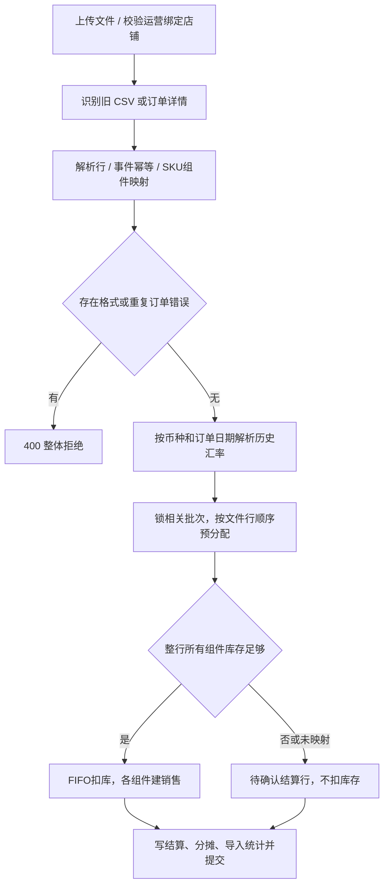
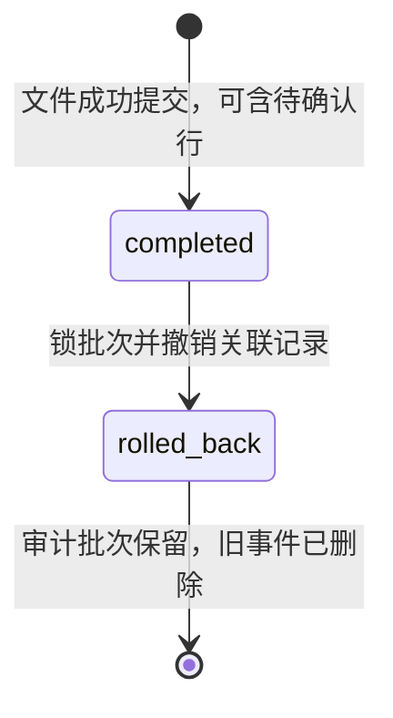

# 销售、导入与撤销流程

管理员或运营作废错误历史批次后，lock_fifo_batches排除voided_at非空的批次；既有Sale和SaleCostDetail保留。销售列表仍展示原成本供追溯，cost_status为needs_review、人民币利润留空；月度毛利留空并计数，待人工核对原销售分配。普通文件撤销若恢复到已作废批次，只修改历史剩余字段，不让其重新参与FIFO。详见[库存作废规则](../inventory/workflow.md#编辑与删除)。

## 手工销售

页面 createSale 提交店铺、商品、订单号、数量、售价、其他费用和日期（时间为该日23:59:59）；这些金额可填写，不再固定传0。后端 strip 订单号并全局查重，非管理员强制采用绑定店铺且不允许指定他店，管理员必须选有效店铺。

fifo_sell 在同一会话按 product_id、arrived_at、id 锁定 remaining_quantity>0 的批次，只从到货自然日不晚于销售日的批次复查可用库存、逐批扣减，写 Sale 和 SaleCostDetail。同一天到货可用，未来到货不能填补历史销售；共享库存仍不按店铺限定。成本 = Σ(明细数量×批次 unit_cost)，利润 = 单价×数量−FIFO 成本−费用；手工销售提交一次，销售日库存不足返回400并回滚。

新订单首条Sale以order_claim=order_no占用数据库唯一索引uq_sales_order_claim；并发重复请求即使通过前置查询，也只有一个事务能成功，另一事务返回409并回滚扣库。组合订单后续组件为NULL，保留同订单号多明细。历史记录保持NULL，仍由order_no前置查询拦截，不回填或重算历史成本；内部claim_order不是外部请求参数。上线需先完成兼容迁移并统一更新写入进程，旧版本进程不写占位值，不能混跑时宣称完整防重。

依据：[sales.py](../../../routers/sales.py) 的 create_sale；[fifo.py](../../../services/fifo.py) 的 lock_fifo_batches、fifo_sell。

## 文件导入

1. XLSX/XLSM 只读取“订单详情”工作表，必须有9个必要列；CSV 优先识别这些表头，否则按无表头 SKU,日期,数量 解析。编码按 utf-8-sig/utf-8/gb18030 尝试。
2. 运营必须绑定有效店铺；管理员必须通过multipart的store_id明确选择有效店铺。_resolve_import_store在读文件/扣库前校验，运营旧请求可省略参数，不能指定他店。所有本地商品读取用于解析；订单详情只加载启用的 platform=tiktok_shop 映射。
3. 事件键 _source_key 包含结算单、付款、订单、SKU、交易类型、日期、数量和金额等；已存在事件跳过，文件内重复事件为错误。兼容旧哈希的事件通过 raw_data 重算判断。
4. 新的库存销售还检查 sales.order_no，该列保持非唯一以兼容组合明细；数据库使用首条明细的order_claim唯一约束兜底并发，其他组件不重复占位。
5. 订单正数量且净销售额非负才可作为库存销售；退款/调整/负数行仅保存结算等关联，不自动恢复库存。无 SKU 的物流/平台赔付按独立费用保存。
6. SKU 映射缺失、组件不足或销售日可用库存不足转 pending_confirmation。按文件行序、各行销售日期从同一批次层预分配，聚合同一商品的组件需求；任何组件不足则该行不扣任何库存，后续更小行仍可能成功。预检查和实际FIFO均排除销售日之后到货的批次。
7. 汇率在锁库存前查询；同商品批次按统一顺序 FOR UPDATE，预分配与实际 fifo_sell(commit=False) 使用同一锁保护的库存；最后一个事务提交导入批次、销售、明细、结算和分摊。
8. HTTPException/IntegrityError 路径回滚业务事务，冲突返回409。成功结果仍可包含 pending_confirmation>0，不能只凭 success=true 认定全部出库。

依据：[sales.py](../../../routers/sales.py) 的 _read_import_file、_source_key、_resolve_platform_sku_components、_allocate_available_stock、import_sales_file。

## 组合金额与人民币

2026-10-19：独立退款/调整/赔付通过[financial_facts.py](../../../services/financial_facts.py)公共查询进入销售列表、月度和财务报表；排除直接或组件销售已关联的结算，不重复计算原销售收入。独立事件不创建Sale、不自动恢复库存，数量显示0；金额按结算日优先归月，销售仍按sold_at。商品归属不明的组合调整保留全店及未分配组，不能猜测组件利润。阶段边界及后续成本调整见[完善计划](../../plans/2026-10-19-financial-accuracy.md)。

每个组件出库数量 = 来源数量×quantity_per_sale。初始按数量分配收入/费用；总 FIFO 成本>0 时改为各组件 FIFO 成本占比分摊收入及其他费用；总成本为0时保持数量分摊。_sale_import_context 从保存的关联及权重重构来源金额。

其他费用 = 净商品销售额−结算总金额；物流/平台赔付取差额绝对值作为费用。外币净收入和费用乘固化汇率；profit_cny = 收入人民币−FIFO成本−费用人民币。导入后的 sales.selling_price/platform_fee 为来源分摊金额，持久化 profit 会与人民币成本相减，报表应使用人民币响应与结算上下文，不能直接把原字段视为人民币。

get_cny_rates 对 CNY 返回1，对其他三字母币种查询包含向前14天的区间，取目标日及之前最近可用汇率。获取失败502；保存汇率、实际汇率日期及 Frankfurter/ECB 来源，重复报表不重新查汇率。缺失或历史遗留汇率在月度汇总显示 fx_missing_count 并将金额设为空；损益/产品线对缺失率的处理不同，见[报表流程](../reports/workflow.md)。

依据：[exchange_rates.py](../../../services/exchange_rates.py)、[sales.py](../../../routers/sales.py) 的 _component_allocation_shares、_build_sale_response、_sale_import_context、_monthly_sales_summary。

## 待确认与文件撤销

待确认只提供查询和汇总导出，没有单行“确认并扣库”API。补齐映射/库存后直接重导相同事件会被去重；现有可用操作是按授权撤销原文件再重导，撤销会同时恢复该文件已成功销售，不是只处理待确认行。此操作范围应在业务使用前明确。

结算映射状态 confirmed/pending_confirmation 与导入状态 completed/rolled_back 是两套字段。撤销先锁导入批次，拒绝重复撤销；按原明细汇总并锁库存批次，校验恢复不超过原数量，然后删除分摊、结算、成本明细、销售并标记撤销。删除销售同时释放该订单占位，失败事务也会回滚占位。历史快照不随撤销重建，当前报表可受影响。

source_key、order_no查重和order_claim均为全局范围，没有改成按店铺分区；跨店同号策略仍待业务确认。模拟回归见[test_sales_integrity.py](../../../tests/test_sales_integrity.py)，真实本地InnoDB并发/回滚验证见[mysql_sales_integrity.py](../../../tests/mysql_sales_integrity.py)；本地通过不代表生产结构或混合版本已验收。依据：[sales.py](../../../routers/sales.py) 的 rollback_sales_import；[models.py](../../../models.py)；[migrate.py](../../../migrate.py) 的 ensure_sales_order_schema。

## 实际成本追溯层

启用财务增强后，查询成本和人民币利润叠加按原批次数量分配的实际差额，已售部分仍归原销售月。原Sale及SaleCostDetail保存成本不改写，旧原币profit不可作为重算人民币利润。批次成本状态/反向单/月度版本见[财务增强流程](../financial-control/workflow.md)。

财务增强启用后，导入头已被结算分类或费用凭证引用时拒绝物理撤销（409），不改变库存；保留来源并用更正凭证处理，避免外键异常和审计来源丢失。新增关联先锁导入头，已撤销来源不能再引用。

销售页工具栏有独立“导入店铺”，与手工销售的店铺选择分开；管理员先选店铺才能上传，运营显示锁定的绑定店铺。店铺未加载/无有效绑定/正在提交时禁用上传；提交捕获店铺ID，重复点击不再次发请求，退出后丢弃旧会话的异步结果。loadManualSaleStores过滤过期请求，刷新保留仍有效的导入选择。历史未关联记录保持原状，待确认导出明确标注，见[API](api.md)。

页面 rollbackSalesImport 使用 [page-interactions.js](../../../static/page-interactions.js) 的页面内确认框，告知销售删除及库存恢复后再请求撤销；取消/Esc/会话退出不提交，等待期间连点不重复发起。服务端409保护及事务不变，不再依赖浏览器原生 confirm。
