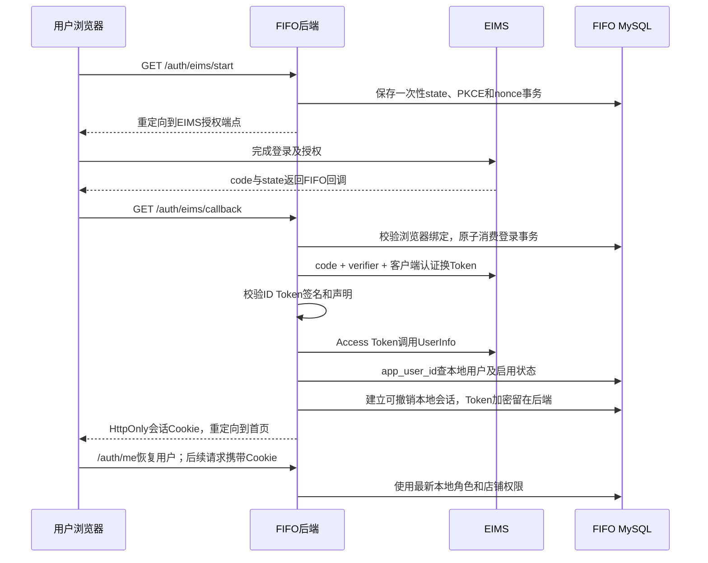

# FIFO 接入 EIMS 统一登录方案

日期：2026-10-13。状态：**代码已实施，本地验证通过；正式客户端/绑定与真实 EIMS 联调待完成**。用户批准方案后已修改认证代码、验证独立本地 MySQL 并更新 8010；未安装依赖、注册正式客户端、操作生产数据库或部署。配置入口见[接入说明](../modules/auth/eims-sso-setup.md)。

## 1. 已核验事实与接入边界

| 项目 | 方案阶段公开读取结果（不代表生产新版本验收） |
| --- | --- |
| EIMS Discovery | HTTPS GET返回200：[Discovery](https://eims.yueweiportal.com/oauth/.well-known/openid-configuration)。 |
| 精确Issuer | `https://eims.yueweiportal.com`，无末尾斜杠；ID Token的iss必须按这个值精确比较。 |
| 授权与换Token | 声明支持授权码、refresh_token、PKCE S256，客户端认证支持Basic和表单。 |
| ID Token签名 | Discovery声明RS256；[JWKS](https://eims.yueweiportal.com/oauth/jwks) GET返回200，现有1个带kid的RSA签名公钥。 |
| FIFO入口 | [HTTPS首页](https://fifo.yueweiportal.com/) GET返回200，标题为FIFO库存成本核算系统，有本地登录调用，未发现EIMS登录入口。HEAD返回405不代表GET不可访问。 |
| 已公布退出端点 | `https://eims.yueweiportal.com/oauth/logout`。尚未进行实际退出联调。 |
| Token撤销能力 | 本次Discovery未公布revocation_endpoint；接入指南列有/oauth/revoke，但未核验，不假定已可用。 |
| 尚缺客户端资料 | FIFO的client_id、client_secret、EIMS目录访问角色、正式账号绑定。 |

公开端点可访问不等于SSO已验收。尚未对真实 EIMS 执行授权、换Token、刷新、UserInfo或用户退出；离线测试使用模拟提供方。

EIMS负责身份认证及系统入口访问权；FIFO继续按本地 `users.role`、`users.store_id`执行原有权限。EIMS角色不映射为FIFO管理员，不使用app_roles，不共享数据库或密码，不修改FIFO、销售、存货及损益计算。

当前依据：[认证模块](../modules/auth/overview.md)、[权限矩阵](../knowledge/authentication.md)、[auth.py](../../auth.py)、[routers/auth.py](../../routers/auth.py)、[models.py](../../models.py)。用户提供的接入规范位于 `D:/eims-sso-integration-guide.md`，不在仓库内。

## 2. EIMS管理员可直接使用的接入信息

以下为待 EIMS 注册的值；FIFO 新路由已实现，但尚未部署到正式域名。

| EIMS配置项 | 拟使用值 |
| --- | --- |
| 系统名称 | FIFO库存成本核算系统 |
| 系统编码 | `fifo`，若已占用由双方确定唯一编码，不改已有系统记录 |
| 系统说明 | 商品、批次库存、FIFO销售成本和财务报表 |
| FIFO公开地址 | `https://fifo.yueweiportal.com` |
| 门户入口地址 | `https://fifo.yueweiportal.com/auth/eims/start` |
| OAuth登录回调 | `https://fifo.yueweiportal.com/auth/eims/callback` |
| 退出回调 | `https://fifo.yueweiportal.com/auth/eims/logout/callback` |
| 申请scope | `openid profile`；当前不依赖邮箱识别身份 |
| 门户登录方式 | `oauth2`，关联为FIFO注册的OAuth2应用 |
| 门户访问策略 | 按实际EIMS角色配置roles及允许角色；角色编码待管理员确认。不能把空角色列表当作允许所有人 |
| 本地账号匹配值 | `app_user_id`对应正式FIFO数据库的 `users.id`，正整数；支持协议返回的整数或规范十进制字符串 |
| 本地用户名 | `users.username`，只用于辅助展示 |
| 本地角色与店铺 | 由FIFO用户管理配置，EIMS不下发也不改写 |

按照接入指南当前约定，登录回调与退出回调都加入该客户端已注册回调地址列表，精确匹配协议、域名、端口、路径和末尾斜杠。由EIMS通过安全渠道交付client_secret，不能发到聊天、文档、Git或前端。

账号绑定操作：先在正式FIFO用户管理页确认用户ID，为至少一个普通用户和一个管理员分别建立EIMS绑定。需要读取ID时可在已有授权数据库连接上执行：

```sql
SELECT id, username, role, store_id FROM users ORDER BY id;
```

不能用本地测试库的ID推定生产账号，也不能把EIMS的sub直接当作FIFO用户ID。没有app_user_id、用户不存在或已停用，均拒绝登录；不自动开户，不按用户名/邮箱兜底，不进入默认账号。

门户启动必须让FIFO先生成state和PKCE临时状态，再进入EIMS授权端点。若EIMS目录的现有oauth2启动方式自行生成授权请求，需要在联调时核实其与 `/auth/eims/start` 的配合，不能绕过FIFO发起登录的步骤。

## 3. 推荐登录模式与协议流程

首期使用混合登录，保留本地登录用于联调和恢复。以下配置名与模式已实现；hybrid 指两种登录方式共存，OAuth 协议仍只使用授权码流程。

| FIFO_AUTH_MODE | 行为 |
| --- | --- |
| local | 本地登录；关闭SSO入口，拒绝使用EIMS来源会话。 |
| hybrid | 本地登录与EIMS登录均可用；保持传统Bearer客户端兼容。 |
| eims | 普通登录入口只用EIMS；服务端关闭密码登录并拒绝传统本地Bearer令牌，不能只隐藏登录按钮。 |

切到eims之前须完成管理员、普通用户、账号解绑、角色变化与退出测试。混合模式下SSO失败只报告失败，不自动登录到任何本地账号；用户可明确选择本地登录并提交自己的凭据。



登录开始生成随机state、PKCE S256和nonce，临时事务已设为5分钟有效，并绑定发起浏览器。回调先读取到本次处理上下文，再原子消费服务端事务；消费后仍用上下文里的verifier换Token，不能删除后丢失它。拒绝过期、重放、错误state、错误浏览器绑定以及不可信返回地址。

使用Basic认证换Token，所有网络通信验证HTTPS证书并设置超时；Discovery的issuer必须与配置一致，端点来自已信任的Discovery，不能由用户参数或JWT自带jku决定。ID Token限定RS256并校验签名、iss、aud、exp、nonce及适用的azp/时间声明；UserInfo的sub必须与ID Token一致，再读取app_user_id。[OIDC校验规则](https://openid.net/specs/openid-connect-core-1_0.html#IDTokenValidation)、[UserInfo规则](https://openid.net/specs/openid-connect-core-1_0.html#UserInfoResponse)。

## 4. 本地会话、刷新和退出

### 浏览器会话与兼容

浏览器使用随机、不透明的本地会话Cookie；生产设置Secure、HttpOnly、SameSite=Lax、Path=/，不设置跨子域Domain。使用服务端会话ID轮换避免沿用登录前会话。

本地密码登录也建立同类浏览器会话，原 `/auth/login` JSON返回字段保留给既有客户端；新页面不再把JWT持久化到localStorage。EIMS Access/Refresh/ID Token不进入前端存储，也不作为FIFO本地Bearer令牌使用。

`get_current_user`增加Cookie会话鉴权，保留local/hybrid下无Cookie请求的传统Bearer兼容；有Cookie就按它鉴权，Cookie失效时不退回旧Bearer身份。前端清理原latingo登录缓存，改用 `/auth/me`恢复本地用户名、角色、ID和店铺。

Cookie鉴权的写请求增加CSRF令牌与来源校验；不能仅靠SameSite，EIMS与FIFO是同一主域下的不同站点。商品上传、导入、编辑等直接fetch入口也须覆盖。所有已有服务端角色/店铺判断继续执行，包含当前viewer的实际权限，不在SSO任务中重新定义角色。

### EIMS状态与刷新

SSO会话的绝对有效期设为24小时，沿用当前本地令牌上限；EIMS Token有效期按实际expires_in处理，两者不混为一谈。UserInfo身份/绑定复核缓存最多60秒，Cookie写操作每次即时复核；本地停用与角色校验每次请求读取。

Access Token到期后由后端刷新。同一会话串行执行并替换轮换的Refresh Token，不并发复用旧Token。刷新后核验身份、UserInfo的sub/app_user_id与原会话一致，绑定变化须重新登录。永久身份/授权错误撤销会话。2026-10-14修正临时故障处理：503拒绝本次请求；已收到的轮换结果保留为加密待复核状态，恢复后仍验签/核对绑定，不回滚为已失效的旧Refresh Token，详见[认证流程](../modules/auth/workflow.md)。

EIMS账号停用、门户权限撤销和解绑是否会被UserInfo/刷新即时拒绝，需要真实联调；不能仅凭门户隐藏卡片宣称FIFO旧会话已失效。本方案没有把客户端60秒缓存说成EIMS已实现的即时撤权能力。

### 退出

显式退出先撤销本地会话、清Cookie和界面缓存；JS只收到同源一次性logout/start票据。服务端消费票据后303到Discovery退出端点，携带已注册地址、client_id、一次性logout_state及适用的id_token_hint，ID Token不交给页面脚本。退出回调校验并消费logout_state，返回清理后的首页。[RP发起退出规范](https://openid.net/specs/openid-connect-rpinitiated-1_0.html)。

当前Discovery未公布Token撤销端点，不盲调用/oauth/revoke，也不宣称退出自动撤销了全部Access/Refresh Token。id_token_hint属于退出协议参数，相关URI同样须保护日志。

现有 `api()` 的401处理要与用户主动退出区分：会话过期清理本地状态并显示登录页，不因一个API的401自动触发EIMS全局退出。

## 5. 已实施的代码与数据范围

| 文件/层次 | 实施内容 |
| --- | --- |
| `services/eims_sso.py`，新增 | 配置检查、Discovery/JWKS缓存、PKCE、Token/UserInfo、身份校验、刷新及退出URL。 |
| `services/auth_sessions.py`，新增 | 一次性登录/退出事务、本地可撤销会话、Token加密、并发刷新。 |
| `routers/eims_auth.py`，新增 | start/callback/logout回调与认证能力信息等入口。 |
| [auth.py](../../auth.py) | HTTPBearer改为可选，按模式支持本地会话及传统令牌；统一检查用户启用状态。 |
| [routers/auth.py](../../routers/auth.py)、[schemas.py](../../schemas.py) | 本地登录兼容、服务端退出、用户启停管理；保持me原有字段。 |
| [models.py](../../models.py)及迁移 | 用户新增is_active（现有用户默认启用）；新增认证事务和会话表。 |
| [main.py](../../main.py) | 注册SSO路由；配置与清理生命周期，不把EIMS不可达自动变成默认身份。 |
| [templates/index.html](../../templates/index.html)、[index.html](../../index.html) | 登录按钮、会话恢复、CSRF、显式退出及全部fetch入口；保留两份页面的原有其他差异。 |
| [requirements.txt](../../requirements.txt) | 明确声明实施选用的异步HTTP客户端；复用现有python-jose/cryptography，不依赖本机碰巧安装的包。已声明 httpx 版本范围；本机已有依赖，本次未安装。 |
| [docker-compose.yml](../../docker-compose.yml)、[Dockerfile](../../Dockerfile)及示例配置 | 显式传递认证配置及强JWT密钥，调整回调访问日志。实际密钥只在部署配置中。 |
| 测试与文档 | 新增SSO安全/会话回归，联跑原权限/店铺测试；实施后更新认证模块、架构、运行及部署文档。 |

已复用 MySQL，无新增 Redis；已新增：

- `auth_login_transactions`：登录/退出类型、状态及浏览器绑定哈希、加密verifier/nonce等、有效期、消费标记；事务只能消费一次。
- `auth_sessions`：会话ID哈希、user_id、登录来源、EIMS issuer/sub、加密Token、有效期、撤销状态和最近复核时间；Cookie不直接保存Token。
- `users.is_active`：布尔启用状态，登录及每次鉴权统一检查；管理员不得停用自己，停用不删除历史业务记录。

加密密钥单独从后端配置读取，不复用数据库密码。SSO事务/刷新用独立数据库会话，在进入库存业务前提交并释放认证锁，不与FIFO批次锁混用。

以上属于加法型认证迁移；真实生产表结构、历史用户和约束尚未核验。实施及迁移前分别核实目标并备份，不能直接启动应用来做“只读验证”，因为本项目启动会迁移、修复和生成快照。

### 已新增接口

| 方法与路径 | 用途 |
| --- | --- |
| `GET /auth/config` | 提供登录模式和SSO可用状态，不返回客户端密钥/Token。 |
| `GET /auth/eims/start` | 发起一次性SSO登录，固定回到本系统。 |
| `GET /auth/eims/callback` | 消费回调、校验身份并创建本地会话。 |
| `POST /auth/logout` | 有CSRF保护的显式本地退出；SSO来源返回退出导航信息。 |
| `GET /auth/eims/logout/start` | 消费一次性本地导航票据，后端跳转提供方，不把ID Token放到JS。 |
| `GET /auth/eims/logout/callback` | 校验退出state，返回首页。 |
| `PUT /auth/users/{user_id}/status` | admin启停账号，不可自停用；停用撤销该用户Cookie会话。 |

配置不全时SSO入口标为不可用并说明联系管理员；local/hybrid的本地恢复入口保留。eims模式不允许因配置错误静默降级成密码登录。

## 6. 部署配置

以下变量已由代码读取并显式传入 Compose，值为占位；不是已生效的生产配置：

```dotenv
FIFO_AUTH_MODE=hybrid
FIFO_PUBLIC_BASE_URL=https://fifo.yueweiportal.com
EIMS_ISSUER=https://eims.yueweiportal.com
EIMS_CLIENT_ID=<由EIMS注册FIFO客户端后生成>
EIMS_CLIENT_SECRET=<仅在后端通过安全渠道配置>
SSO_TOKEN_ENCRYPTION_KEY=<独立随机加密密钥>
JWT_SECRET=<本系统强随机密钥>
```

登录与退出回调由固定公开地址拼接，不根据任意Host/转发头或请求参数推导。生产仍使用现有反向代理到FIFO Web容器；可信代理、HTTPS转发头、域名证书与容器出站访问EIMS在部署时核验。

Compose 已显式传入 MySQL/OA/JWT/SSO 配置，JWT_SECRET 必填；Docker 构建排除 .env。环境变更需重新创建容器，不能只上传 .env 或打包真实密钥进镜像。

回调及退出回调的Nginx日志不记录query；Uvicorn禁用访问日志或配置确定有效的查询脱敏过滤。应用日志只记录不含凭据的事件和错误分类，严禁输出code/state/verifier/Token/完整Cookie。实施时核对真实反向代理配置归属，不根据历史手册猜测服务器配置。

## 7. 实施、验收与恢复顺序

1. EIMS侧注册独立FIFO客户端，填写两条精确回调、scope、目录访问策略；准备正式账号绑定。测试与生产分别注册和绑定。
2. 本地实现认证服务、会话、接口和页面，先用模拟提供方及依赖覆盖测试，不启动业务lifespan进行单元验证。
3. 获得目标运行授权后，在核实的独立本地测试库验证认证表、事务一次性消费、并发刷新、停用和会话撤销；不复用生产配置进行本地写入。
4. 测试客户端做真实浏览器联调；生产Cookie使用HTTPS，开发Cookie显式区分配置；本地回调也需单独注册，不借用生产回调。
5. 在备份和明确发布授权后发布hybrid；确认普通用户、管理员及退出均正常，再单独决定是否切eims。

验收至少覆盖：

| 场景 | 预期 |
| --- | --- |
| 已绑定普通用户/管理员 | 登录到准确的FIFO用户，保留其本地角色和店铺范围。 |
| EIMS管理员绑定FIFO运营 | 仍是FIFO运营，不能提升为FIFO管理员。 |
| 未绑定、错误app_user_id、被删除/停用用户 | 不创建会话、不进入默认账号。 |
| 修改state、浏览器绑定、nonce、issuer/audience、重放code | 拒绝并消费/清理相应临时状态；无凭据日志。 |
| UserInfo与ID Token的sub不同 | 拒绝登录。 |
| 本地角色撤销、店铺解绑、账号停用 | 下一次受保护请求按最新本地状态处理。 |
| EIMS解绑、停用或门户访问权撤销 | 核验提供方UserInfo/刷新拒绝行为及本地会话失效时限。 |
| 同时请求触发Refresh Token轮换 | 单次串行刷新，其他请求使用新Token；不重复使用旧Refresh Token。 |
| Cookie鉴权写接口缺少/伪造CSRF | 拒绝；原有本地Bearer客户端在允许模式下保持兼容。 |
| 用户显式退出 | 本地会话立即失效，退出state受校验，并验证EIMS退出效果。 |
| API返回401 | 清理过期本地状态，不自动退出整个EIMS门户。 |
| EIMS网络故障及配置缺失 | 显示明确不可用状态，不授予默认身份；hybrid本地登录按显式凭据恢复。 |

恢复优先通过新版本的local模式关闭SSO，并撤销SSO来源会话；保留认证新表/列和业务数据，不删除数据库、Docker卷或历史记录。若需回滚代码，必须核实旧版本对用户停用与新会话的兼容，不能直接假定安全。

## 8. 实施结果与待确认

已完成：认证代码、两份页面的 Cookie/CSRF/退出、用户启停、加法型认证结构、Compose 配置及访问日志保护，并同步知识库。保留原业务角色/店铺权限及两份页面原有平台 SKU 差异，未修改 FIFO、销售和财务计算代码。未编辑实际 .env 或安装依赖。

2026-10-13 验证记录：

- 完整 unittest 回归 150 项通过，其中 test_eims_sso 47 项；覆盖模拟 RSA/JWKS、state/nonce/重放、绑定/启停、CSRF、模式、Token 轮换及退出。模拟提供方和 SQLite 锁不代表真实 EIMS 或 InnoDB。
- 两份页面共 48 项认证辅助函数/脚本检查通过，不等于真实浏览器视觉和 Cookie/跳转验收。
- 静态核对606个本地文档链接、19张ORM表和64个路由端点；修改的12个Python文件AST解析及git diff --check通过，两份页面原有7处差异保留。Compose配置仅静态校验，未执行生产构建或部署。
- 独立本地 MySQL `127.0.0.1:3309 / inventory_fifo_test`：仅补认证结构和临时记录；两张表为 InnoDB，两个事务只有一次消费成功，并发仅刷新一次，撤销 Cookie 被拒绝；比较既有17张表的业务记录一致，测试自建记录已清理。结构保留、自增序列正常推进；users 比较公开身份/角色/店铺字段，不将密码哈希写入检查摘要。
- 8010 实际 HTTP：配置 hybrid、SSO 未配置；Cookie me、商品列表、72条存货数据正常，缺 CSRF 写请求403，退出后旧Cookie401。此检查使用临时本地会话，未执行真实提供方登录。
- 本机 passlib/bcrypt 元数据兼容提示及旧 python-jose utcnow 弃用提示存在，密码哈希/验证测试通过；未安装/升级依赖，生产镜像依赖与浏览器仍需验收。

待完成：EIMS 客户端创建及安全密钥配置、门户访问策略/start 配合、正式用户ID绑定、真实浏览器授权/刷新/退出/撤权、代理日志保护和生产迁移/发布。当前本地未填 EIMS 客户端，不能宣称已正式接通。

本地检查摘要保存在 Git 忽略的 output/eims-sso/，不保存凭据或提供方 Token。配置与操作步骤统一在[接入说明](../modules/auth/eims-sso-setup.md)维护。

标准补充参考：[OIDC Core](https://openid.net/specs/openid-connect-core-1_0.html)、[RP-Initiated Logout](https://openid.net/specs/openid-connect-rpinitiated-1_0.html)、[OAuth安全实践RFC9700](https://www.rfc-editor.org/rfc/rfc9700.html)。

## 9. 2026-10-14 审查问题修复

修复三项已复现问题：

1. [login](../../routers/auth.py) 通过校验后的密码哈希交给 [create_session](../../services/auth_sessions.py)，后者锁定并刷新 User、核对哈希/启用状态后创建会话。改密/重置/启停先锁 User，再撤销 AuthSession；自助改密用锁定后的最新哈希校验旧密码。先创建的会话会被改密撤销，改密先提交则拒绝旧校验结果。
2. 刷新成功后若 JWKS/UserInfo 暂不可用，保留新 Token 与 `_id_token_pending` 加密标记，validated_at 为空且返回503。恢复后重新完成验签、sub/app_user_id核对，再允许读缓存；错误身份仍永久撤销。没有修改表结构，未承诺远端响应丢失/本地提交失败具有分布式原子恢复。
3. [退出回调](../../routers/eims_auth.py) 消费原退出事务后不再清当前登录Cookie，避免清掉另一标签页后来登录；不匹配/重放回调不清新的流程Cookie。登录/退出导航失败同样只清已消费的自身流程。

本轮新增10项认证回归，并让模拟提供方真正拒绝已经轮换的旧Refresh Token。57项认证测试、全量160项unittest、两份页面48项检查通过。真实本地InnoDB验证两个锁等待方向、旧密码创建被拒、先创建会话被撤销、轮换后的503恢复不重复刷新；比较既有17张业务表一致，自建测试记录清理完毕，未增加表/字段或执行生产迁移。验证使用模拟提供方，不代表真实EIMS已完成联调。

未安装依赖、修改实际.env、提交/推送或生产发布；原角色/店铺规则、FIFO及财务计算保留。当前真实EIMS客户端/门户/绑定/撤权/退出验收仍待完成，发布步骤继续见[接入说明](../modules/auth/eims-sso-setup.md)。
